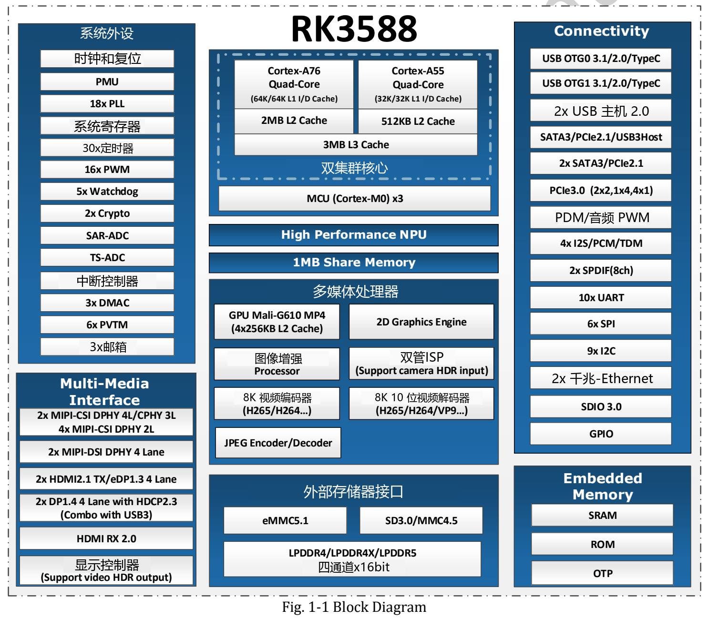

RK3588 的价值在于把计算、图像、视频和高速外设放在同一平台上。ArmSoM 为不同开发阶段提供三种形态：Sige7 用于快速搭建应用，AIM7 用于可插拔模块方案，LM7 用于 LGA 核心板集成。选型时先明确数据如何进入、计算和输出，再决定板卡。

## 计算架构与分工

| 模块 | Datasheet V1.4 描述 | 工程用途 |
|---|---|---|
| CPU | 4× Cortex-A76 + 4× Cortex-A55，3MB 共享 L3 | 业务逻辑、系统服务与前后处理 |
| GPU | Mali-G610 MP4，OpenGL ES 3.2、OpenCL 2.2、Vulkan 1.2 | 图形界面及受驱动支持的计算 |
| NPU | 三核，可独立、双核或三核协作，最高 6 TOPS | 转换后受支持的神经网络 |
| 内存 | 四通道，每通道 16-bit；LPDDR4/4X/5；最高 32GB 地址空间 | 多任务、模型与视频缓冲 |
| 高速扩展 | PCIe 3.0、PCIe 2.x/SATA/USB 组合接口 | 存储、外设与采集系统 |

图形 API 版本是原稿能力描述，实际可用性取决于系统和驱动。6 TOPS 不等于模型帧率，更不能直接换算大模型 tokens/s；应记录精度、输入尺寸、算子、运行版本和端到端测量条件。不能把其他芯片的稀疏算力脚注移植到这份 RK3588 文档。

## 视频能力：别把所有格式都写成 8K60

| 编码格式/方向 | V1.4 详细条目上限 |
|---|---|
| H.265、VP9、AVS2 解码 | 8K60 |
| H.264 解码 | 8K30 |
| AV1 解码 | 4K60 |
| H.264/H.265 编码 | 8K30 |

这些是指定编码配置下的芯片上限，不能理解为多路同时满载的保证。做视频分析终端时，应分别验证解码、缩放、推理、显示和保存，尤其观察数据拷贝、内存带宽和持续温升。

## ISP 的像素数必须带上模式

V1.4 给出双 ISP 的 48M（8064×6048@15）和 32M（6528×4898@30）模式，以及单 ISP 的 16M（4672×3504@30）。因此官方页面中 48MP、32MP 和双 16MP 的表述不能简单视为同一种工作条件。相机落地还依赖传感器驱动、调校文件、镜头与同步方案。

对于工位检测，可按“相机 → ISP → RGA 预处理 → NPU → CPU 判定 → 显示/上报”搭建。先固定光照、采集条件与样本，再优化模型；这是一条建议链路，不是已完成的 ArmSoM 检测实测。

## RK3588 与 RK3588S：先看扩展需求

两者有相近的核心计算定位，但不能把 RK3588 的 PCIe 3.0 和 HDMI 输入等扩展能力直接写到 RK3588S 产品上。如果项目需要高速 SSD、外部视频采集或多接口组合，应核对目标 SoC、板级原理图和实际引出的端口。接口存在也不意味着全部复用功能可以并发。

## 选择 ArmSoM 的开发起点

- **Sige7**：先连接屏幕、网络和存储，验证软件与外设。
- **AIM7**：先评估匹配载板，适合围绕模块与底板分工开发。
- **LM7**：适合有自定义尺寸、接口和生产工艺要求的整机方案。

三个产品都需要按实际硬件版本与镜像验证。迁移应用时可以复用业务代码和模型经验，但设备树、供电、相机及散热不能省略。文章中的应用方向是选型建议，没有声称性能、功耗或客户部署已实测。

## 系列文章与产品入口

- [AIM7 替代 Jetson Nano/Orin：从硬件评估到 RKNN 模型迁移](/zh/articles/aim7-jetson-nano-orin-alternative/)
- [Sige7 与 LM7：从 RK3588 应用原型到定制产品的六种方案](/zh/articles/sige7-lm7-rk3588-applications/)
- [RK3588 Datasheet V1.4 下载与解读：框图、封装与电气设计](/zh/articles/rk3588-datasheet-v14/)
- [ArmSoM AIM7](https://docs.armsom.org/armsom-aim7) · [Sige7](https://docs.armsom.org/armsom-sige7) · [LM7](https://docs.armsom.org/armsom-lm7)

## 参考资料

- [Rockchip RK3588](https://www.rock-chips.com/a/en/products/RK35_Series/2022/0926/1660.html)
- [ArmSoM AIM7](https://docs.armsom.org/armsom-aim7)
- [ArmSoM Sige7](https://docs.armsom.org/armsom-sige7)
- [ArmSoM LM7](https://docs.armsom.org/armsom-lm7)
- [NVIDIA Jetson modules](https://developer.nvidia.com/embedded/jetson-modules)
- [RKNN-Toolkit2](https://github.com/airockchip/rknn-toolkit2)
