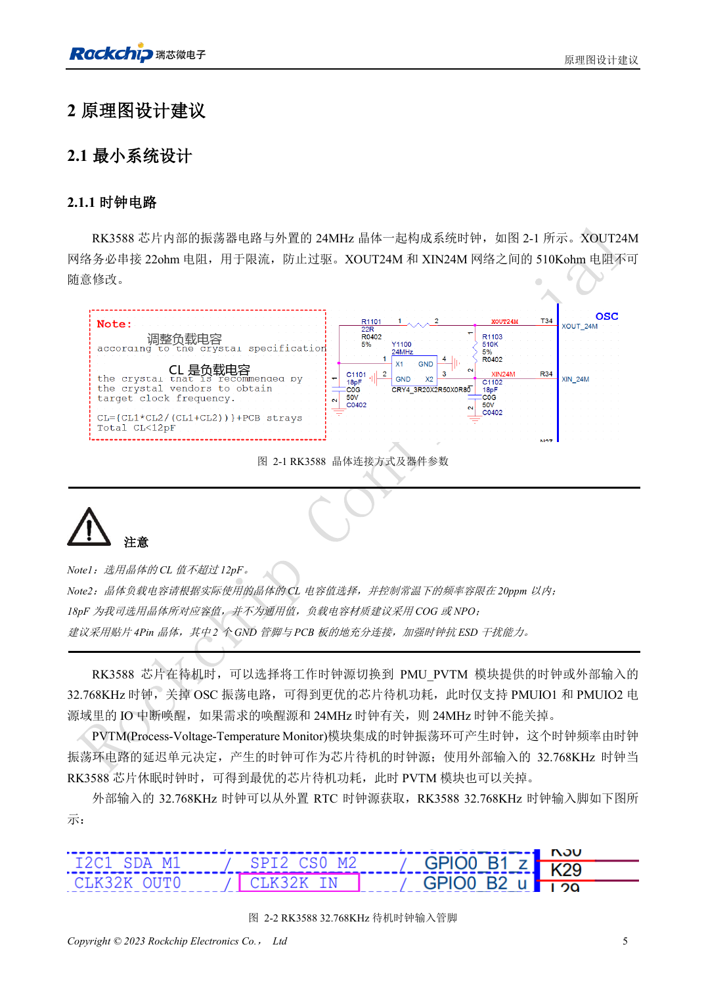
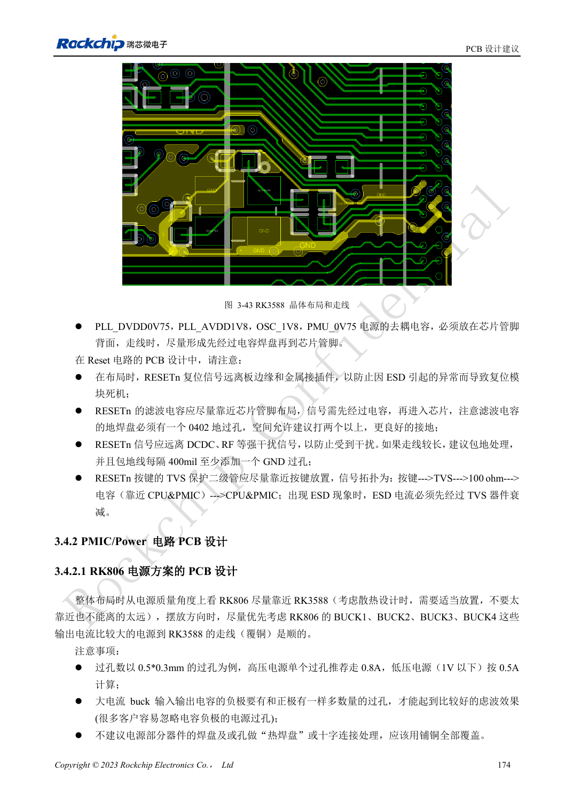

<!-- rk3588-hardware-v13-20261109 -->

# RK3588 时钟电路：24MHz、32kHz 与布局

本文依据 RK3588 Hardware Design Guide V1.3（2023-02-13）中英文原稿整理，面向芯片主板和载板设计审查。AIM7、LM7 载板须遵循模块接口定义；Sige7 可作为软件与外设验证起点。芯片能力不等于板卡接口清单，SDK/BSP、内核、板卡版本及固件需逐项核对。数值为原稿参考，未经 ArmSoM 硬件实测。

**RK3588 Hardware Design Guide V1.3 (2023-02-13), CN** · §2.1.1; §3.4.1

## 按晶体选负载

XOUT24M 的 22Ω 串阻限流，XOUT24M 与 XIN24M 之间的 510kΩ 不可随意修改。晶体 CL 不超过 12pF。原图 18pF 只是参考晶体的负载值，需根据实际 CL 和寄生重新选择，优先 C0G/NP0 和四脚晶体。探头电容也会影响振荡。

## 同时检查唤醒与 PCB

停止 24MHz 前确认唤醒源不依赖它。低功耗路径使用 PMU_PVTM 或外部 32.768kHz，并检查 PMUIO1/2 的 IO 唤醒。晶体与 SoC 尽量同面靠近，晶体和 XIN/XOUT 投影区域不走其他信号，保持邻层地完整，包地每隔 200–300mil 打地过孔。

## 设计参数与检查表

| 项目 | 原稿参考值 |
| --- | --- |
| 24MHz 频差 | ≤20ppm |
| 32.768kHz 频差 | ±30ppm |
| 32kHz 占空比 | 45–55% |
| 32kHz 幅度 | 0.7×VDD … VDD; VDD=PMUIO1 |

## 参考原图

下图为原稿参考页，包含对应电路图或时序图；点击可查看大图。位号和元件值属于参考设计，不是 ArmSoM 产品原理图。

中文原稿 · PDF 22 · 2-1

中文原稿 · PDF 191 · 3-43

## ArmSoM 开发路径

AIM7 适合基于计算模块设计载板；LM7 面向 LGA 模块集成；Sige7 可用于开发前期的软件与外设评估。使用模块时先检查哪些电源、DDR 与启动电路已在模块内完成，不应把芯片参考电路重复放到载板上。实际连接器、可用接口、电平与系统支持以对应产品资料为准。

- [ArmSoM AIM7](https://www.armsom.org/aim7) · [AIM7 Docs](https://docs.armsom.org/armsom-aim7)
- [ArmSoM Sige7](https://www.armsom.org/sige7) · [Sige7 Docs](https://docs.armsom.org/armsom-sige7)
- [ArmSoM LM7](https://www.armsom.org/lm7) · [LM7 Docs](https://docs.armsom.org/armsom-lm7)

## 继续阅读

- [RK3588 硬件设计系列：30 个主题](/zh/articles/rk3588-hardware-design-series/)
- [RK3588 边缘 AI 设备设计：从负载到验证计划](/zh/articles/rk3588-edge-ai-hardware-design/)
- [RK3588 复位、看门狗与过温保护](/zh/articles/rk3588-reset-watchdog-hardware/)
