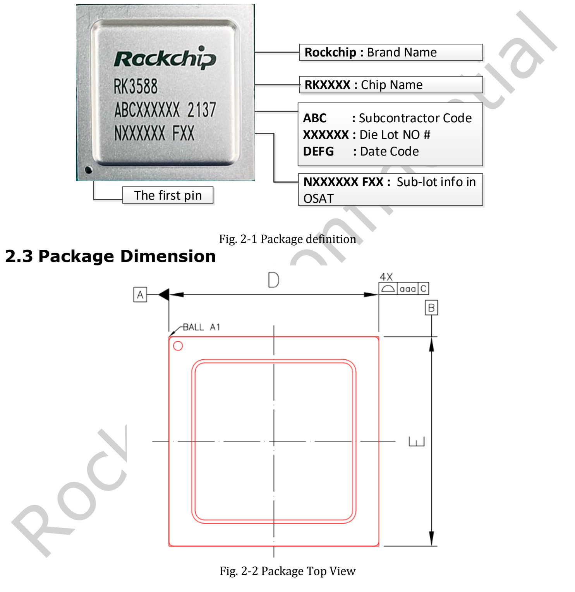
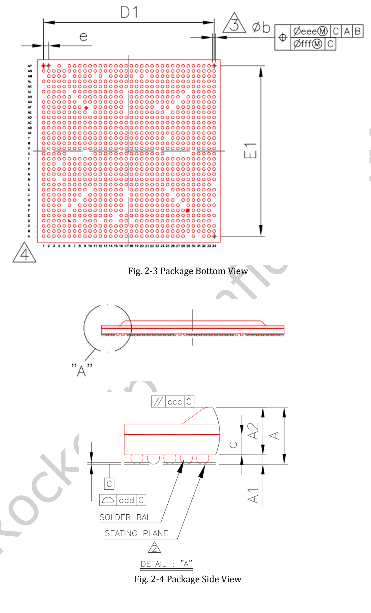
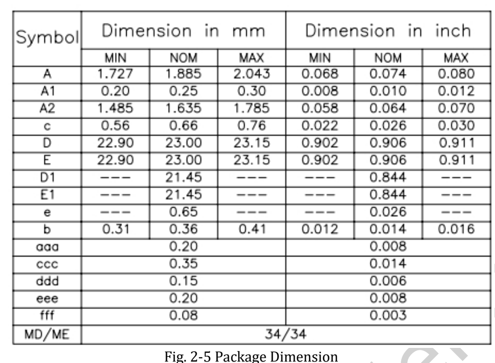

**RK3588 Datasheet V1.4，修订日期 2022-05-24，共 34 页**，涵盖芯片功能、封装、引脚、电气和热管理。本篇是阅读导航与设计解读，不是逐字全文译本；完整原始文件保留用于查阅。

[下载原始 RK3588 Datasheet V1.4 PDF](/assets/rk3588/Rockchip-RK3588-Datasheet-V1.4-20220524.pdf)

## 原稿章节导航

| 页码 | 内容 | 使用方式 |
|---|---|---|
| 6–16 | CPU、内存、NPU、视频、显示和接口 | 系统架构与功能核对 |
| 16 | 芯片框图 | 识别模块及复用关系 |
| 17–19 | 标识、封装尺寸、MSL、焊球材料 | 封装及制造参考 |
| 19–27 | 引脚编号表 | SoC 信号与电源域核对 |
| 28 | 绝对最大额定值 | 极限条件，不是工作推荐值 |
| 29–33 | 建议工作条件和接口电气特性 | 电源与信号设计 |
| 34 | 热管理 | 带条件的散热参考 |

## 架构和计算

四个 A76 与四个 A55 共享 3MB L3；A76 每核 512KB L2，A55 每核 128KB L2。四路 16-bit 内存通道支持 LPDDR4/4X/5，最高 32GB 地址空间。NPU 是三核结构，原稿标注最高 6 TOPS，计算格式包括 INT4/INT8/INT16、FP16、BF16、TF32。芯片支持的格式不代表每个工具版本都可执行任意算子组合。

## 视频、ISP 和版本疑点

原稿详细列出 H.265/VP9/AVS2 8K60、H.264 8K30、AV1 4K60 解码，以及 H.264/H.265 8K30 编码。ISP 模式分别列 48M@15、32M@30 双 ISP 和 16M@30 单 ISP，应连同完整分辨率及模式看待。

第 9 页 JPEG Decoder 小节最后写“Embedded four encoder units”，与该小节标题不一致。本文不擅自将其改写为四个 decoder；原始表述保留在 PDF，设计时需核对正式资料。公开网页与 PDF 对图形 API、ISP 或 DP 版本的写法也不完全一致，本文以这份带版本的原稿为引用基础，不宣称它是最新文档。

## 封装与尺寸

FCBGA1088L，主体 23×23mm，焊球标称直径 0.36mm、球距 0.65mm，MSL3，焊球材料 SnAgCu。V1.4 的技术修订包括封装尺寸和框图更新，制作 PCB 封装时应使用完整尺寸公差及正式设计文件，而不只是上述名义尺寸。

## 电气与热设计

第 30 页给出的最大 CPU 频率为 2.2–2.4GHz，GPU/NPU 为 1000MHz，环境工作温度为 0–80°C。这些是该版本的条件描述，不是保证每块板持续运行在最大频率。

第 34 页要求结温低于 125°C，并给出 θJA=8.7、θJB=3.5、θJC=0.12°C/W。原稿说明这些为模拟参考值，测试 PCB 为 10 层、114×101mm，环境 25°C，需以实物测试为准。不能直接套用于任意散热器、机壳或 LM7/AIM7 模块，也不能将结温与环境温度混用。

## 结合 ArmSoM 硬件使用

Sige7 用户应从板级供电和散热要求出发；AIM7 载板设计先核对模块连接器；LM7 设计先核对 LGA 模块焊盘与供电。SoC 焊球表不等于核心板引脚表。本文没有重新测量电气参数，完整 PDF 和原图中的标识均保持原样。

## 系列文章与产品入口

- [RK3588 芯片详解：八核 CPU、6 TOPS NPU 与高速扩展如何落地](/zh/articles/rk3588-chip-guide/)
- [AIM7 替代 Jetson Nano/Orin：从硬件评估到 RKNN 模型迁移](/zh/articles/aim7-jetson-nano-orin-alternative/)
- [Sige7 与 LM7：从 RK3588 应用原型到定制产品的六种方案](/zh/articles/sige7-lm7-rk3588-applications/)
- [ArmSoM AIM7](https://docs.armsom.org/armsom-aim7) · [Sige7](https://docs.armsom.org/armsom-sige7) · [LM7](https://docs.armsom.org/armsom-lm7)

## 参考资料

- [Rockchip RK3588](https://www.rock-chips.com/a/en/products/RK35_Series/2022/0926/1660.html)
- [ArmSoM AIM7](https://docs.armsom.org/armsom-aim7)
- [ArmSoM Sige7](https://docs.armsom.org/armsom-sige7)
- [ArmSoM LM7](https://docs.armsom.org/armsom-lm7)
- [NVIDIA Jetson modules](https://developer.nvidia.com/embedded/jetson-modules)
- [RKNN-Toolkit2](https://github.com/airockchip/rknn-toolkit2)
