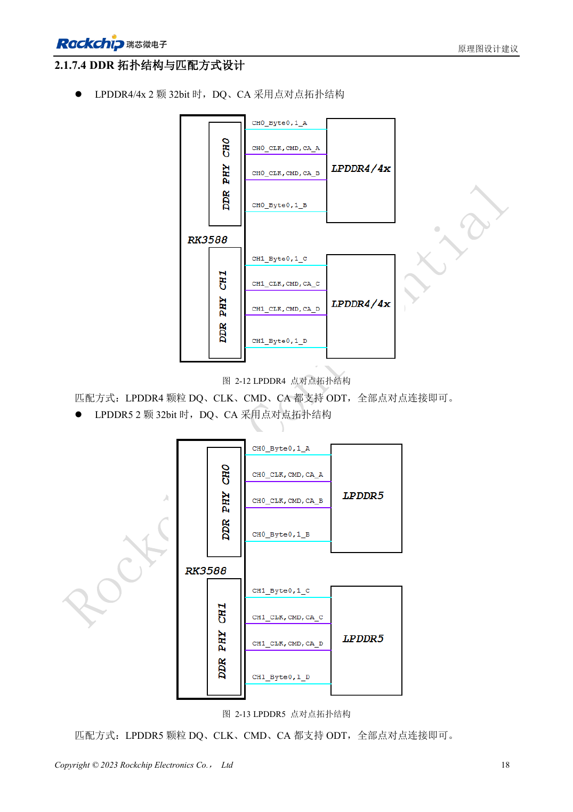
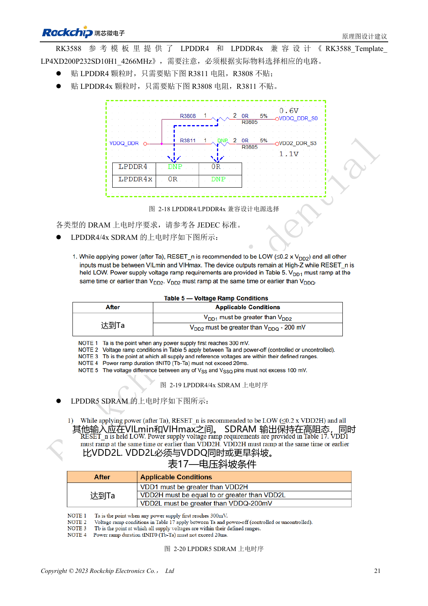

<!-- rk3588-hardware-v13-20261109 -->

# RK3588 DDR 原理图：LPDDR4/4X/5 与容量配置

本文依据 RK3588 Hardware Design Guide V1.3（2023-02-13）中英文原稿整理，面向芯片主板和载板设计审查。AIM7、LM7 载板须遵循模块接口定义；Sige7 可作为软件与外设验证起点。芯片能力不等于板卡接口清单，SDK/BSP、内核、板卡版本及固件需逐项核对。数值为原稿参考，未经 ArmSoM 硬件实测。

**RK3588 Hardware Design Guide V1.3 (2023-02-13), CN** · §2.1.7

## 容量与模板一起选择

V1.3 描述四个 16bit 通道、总线 64bit，每通道最大寻址 8GB、总共 32GB。图纸中的 32bit CH0/CH1 不能用不同容量，例如 4GB+2GB。此为该版指南范围，不推断其他变体或后续 BSP。颗粒型号、封装、固件和模板需成套确认。

## 电压与映射不可只改名字

两颗 32bit 颗粒采用 DQ/CA 点对点。兼容模板中 LPDDR4 装 R3811、不装 R3808，LPDDR4X 相反；位号仅适用于原模板，换图纸须核对网络。LPDDR5 需对应 WCK、映射和电源。AIM7/LM7 已集成 DDR，载板重点是输入电源、接口和散热。

## 设计参数与检查表

| 项目 | 原稿参考值 |
| --- | --- |
| V1.3 总线 | 4×16bit =64bit |
| V1.3 寻址 | 8GB/通道; 32GB 总计 |
| CH0 / CH1 | 容量相同 |

## 参考原图

下图为原稿参考页，包含对应电路图或时序图；点击可查看大图。位号和元件值属于参考设计，不是 ArmSoM 产品原理图。

中文原稿 · PDF 35 · 2-12

中文原稿 · PDF 38 · 2-18

## ArmSoM 开发路径

AIM7 适合基于计算模块设计载板；LM7 面向 LGA 模块集成；Sige7 可用于开发前期的软件与外设评估。使用模块时先检查哪些电源、DDR 与启动电路已在模块内完成，不应把芯片参考电路重复放到载板上。实际连接器、可用接口、电平与系统支持以对应产品资料为准。

- [ArmSoM AIM7](https://www.armsom.org/aim7) · [AIM7 Docs](https://docs.armsom.org/armsom-aim7)
- [ArmSoM Sige7](https://www.armsom.org/sige7) · [Sige7 Docs](https://docs.armsom.org/armsom-sige7)
- [ArmSoM LM7](https://www.armsom.org/lm7) · [LM7 Docs](https://docs.armsom.org/armsom-lm7)

## 继续阅读

- [RK3588 硬件设计系列：30 个主题](/zh/articles/rk3588-hardware-design-series/)
- [RK3588 与 RK806：单、双 PMIC 电源树](/zh/articles/rk3588-rk806-pmic-design/)
- [RK3588 DDR 布线：等长与等延时](/zh/articles/rk3588-ddr-pcb-routing/)
