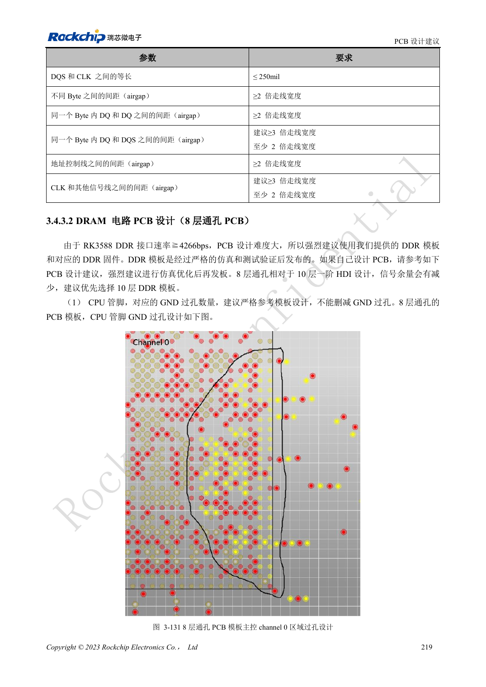
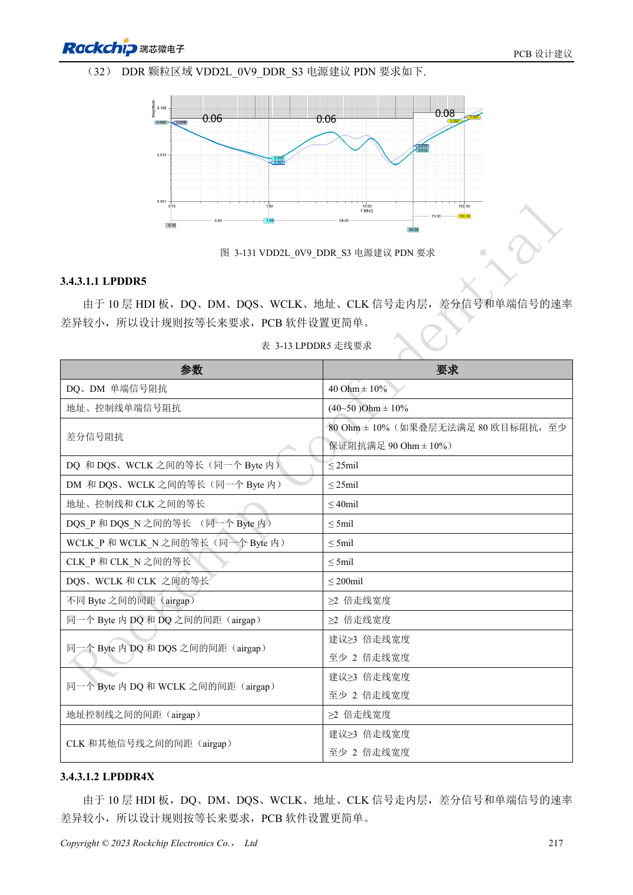

<!-- rk3588-hardware-v13-20261109 -->

# RK3588 DDR 布线：等长与等延时

本文依据 RK3588 Hardware Design Guide V1.3（2023-02-13）中英文原稿整理，面向芯片主板和载板设计审查。AIM7、LM7 载板须遵循模块接口定义；Sige7 可作为软件与外设验证起点。芯片能力不等于板卡接口清单，SDK/BSP、内核、板卡版本及固件需逐项核对。数值为原稿参考，未经 ArmSoM 硬件实测。

**RK3588 Hardware Design Guide V1.3 (2023-02-13), CN** · §3.4.3

## 按叠层选择规则

10 层 HDI 是优先方案，LPDDR5 模板也使用它。内层信号按等长处理；8 层通孔 LPDDR4/4X 的表层、内层、过孔与封装传播不同，要按等延时。16ps 不是 16mil，不同材料不能沿用同一换算系数。模板、颗粒和 DDR 固件版本要一起记录。

## 建立字节组约束

LPDDR5 表 3-13：同 Byte 的 DQ/DM 相对 DQS/WCLK ≤25mil，地址控制相对 CLK ≤40mil，差分对内 ≤5mil。8 层 LPDDR4X 表 3-16 则给同 Byte ≤16ps、对内 ≤1ps。验收应包括训练日志、目标频率压力测试、温度与重复冷启动，一次开机不证明余量。

## 设计参数与检查表

| 项目 | 原稿参考值 |
| --- | --- |
| LPDDR5 DQ/DM 阻抗 | 40Ω ±10% |
| LPDDR5 地址/控制 | 40–50Ω ±10% |
| LPDDR5 差分目标 | 80Ω ±10%; 原稿备选 90Ω ±10% |
| 8 层 LPDDR4X 字节内偏差 | ≤16ps |

## 参考原图

下图为原稿参考页，包含对应电路图或时序图；点击可查看大图。位号和元件值属于参考设计，不是 ArmSoM 产品原理图。

中文原稿 · PDF 236 · 3-131

中文原稿 · PDF 234 · table:3-13

## ArmSoM 开发路径

AIM7 适合基于计算模块设计载板；LM7 面向 LGA 模块集成；Sige7 可用于开发前期的软件与外设评估。使用模块时先检查哪些电源、DDR 与启动电路已在模块内完成，不应把芯片参考电路重复放到载板上。实际连接器、可用接口、电平与系统支持以对应产品资料为准。

- [ArmSoM AIM7](https://www.armsom.org/aim7) · [AIM7 Docs](https://docs.armsom.org/armsom-aim7)
- [ArmSoM Sige7](https://www.armsom.org/sige7) · [Sige7 Docs](https://docs.armsom.org/armsom-sige7)
- [ArmSoM LM7](https://www.armsom.org/lm7) · [LM7 Docs](https://docs.armsom.org/armsom-lm7)

## 继续阅读

- [RK3588 硬件设计系列：30 个主题](/zh/articles/rk3588-hardware-design-series/)
- [RK3588 DDR 原理图：LPDDR4/4X/5 与容量配置](/zh/articles/rk3588-ddr-circuit-design/)
- [RK3588 eMMC：时钟、上拉与 Strobe](/zh/articles/rk3588-emmc-hardware-design/)
