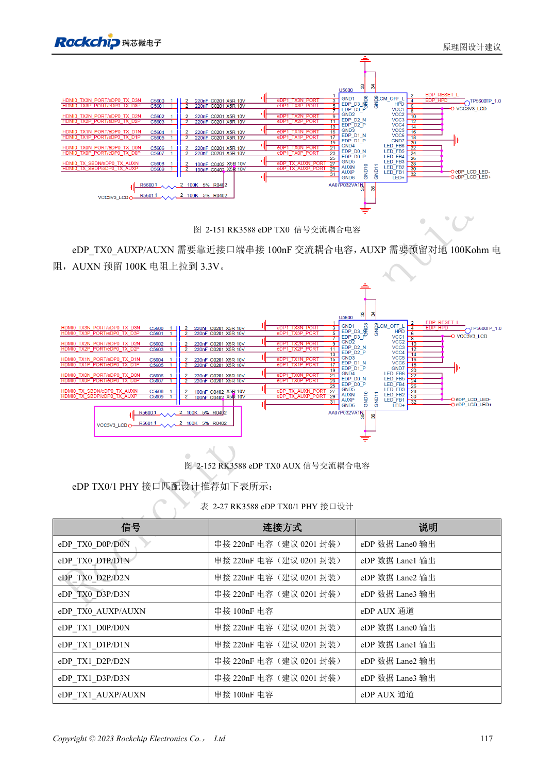
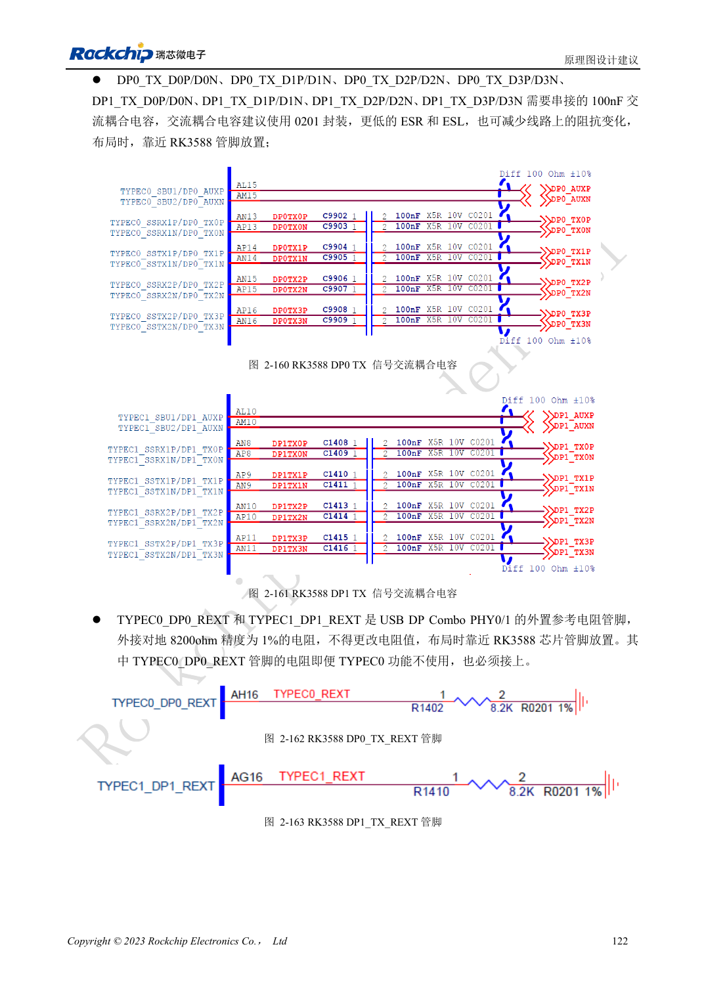

<!-- rk3588-hardware-v13-20261109 -->

# RK3588 DP 与 eDP：PHY 复用、AUX 与耦合

本文依据 RK3588 Hardware Design Guide V1.3（2023-02-13）中英文原稿整理，面向芯片主板和载板设计审查。AIM7、LM7 载板须遵循模块接口定义；Sige7 可作为软件与外设验证起点。芯片能力不等于板卡接口清单，SDK/BSP、内核、板卡版本及固件需逐项核对。数值为原稿参考，未经 ArmSoM 硬件实测。

**RK3588 Hardware Design Guide V1.3 (2023-02-13), CN** · §2.3.8.1; §2.3.8.3; §3.4.4; §3.4.13

## 相似名称不代表同一电路

DP0/1 与 USB Type-C 共用 PHY，eDP 与 HDMI TX 共用 PHY。DP 主链路推荐 100nF，eDP 主链路为 220nF，AUX 为 100nF。不能把 DP 和 eDP 的阻抗、耦合与引脚直接互换。线缆、连接器、显示器输入和 BSP 都属于链路的一部分。

## 不用 TYPEC0 也有必接项

TYPEC0_DP0 的三路电源和 8.2kΩ、1% REXT 即使不使用 TYPEC0 也要按指南保留。eDP AUX 在接口附近耦合并保留参考偏置位置。原稿章节标题写 eDP1.4，而正文写 V1.3；这里按明确电气参数整理，不据此宣称额外协议能力。

## 设计参数与检查表

| 项目 | 原稿参考值 |
| --- | --- |
| 独立 DP / USB-DP 阻抗 | 100Ω / 95Ω; ±10% |
| eDP 阻抗 | 90Ω ±10%; 匹配线缆 |
| DP / eDP 主链路耦合 | 100nF / 220nF |
| AUX 耦合 | 100nF |
| 长度/对内差 | <6in / <6mil |

## 参考原图

下图为原稿参考页，包含对应电路图或时序图；点击可查看大图。位号和元件值属于参考设计，不是 ArmSoM 产品原理图。

中文原稿 · PDF 134 · 2-151

中文原稿 · PDF 139 · 2-160

## ArmSoM 开发路径

AIM7 适合基于计算模块设计载板；LM7 面向 LGA 模块集成；Sige7 可用于开发前期的软件与外设评估。使用模块时先检查哪些电源、DDR 与启动电路已在模块内完成，不应把芯片参考电路重复放到载板上。实际连接器、可用接口、电平与系统支持以对应产品资料为准。

- [ArmSoM AIM7](https://www.armsom.org/aim7) · [AIM7 Docs](https://docs.armsom.org/armsom-aim7)
- [ArmSoM Sige7](https://www.armsom.org/sige7) · [Sige7 Docs](https://docs.armsom.org/armsom-sige7)
- [ArmSoM LM7](https://www.armsom.org/lm7) · [LM7 Docs](https://docs.armsom.org/armsom-lm7)

## 继续阅读

- [RK3588 硬件设计系列：30 个主题](/zh/articles/rk3588-hardware-design-series/)
- [RK3588 MIPI 显示：D-PHY、C-PHY 与屏幕配套](/zh/articles/rk3588-mipi-display-hardware/)
- [RK3588 音频硬件：I2S、PDM 与多麦克风](/zh/articles/rk3588-audio-hardware-design/)
