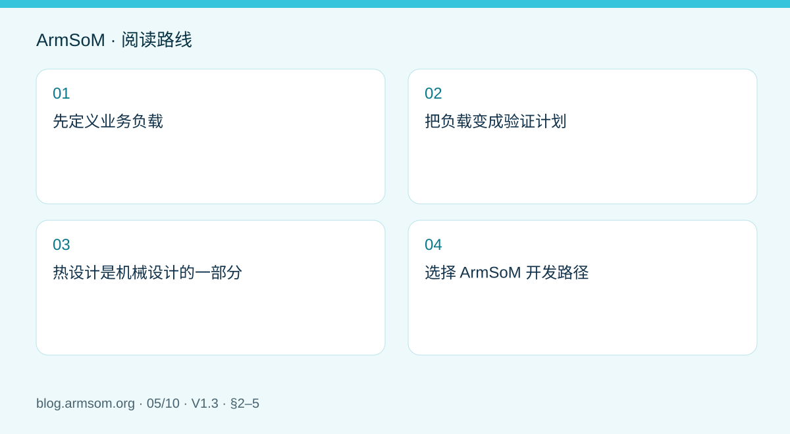
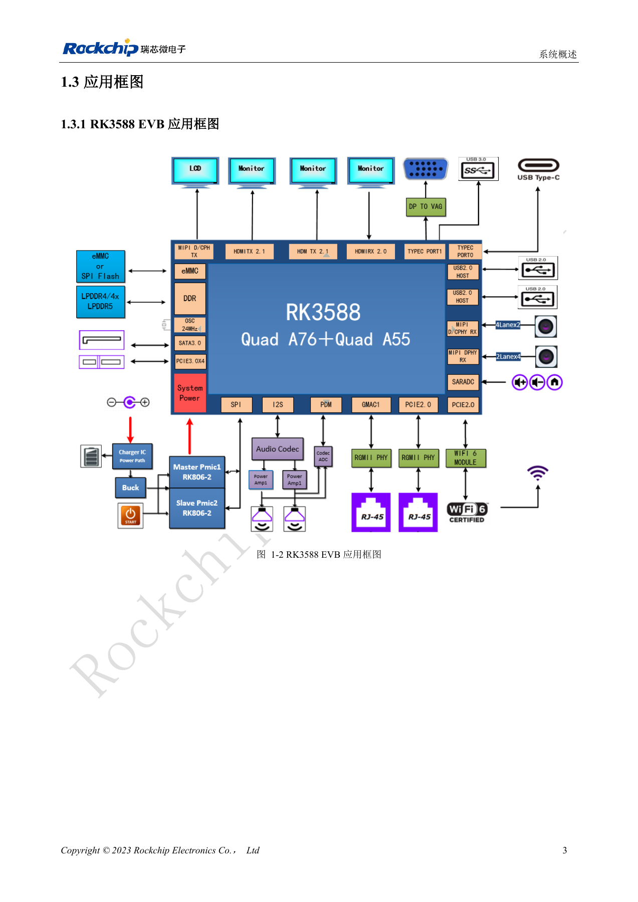

# RK3588 边缘 AI 设备设计：供电、散热与扩展接口规划

## 适用范围与资料

本篇为围绕工程问题编写的专题导读，不是整本 PDF 的逐页翻译。原文示例不代表 ArmSoM 实测；具体电压、引脚、SDK/BSP 和内核应按实际板卡版本核对。

**Rockchip:** `RK3588 Hardware Design Guide-CN-V1.3-20230213.pdf` · V1.3 · §2–5

## 先定义业务负载

边缘 AI 产品不是只运行一个模型。摄像头输入、预处理、NPU 推理、显示、网络上传和存储会共同消耗系统资源。先明确输入路数、分辨率、目标延迟、持续运行时间和环境温度，再选择板型与外设。本文的应用组合是工程规划，不是 ArmSoM 实测性能。

RK3588 V1.3 指南第 2 章提供原理图建议，第 4 章讨论热设计，第 5 章讨论 ESD/EMI。它们适合作为整机审查框架，但 EVB 参数和原厂热仿真不能直接作为 AIM7、Sige7 或 LM7 成品的测试结果。

## 把负载变成验证计划

| 场景 | 重点资源 | 需要观察 |
| --- | --- | --- |
| 视觉检测 | 摄像头、内存、NPU、网络 | 帧丢失、端到端延迟和供电瞬态 |
| 多媒体终端 | 解码、显示、音频、触摸 | 分辨率组合、温升和长期稳定性 |
| 数据采集设备 | 网络、存储、外部接口 | 持续写入、异常断电与恢复 |

供电预算应包含模块或主板、外设启动峰值以及转换损耗，并检查线缆和连接器压降。不要根据处理器典型功耗直接选择整机电源，也不要将不同供电拓扑的参数混用。

## 热设计是机械设计的一部分

确定热源到散热器、外壳和环境的路径，核对导热界面、安装压力、绝缘与通风。封闭盒体中的表现可能不同于裸板。测试应记录环境温度、芯片温度、频率、推理延迟和丢帧，而不是只展示一次最高速度。

温控策略和降频日志用于判断系统是否进入保护状态。若性能随时间下降，应同时检查热路径与供电，不应简单禁用保护来追求跑分。

## 选择 ArmSoM 开发路径

AIM7、Sige7 和 LM7 可作为不同结构与接口需求的候选，实际选择依据各自硬件文档和连接方式。先在选定平台验证模型、视频链路与外设，再固化载板或机壳。迁移已有 Jetson 应用时，CUDA 依赖与模型部署流程需单独评估，不能从板型相似推断软件兼容。

最终交付应包含接口配置、BSP/模型版本、线缆清单和持续负载记录。只有对应配置通过测试，才可对客户说明其实际能力。

## 原文配图

中文稿原图。 参考设计，不是 ArmSoM 板卡原理图。

`RK3588 Hardware Design Guide-CN-V1.3-20230213.pdf` · PDF p. 20.

## 相关产品与开发资料

- **AIM7** — [产品页面](https://www.armsom.org/aim7) · [开发文档](https://docs.armsom.org/armsom-aim7)
- **Sige7** — [产品页面](https://www.armsom.org/sige7) · [开发文档](https://docs.armsom.org/armsom-sige7)
- **LM7** — [产品页面](https://www.armsom.org/lm7) · [开发文档](https://docs.armsom.org/armsom-lm7)

## 继续阅读本系列

- [RK3576 硬件设计入门：最小系统与首次上电检查](/zh/articles/rk3576-hardware-bringup/)
- [ArmSoM CM5 载板设计检查表：供电、启动与接口规划](/zh/articles/019-cm5-carrier-production/)
- [RK3576 高速接口设计：原理图与 PCB 如何配合检查](/zh/articles/rk3576-high-speed-interface-design/)
- [RK3588S 硬件设计指南：从芯片参考设计到 CM7s 载板](/zh/articles/rk3588s-cm7s-carrier-design/)
- [RK3588 高速 PCB 设计：叠层、阻抗与布线检查](/zh/articles/rk3588-high-speed-pcb-review/)
- [RK3506 工业 HMI 硬件设计：结合 CM1 与 Forge1 选择开发路径](/zh/articles/rk3506-industrial-hmi-hardware/)
- [RK3308 系列芯片差异与兼容检查：P2 Pro 音频项目参考](/zh/articles/rk3308-hardware-variant-compatibility/)
- [RK3588S 与 RK3588S2 有什么区别？改版前需要核对什么](/zh/articles/rk3588s-rk3588s2-hardware-differences/)
- [Rockchip 设备从样机到量产：工艺要求与测试清单](/zh/articles/rockchip-hardware-production-checklist/)
