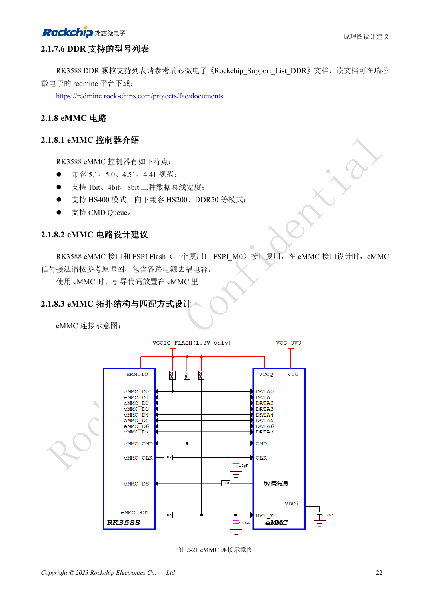
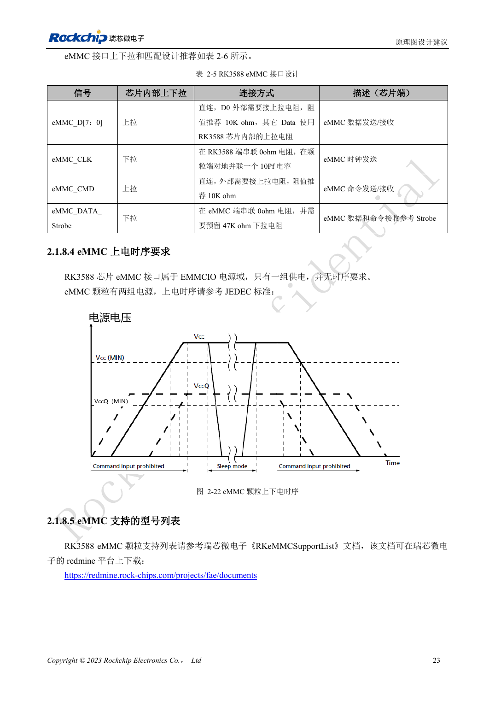

<!-- rk3588-hardware-v13-20261109 -->

# RK3588 eMMC：时钟、上拉与 Strobe

本文依据 RK3588 Hardware Design Guide V1.3（2023-02-13）中英文原稿整理，面向芯片主板和载板设计审查。AIM7、LM7 载板须遵循模块接口定义；Sige7 可作为软件与外设验证起点。芯片能力不等于板卡接口清单，SDK/BSP、内核、板卡版本及固件需逐项核对。数值为原稿参考，未经 ArmSoM 硬件实测。

**RK3588 Hardware Design Guide V1.3 (2023-02-13), CN** · §2.1.8; §3.4.14

## 落实 V1.3 时钟接法

表 2-5 要求 CLK 在 RK3588 端串 0Ω、在 eMMC 端并 10pF 到地。D0 和 CMD 推荐外接 10kΩ 上拉，其余数据用内部上拉。Strobe 在颗粒端串 0Ω、预留 47kΩ 下拉。不要把所有信号按相同模板连接，元件所在端同样重要。

## 电源与模式一起验收

EMMCIO 与颗粒的两路供电是不同层次，颗粒时序仍需按具体料号核对。确认支持列表及 Loader/BSP 版本，测试目标模式、冷启动、持续读写与断电恢复。AIM7/LM7 的 eMMC 通常在模块上，是否可替换或外接应查模块文档，不由 SoC 图推断。

## 设计参数与检查表

| 项目 | 原稿参考值 |
| --- | --- |
| CLK | 0Ω SoC 侧; 10pF eMMC 侧 |
| D0 / CMD | 10kΩ 上拉 |
| 选通 | 0Ω eMMC 侧; 预留 47kΩ 下拉 |
| PCB 阻抗/长度 | 50Ω ±10% / <3.5in |
| 时钟与数据长度差 | <120mil |

## 参考原图

下图为原稿参考页，包含对应电路图或时序图；点击可查看大图。位号和元件值属于参考设计，不是 ArmSoM 产品原理图。

中文原稿 · PDF 39 · 2-21

中文原稿 · PDF 40 · 2-22

## ArmSoM 开发路径

AIM7 适合基于计算模块设计载板；LM7 面向 LGA 模块集成；Sige7 可用于开发前期的软件与外设评估。使用模块时先检查哪些电源、DDR 与启动电路已在模块内完成，不应把芯片参考电路重复放到载板上。实际连接器、可用接口、电平与系统支持以对应产品资料为准。

- [ArmSoM AIM7](https://www.armsom.org/aim7) · [AIM7 Docs](https://docs.armsom.org/armsom-aim7)
- [ArmSoM Sige7](https://www.armsom.org/sige7) · [Sige7 Docs](https://docs.armsom.org/armsom-sige7)
- [ArmSoM LM7](https://www.armsom.org/lm7) · [LM7 Docs](https://docs.armsom.org/armsom-lm7)

## 继续阅读

- [RK3588 硬件设计系列：30 个主题](/zh/articles/rk3588-hardware-design-series/)
- [RK3588 DDR 布线：等长与等延时](/zh/articles/rk3588-ddr-pcb-routing/)
- [RK3588 FSPI Flash：启动、供电与匹配](/zh/articles/rk3588-fspi-boot-hardware/)
