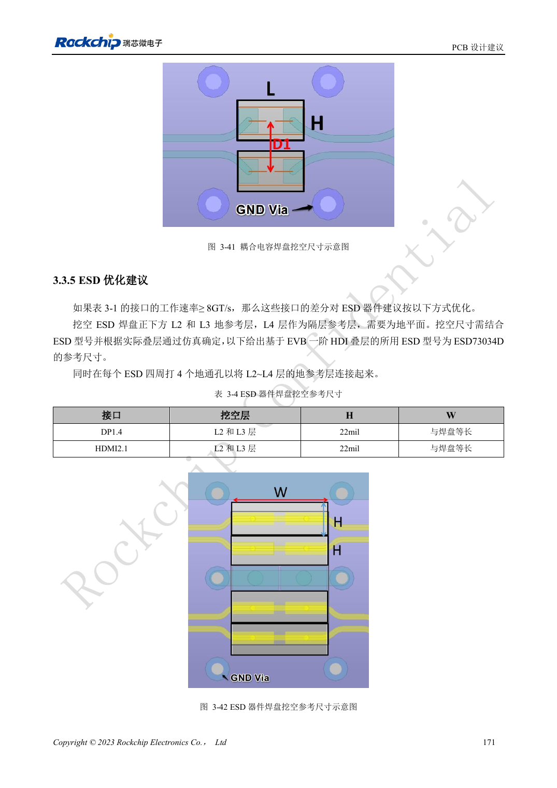

<!-- rk3588-hardware-v13-20261109 -->

# RK3588 ESD 与 EMI：接口保护和整机回流

本文依据 RK3588 Hardware Design Guide V1.3（2023-02-13）中英文原稿整理，面向芯片主板和载板设计审查。AIM7、LM7 载板须遵循模块接口定义；Sige7 可作为软件与外设验证起点。芯片能力不等于板卡接口清单，SDK/BSP、内核、板卡版本及固件需逐项核对。数值为原稿参考，未经 ArmSoM 硬件实测。

**RK3588 Hardware Design Guide V1.3 (2023-02-13), CN** · §5; §3.3.5

## 保护元件放在电流进入处

TVS 应靠近连接器或放电点，给它短而低阻抗的地回路。敏感复位、时钟、中断远离板边，指南建议至少 5mm。高速 ESD 的结电容与焊盘必须纳入信号完整性评估，不能认为耐压更高或电容更多总是更好。

## EMI 排查从源与耦合路径开始

优先检查回流中断、长支路、共模转换和开关电源，再选择滤波或屏蔽。散热器也可能耦合辐射，应预留接地条件并实测。原稿一般串阻建议不能覆盖 USB/HDMI/PCIe 各自的约束。以实际外壳、线缆、接地与目标认证条件测试，不把设计建议称为认证通过。

## 设计参数与检查表

| 项目 | 原稿参考值 |
| --- | --- |
| 敏感线距板边 | ≥5mm |
| 时钟源至串阻 | ≤400mil |
| 电源层边缘参考 | 20H; H=电源/地介质间距 |
| 高速 ESD | 使用接口专属电容限值 |

## 参考原图

下图为原稿参考页，包含对应电路图或时序图；点击可查看大图。位号和元件值属于参考设计，不是 ArmSoM 产品原理图。

中文原稿 · PDF 188 · 3-42

## ArmSoM 开发路径

AIM7 适合基于计算模块设计载板；LM7 面向 LGA 模块集成；Sige7 可用于开发前期的软件与外设评估。使用模块时先检查哪些电源、DDR 与启动电路已在模块内完成，不应把芯片参考电路重复放到载板上。实际连接器、可用接口、电平与系统支持以对应产品资料为准。

- [ArmSoM AIM7](https://www.armsom.org/aim7) · [AIM7 Docs](https://docs.armsom.org/armsom-aim7)
- [ArmSoM Sige7](https://www.armsom.org/sige7) · [Sige7 Docs](https://docs.armsom.org/armsom-sige7)
- [ArmSoM LM7](https://www.armsom.org/lm7) · [LM7 Docs](https://docs.armsom.org/armsom-lm7)

## 继续阅读

- [RK3588 硬件设计系列：30 个主题](/zh/articles/rk3588-hardware-design-series/)
- [RK3588 热设计：参考热阻与整机验证](/zh/articles/rk3588-thermal-hardware-design/)
- [RK3588 焊接与存储：回流曲线、MSL3 和烘烤记录](/zh/articles/rk3588-assembly-storage-design/)
