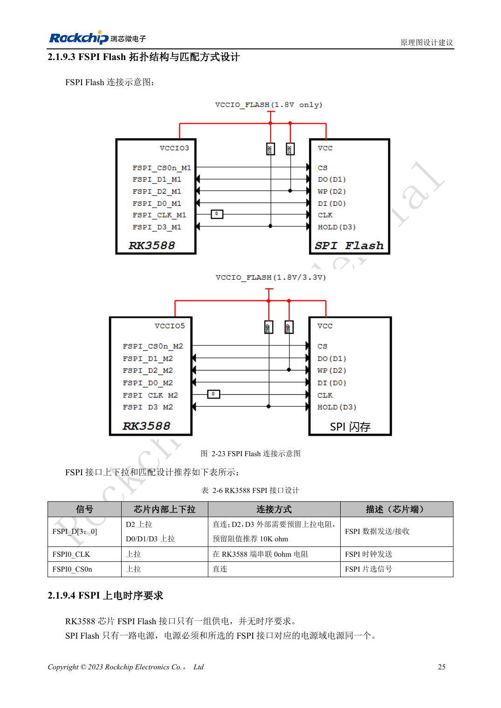

<!-- rk3588-hardware-v13-20261109 -->

# RK3588 FSPI Flash：启动、供电与匹配

本文依据 RK3588 Hardware Design Guide V1.3（2023-02-13）中英文原稿整理，面向芯片主板和载板设计审查。AIM7、LM7 载板须遵循模块接口定义；Sige7 可作为软件与外设验证起点。芯片能力不等于板卡接口清单，SDK/BSP、内核、板卡版本及固件需逐项核对。数值为原稿参考，未经 ArmSoM 硬件实测。

**RK3588 Hardware Design Guide V1.3 (2023-02-13), CN** · §2.1.9; §2.1.4; §3.4.17

## 选择启动与电源域

FSPI 可以作为早期引导介质，也可先初始化 PCIe 再加载 SSD 系统。所选复用组决定 IO 域，Flash 电源必须与该组电源域使用同一路电源。不要仅因封装相同就替换 Flash，料号支持、容量、引导固件与写入流程要共同确认。

## 保留调试与恢复余量

表 2-6 给 D2/D3 预留 10kΩ 上拉，CLK 在 SoC 端串 0Ω，CS 直连。把串阻位置、板长和上电时序一起检查，再做重复冷启动与完整读回比对。量产保留 USB 恢复入口，防止错误 Flash 内容使设备无法维修。

## 设计参数与检查表

| 项目 | 原稿参考值 |
| --- | --- |
| D2 / D3 | 预留 10kΩ 上拉 |
| CLK | 0Ω SoC 侧 |
| 供电 | 与所选 FSPI IO 域同电源 |
| PCB 阻抗/长度 | 50Ω ±10% / <4in |
| 时钟与数据长度差 | <200mil |

## 参考原图

下图为原稿参考页，包含对应电路图或时序图；点击可查看大图。位号和元件值属于参考设计，不是 ArmSoM 产品原理图。

中文原稿 · PDF 42 · 2-23

## ArmSoM 开发路径

AIM7 适合基于计算模块设计载板；LM7 面向 LGA 模块集成；Sige7 可用于开发前期的软件与外设评估。使用模块时先检查哪些电源、DDR 与启动电路已在模块内完成，不应把芯片参考电路重复放到载板上。实际连接器、可用接口、电平与系统支持以对应产品资料为准。

- [ArmSoM AIM7](https://www.armsom.org/aim7) · [AIM7 Docs](https://docs.armsom.org/armsom-aim7)
- [ArmSoM Sige7](https://www.armsom.org/sige7) · [Sige7 Docs](https://docs.armsom.org/armsom-sige7)
- [ArmSoM LM7](https://www.armsom.org/lm7) · [LM7 Docs](https://docs.armsom.org/armsom-lm7)

## 继续阅读

- [RK3588 硬件设计系列：30 个主题](/zh/articles/rk3588-hardware-design-series/)
- [RK3588 eMMC：时钟、上拉与 Strobe](/zh/articles/rk3588-emmc-hardware-design/)
- [RK3588 SDMMC 与 SDIO Wi-Fi：电压切换和防护](/zh/articles/rk3588-sdmmc-sdio-wifi-design/)
