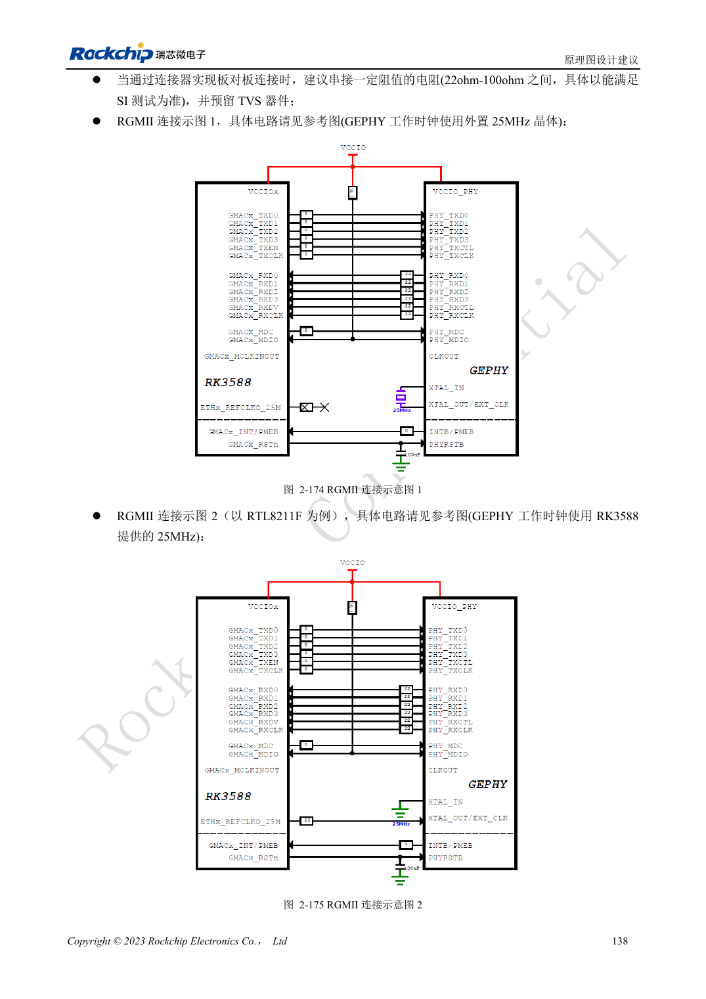

<!-- rk3588-hardware-v13-20261109 -->

# RK3588 以太网硬件：GMAC、PHY 与时钟方向

本文依据 RK3588 Hardware Design Guide V1.3（2023-02-13）中英文原稿整理，面向芯片主板和载板设计审查。AIM7、LM7 载板须遵循模块接口定义；Sige7 可作为软件与外设验证起点。芯片能力不等于板卡接口清单，SDK/BSP、内核、板卡版本及固件需逐项核对。数值为原稿参考，未经 ArmSoM 硬件实测。

**RK3588 Hardware Design Guide V1.3 (2023-02-13), CN** · §2.3.10; §3.4.19

## 先确定电压和时钟来源

两个 GMAC 支持外接 RGMII/RMII PHY。GMAC0 位于 VCCIO3，仅 1.8V；GMAC1 位于 VCCIO5，可选 1.8V/3.3V，但固定 1.8V 脚仍要供电。RMII 的 50MHz 输入/输出模式必须在 MAC 与 PHY 两端一致，避免双输出驱动。

## 延时和匹配分别验证

TX 预留 SoC 端 0Ω，RX 在 PHY 端串 22Ω，MDIO 上拉 1.5–1.8kΩ。PHY 的内部延时、PCB 时延和 BSP 配置要共同审查，不能重复补偿。验证不同速率、双向持续流量、错误计数和复位恢复。RGMII 信号不是双绞线端口，不能直接接 RJ45。

## 设计参数与检查表

| 项目 | 原稿参考值 |
| --- | --- |
| RGMII 阻抗 | 50Ω ±10% 单端 |
| TX/RX 组与时钟差 | <120mil |
| 走线长度 | <5in |
| MDIO 上拉 | 1.5–1.8kΩ |

## 参考原图

下图为原稿参考页，包含对应电路图或时序图；点击可查看大图。位号和元件值属于参考设计，不是 ArmSoM 产品原理图。

中文原稿 · PDF 155 · 2-175

## ArmSoM 开发路径

AIM7 适合基于计算模块设计载板；LM7 面向 LGA 模块集成；Sige7 可用于开发前期的软件与外设评估。使用模块时先检查哪些电源、DDR 与启动电路已在模块内完成，不应把芯片参考电路重复放到载板上。实际连接器、可用接口、电平与系统支持以对应产品资料为准。

- [ArmSoM AIM7](https://www.armsom.org/aim7) · [AIM7 Docs](https://docs.armsom.org/armsom-aim7)
- [ArmSoM Sige7](https://www.armsom.org/sige7) · [Sige7 Docs](https://docs.armsom.org/armsom-sige7)
- [ArmSoM LM7](https://www.armsom.org/lm7) · [LM7 Docs](https://docs.armsom.org/armsom-lm7)

## 继续阅读

- [RK3588 硬件设计系列：30 个主题](/zh/articles/rk3588-hardware-design-series/)
- [RK3588 音频硬件：I2S、PDM 与多麦克风](/zh/articles/rk3588-audio-hardware-design/)
- [RK3588 GPIO 与 SARADC：电源域和按键边界](/zh/articles/rk3588-gpio-saradc-hardware/)
