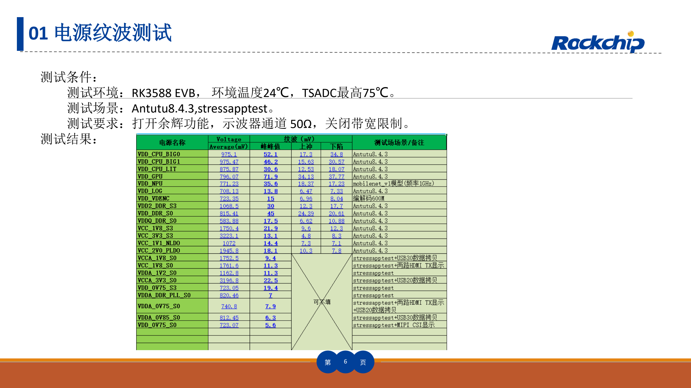
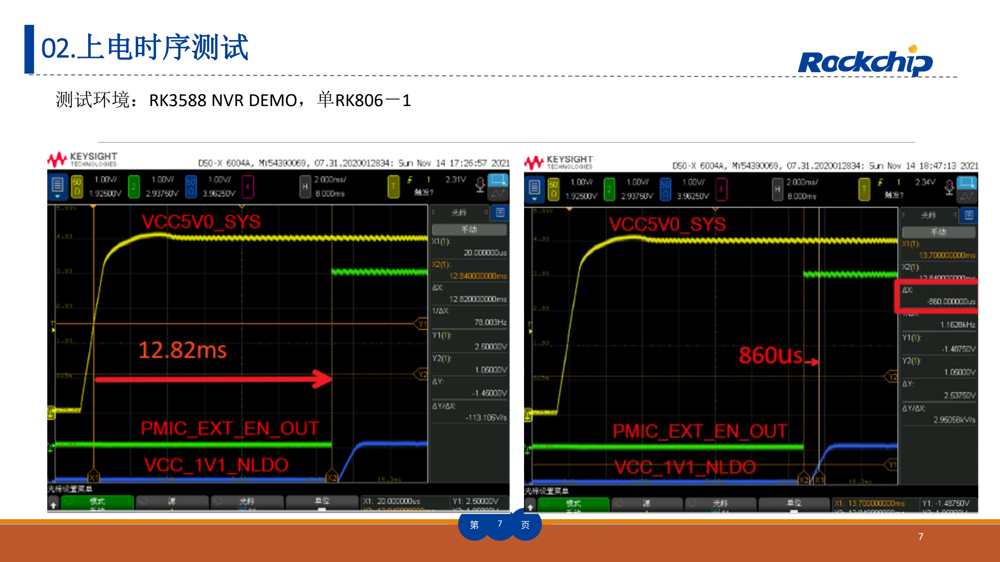
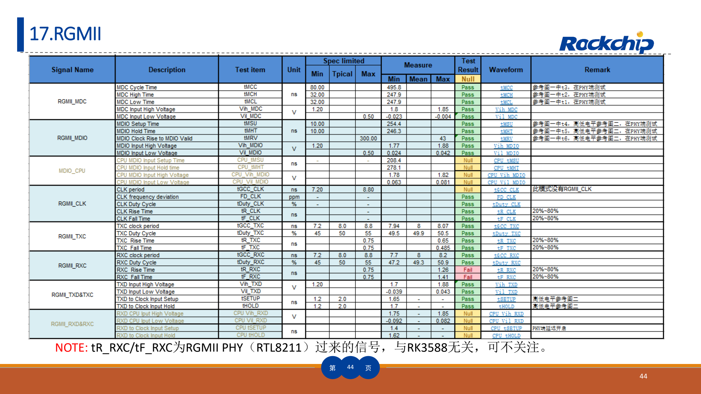

本文按选型和调试任务解读原稿，保留关键参数、边界和原图；不是逐页翻译或完整引脚／寄存器手册。原厂示例不是 ArmSoM 实测。应用前须核对具体板卡版本、原理图、SDK/BSP、内核及驱动；本文未新增硬件验证。

**主要资料：** `RK3588_HW_Test_Report_Summary V1.3_20230215.pdf` · PDF 51 页.

## 参考报告的价值是方法，不是替你的板卡盖章

这份 51 页报告包含电源、DDR、存储、视频、网络和音频等 23 类测试。它可以帮助确定要测什么、怎样保留条件，以及如何定位边界问题。AIM7、Sige7、LM7 均有 RK3588 产品资料，但不同载板、接口、散热和供电的结果不能由原厂 EVB 报告代替。

文件名为 V1.3_20230215，封面仍写 V1.2_20220829；修订表增加了 V1.3，并注明第 44 页 RGMII 更新。本篇以实际文件内容为准，保留这一版本差异。

## 23 类测试如何安排

| 原稿序号 | 测试组 | 应保留的条件与输出 |
| --- | --- | --- |
| 01–03 | 电源纹波、上电时序、功耗 | 负载、环境、各电源轨、测点、探头、触发与测量边界 |
| 04–06 | LPDDR4、LPDDR5、eMMC | 颗粒/BOM、DDR 初始化版本、频率、温度、时序和长时间读写 |
| 07–09 | PCIe3.0、PCIe2.0、SATA3.0 | 链路模式、lane、线缆/转接板、眼图或波形、持续流量 |
| 10–12 | HDMI TX、Type-C DP、eDP | 输出模式、lane、显示器/负载、连接器与测量夹具 |
| 13–16 | MIPI D/C PHY、MIPI DPHY、USB3.0、USB2.0 | 速率、方向、模式、负载、线缆和测点 |
| 17–20 | RGMII、SDMMC、SPDIF、UART | IO 电压、频率、信号方向、时序及误码条件 |
| 21–23 | I2S、PDM、I2C | 时钟、采样或总线频率、负载、上拉及边沿 |

开发顺序建议为：先供电与启动，再内存稳定性，再单接口，最后并发与温度边界。仅看到桌面、连上网络或播放一次视频，无法覆盖这些测试。

*原厂电源纹波测试与条件 — 中文原图；本批未找到对应英文图. `RK3588_HW_Test_Report_Summary V1.3_20230215.pdf`, PDF p. 6.*

## 纹波测试先确认测量条件

第 6 页使用 RK3588 EVB，环境 24℃、TSADC 最高 75℃，负载包含 Antutu 8.4.3 和 stressapptest；原稿还记录示波器余辉、50Ω、带宽限制关闭等设置。它们是该报告的测量配置，不是所有电源轨通用的接法。使用 50Ω 输入前必须确认探头和耦合方式不会对被测轨造成不当负载。

实际记录应包括探头接地长度、测量位置、带宽、峰峰值、平均电压和重复次数。同一轨在空闲和突发负载下可能表现不同；只有截图没有负载条件，很难复现。

*RK3588 NVR DEMO 上电时序示例 — 中文原图；本批未找到对应英文图. `RK3588_HW_Test_Report_Summary V1.3_20230215.pdf`, PDF p. 7.*

## 上电成功也要看时序与掉电

第 7 页时序示例来自 RK3588 NVR DEMO、单 RK806-1 方案。将这些波形与自己的电源树、使能、复位和参考时钟对应，检查冷启动、快速重启、欠压和缓慢掉电。原厂示例波形中的延时不能直接当成 AIM7、Sige7 或 LM7 的默认时序。

第 12 页功耗汇总另指向 `RK3588 Power Consumption Test Report V1.1_20220829_CN`。当前文章不凭汇总页推导整板电源适配器额定值；外设启动电流、转换损耗和散热都应进入预算。

## 高速接口：功能、信号完整性、稳定性分别验收

“能识别设备”只证明一部分功能。PCIe/SATA/USB 需要继续检查协商速率、链路降级、错误计数及热稳态吞吐；显示接口需要核对像素格式、刷新率、抖动和接收端；DDR 的稳定性需要与具体颗粒、布线和初始化配置关联。

原稿所测 LPDDR4/LPDDR5 和接口模式不意味着所有 ArmSoM 产品都安装相同器件。更换内存、载板、连接器或线缆后，至少重新评估受影响项目，不能沿用旧截图作为新硬件的结论。

*RGMII 原始测试表与注释 — 中文原图；本批未找到对应英文图. `RK3588_HW_Test_Report_Summary V1.3_20230215.pdf`, PDF p. 44.*

## 用 RGMII 示例理解责任边界

第 44 页注明 `tR_RXC/tF_RXC` 来自外部 RTL8211 PHY。这个说明用于区分信号来源，不代表整机验证可以忽略 PHY 送到 SoC 的接收时钟。应分别确认发送端、接收端、延时配置和探测位置，再判断违反的是哪一段约束。

## 建议保存的最小测试档案

每项记录板卡/载板修订、BOM、镜像与内核、环境温度、仪器与校准状态、连接图、负载、判定依据、原始结果和复测结论。把“原厂参考值”“自定义目标”“本板实测”分列，异常项附上复现步骤。

在 Sige7 上可先验证应用和外设组合；AIM7 或 LM7 的项目则应把载板、连接方式和散热纳入同一测试档案。选择哪个产品取决于系统形态，不能仅凭这份报告决定。

## 产品与开发资料

- **AIM7** — [产品页](https://www.armsom.org/aim7) · [官方文档](https://docs.armsom.org/armsom-aim7)
- **Sige7** — [产品页](https://www.armsom.org/sige7) · [官方文档](https://docs.armsom.org/armsom-sige7)
- **LM7** — [产品页](https://www.armsom.org/lm7) · [官方文档](https://docs.armsom.org/armsom-lm7)

## 延伸阅读

- [RK3588 NVR 参考设计](/zh/articles/rk3588-nvr-reference-design/)
- [量产工艺与检查表](/zh/articles/rockchip-hardware-production-checklist/)
