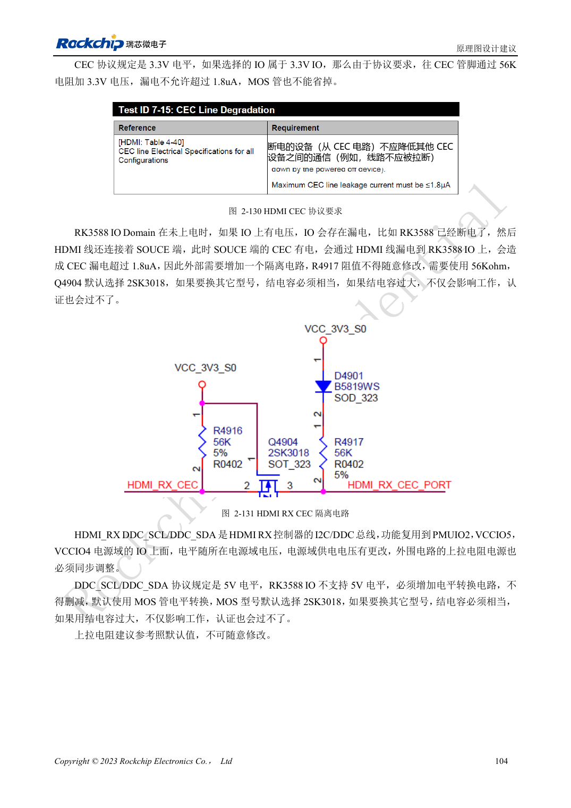

<!-- rk3588-hardware-v13-20261109 -->

# RK3588 HDMI RX：采集输入、CEC 与 DDC 电平

本文依据 RK3588 Hardware Design Guide V1.3（2023-02-13）中英文原稿整理，面向芯片主板和载板设计审查。AIM7、LM7 载板须遵循模块接口定义；Sige7 可作为软件与外设验证起点。芯片能力不等于板卡接口清单，SDK/BSP、内核、板卡版本及固件需逐项核对。数值为原稿参考，未经 ArmSoM 硬件实测。

**RK3588 Hardware Design Guide V1.3 (2023-02-13), CN** · §2.3.7.4; §3.4.7

## RX 不是 TX 电路反接

表 2-24 给 RX 数据/时钟串 2.2Ω，REXT 对地 200Ω、1% 精度。HPD 为输入端向源端发出的控制信号，需要参考 MOS 电路。不要复制 HDMI TX 的 220nF 耦合与偏置网络到接收端，先确认信号方向、参考电阻和供电。

## 关机时仍要检查漏电

DDC 按 HDMI 使用 5V，而 RK3588 IO 不支持 5V，电平转换不能省略。CEC 要有隔离，RX 参考电阻为 56kΩ；不能照抄 TX 的 27kΩ。测试源端上电而本机断电时的漏电、HPD、EDID 读取、目标格式采集和长线稳定性。

## 设计参数与检查表

| 项目 | 原稿参考值 |
| --- | --- |
| RX 串阻 / REXT | 2.2Ω / 200Ω ±1% |
| RX CEC 参考 | 56kΩ |
| 差分阻抗/长度 | 100Ω ±10% / <6in |
| 时钟与数据长度差 | <480mil |

## 参考原图

下图为原稿参考页，包含对应电路图或时序图；点击可查看大图。位号和元件值属于参考设计，不是 ArmSoM 产品原理图。

中文原稿 · PDF 121 · 2-131

## ArmSoM 开发路径

AIM7 适合基于计算模块设计载板；LM7 面向 LGA 模块集成；Sige7 可用于开发前期的软件与外设评估。使用模块时先检查哪些电源、DDR 与启动电路已在模块内完成，不应把芯片参考电路重复放到载板上。实际连接器、可用接口、电平与系统支持以对应产品资料为准。

- [ArmSoM AIM7](https://www.armsom.org/aim7) · [AIM7 Docs](https://docs.armsom.org/armsom-aim7)
- [ArmSoM Sige7](https://www.armsom.org/sige7) · [Sige7 Docs](https://docs.armsom.org/armsom-sige7)
- [ArmSoM LM7](https://www.armsom.org/lm7) · [LM7 Docs](https://docs.armsom.org/armsom-lm7)

## 继续阅读

- [RK3588 硬件设计系列：30 个主题](/zh/articles/rk3588-hardware-design-series/)
- [RK3588 摄像头：CSI、D/C PHY 与 CIF 接口规划](/zh/articles/rk3588-camera-hardware-design/)
- [RK3588 HDMI TX：FRL、TMDS 与兼容电路](/zh/articles/rk3588-hdmi-tx-hardware-design/)
