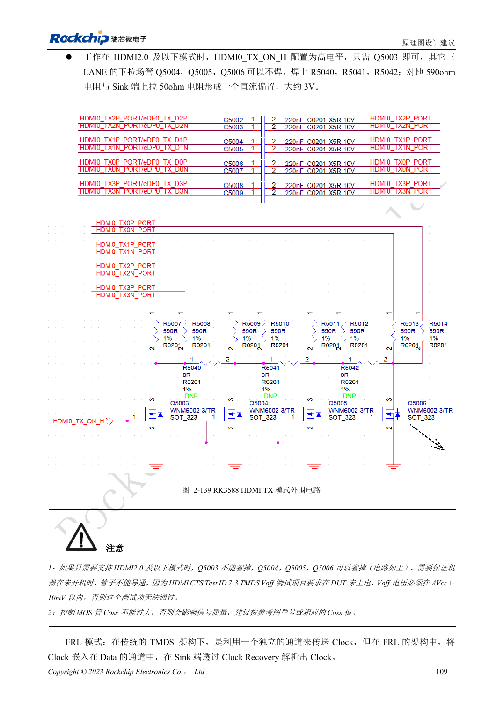
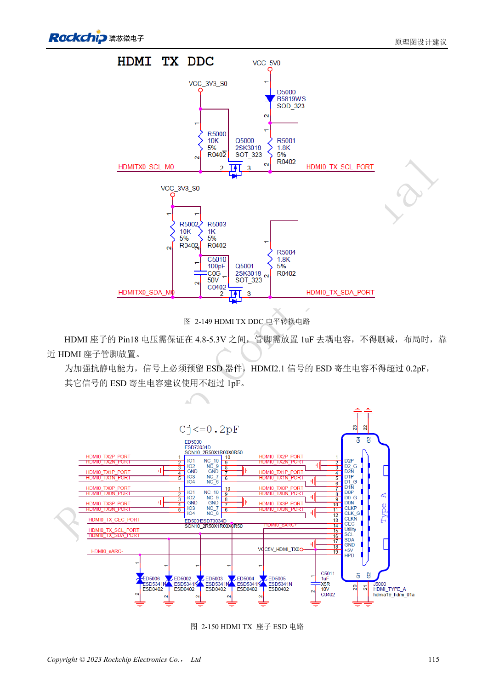

<!-- rk3588-hardware-v13-20261109 -->

# RK3588 HDMI TX：FRL、TMDS 与兼容电路

本文依据 RK3588 Hardware Design Guide V1.3（2023-02-13）中英文原稿整理，面向芯片主板和载板设计审查。AIM7、LM7 载板须遵循模块接口定义；Sige7 可作为软件与外设验证起点。芯片能力不等于板卡接口清单，SDK/BSP、内核、板卡版本及固件需逐项核对。数值为原稿参考，未经 ArmSoM 硬件实测。

**RK3588 Hardware Design Guide V1.3 (2023-02-13), CN** · §2.3.8.1; §3.4.8

## FRL 与 TMDS 外围不是同一状态

HDMI2.1 使用 FRL，向 HDMI2.0 及以下兼容时使用 TMDS。参考电路用 220nF 耦合和受控偏置，TMDS 以 590Ω 配合接收端偏置。MOS 的关机状态和寄生电容都会影响验证，不能只因能亮屏就删掉控制电路。HDMI/eDP 共用 PHY 也限制同时使用。

## 验证低速控制与高速信号

REXT 为 8.2kΩ、1%。DDC 必须做 5V 电平转换，CEC 的 TX 参考为 27kΩ并隔离关机漏电。插座 Pin18 要满足 4.8–5.3V。HDMI2.1 ESD 电容不超过 0.2pF。测试热插拔、关机连接、不同显示器和线缆；原稿“暂不支持”功能只代表该版资料，不推断当前 BSP。

## 设计参数与检查表

| 项目 | 原稿参考值 |
| --- | --- |
| TX 耦合/偏置参考 | 220nF / 590Ω |
| REXT | 8.2kΩ ±1% |
| PCB 差分阻抗/长度 | 100Ω ±10% / <4in |
| 过孔/间距 | 优先无过孔 / ≥7× 线宽 |

## 参考原图

下图为原稿参考页，包含对应电路图或时序图；点击可查看大图。位号和元件值属于参考设计，不是 ArmSoM 产品原理图。

中文原稿 · PDF 126 · 2-139

中文原稿 · PDF 132 · 2-150

## ArmSoM 开发路径

AIM7 适合基于计算模块设计载板；LM7 面向 LGA 模块集成；Sige7 可用于开发前期的软件与外设评估。使用模块时先检查哪些电源、DDR 与启动电路已在模块内完成，不应把芯片参考电路重复放到载板上。实际连接器、可用接口、电平与系统支持以对应产品资料为准。

- [ArmSoM AIM7](https://www.armsom.org/aim7) · [AIM7 Docs](https://docs.armsom.org/armsom-aim7)
- [ArmSoM Sige7](https://www.armsom.org/sige7) · [Sige7 Docs](https://docs.armsom.org/armsom-sige7)
- [ArmSoM LM7](https://www.armsom.org/lm7) · [LM7 Docs](https://docs.armsom.org/armsom-lm7)

## 继续阅读

- [RK3588 硬件设计系列：30 个主题](/zh/articles/rk3588-hardware-design-series/)
- [RK3588 HDMI RX：采集输入、CEC 与 DDC 电平](/zh/articles/rk3588-hdmi-rx-hardware-design/)
- [RK3588 MIPI 显示：D-PHY、C-PHY 与屏幕配套](/zh/articles/rk3588-mipi-display-hardware/)
