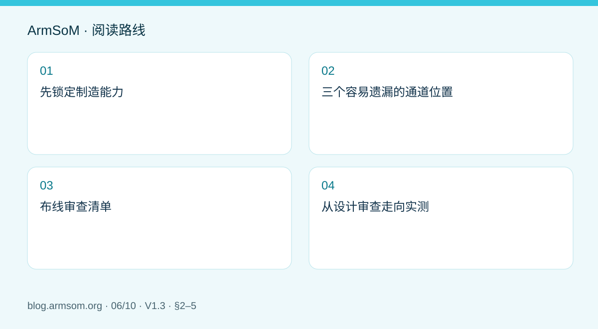
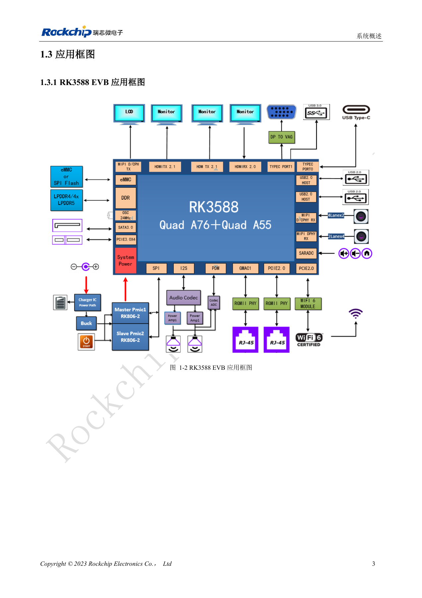
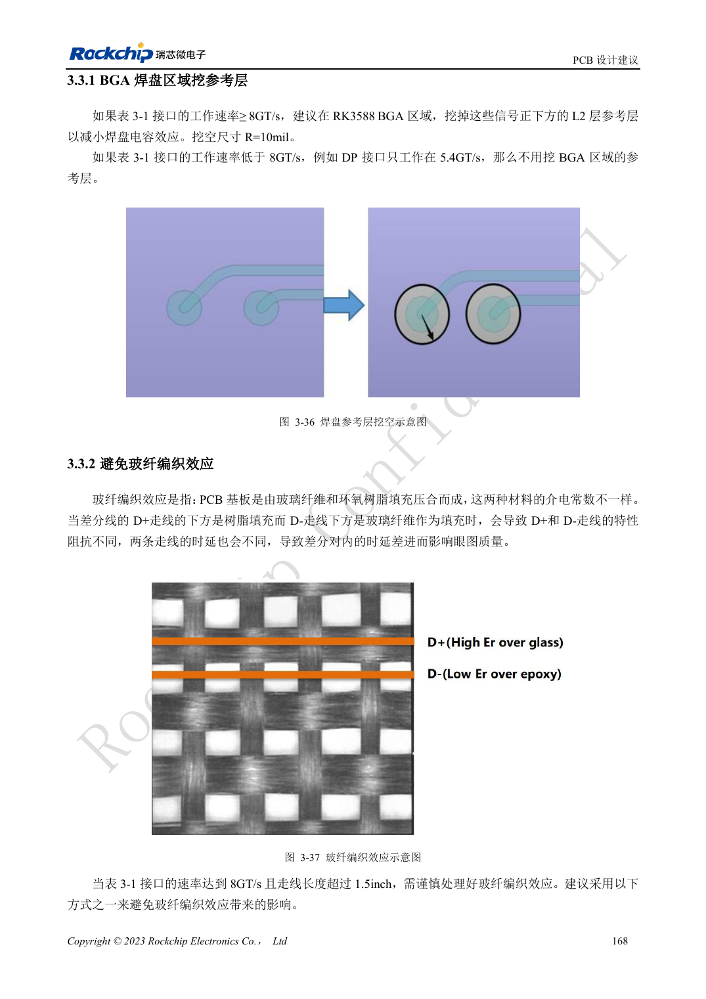
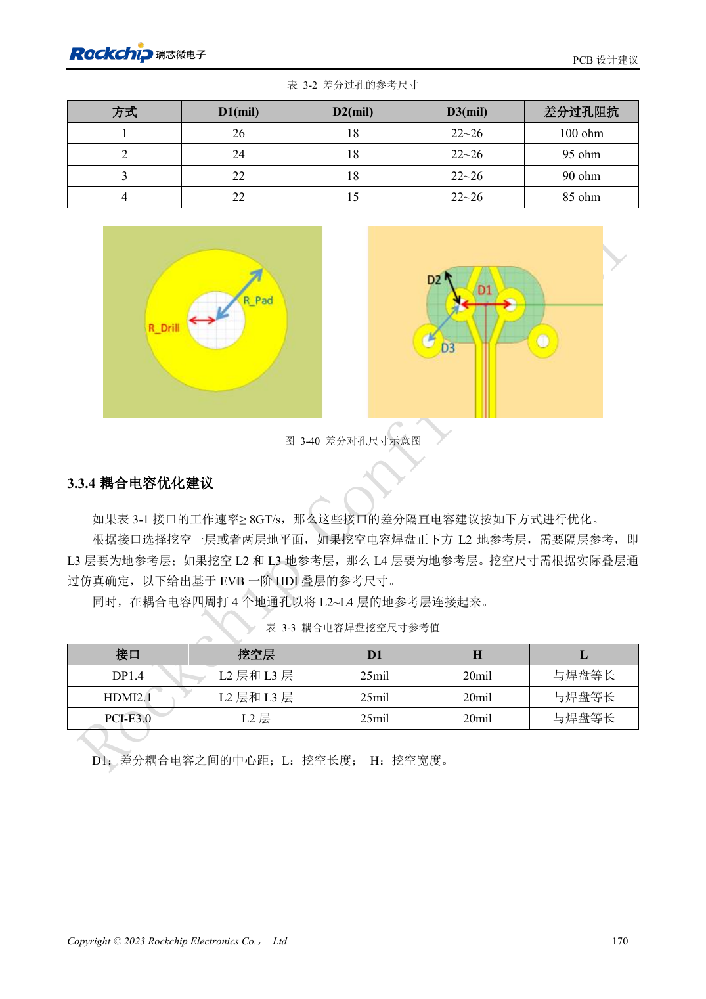
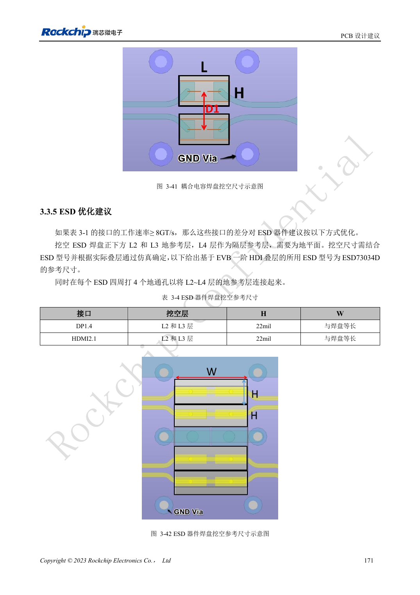

# RK3588 高速 PCB 设计：叠层、阻抗与布线检查

## 适用范围与资料

本篇为围绕工程问题编写的专题导读，不是整本 PDF 的逐页翻译。原文示例不代表 ArmSoM 实测；具体电压、引脚、SDK/BSP 和内核应按实际板卡版本核对。

**Rockchip:** `RK3588 Hardware Design Guide-CN-V1.3-20230213.pdf` · V1.3 · §2–5

## 先锁定制造能力

PCB 叠层不只是层数。介质厚度、材料、铜厚和制造公差共同决定阻抗与损耗。把目标接口、参考层、线宽线距和计算依据交给板厂确认，再将结果写入约束文件。不能从别人的参考板复制线宽后，就认为阻抗已经相同。

原稿 §3.1 讨论叠层和扇出，§3.2 是通用建议，§3.3 针对 8GT/s 及以上信号，§3.4 分接口给出要求。本篇是审查导读，各接口具体数值仍须查对应章节。

## 三个容易遗漏的通道位置

1. **BGA 与连接器焊盘**：局部寄生电容可能改变阻抗；参考层处理须对应实际焊盘、叠层和仿真。
2. **换层与过孔**：检查信号过孔、残桩和附近回流路径，避免信号换层却没有合理的参考转换。
3. **耦合与保护器件**：既要满足电路功能，也要核对封装与焊盘引起的不连续。增加 ESD 器件不代表高速链路仍然满足要求。

指南还讨论玻纤编织效应。它与材料和走线几何有关，不应仅靠末端蛇形补偿就认定已经解决。

## 布线审查清单

| 检查 | 应留下的结果 |
| --- | --- |
| 参考平面连续性 | 关键网络经过区域的逐段检查 |
| 阻抗与长度 | 板厂确认值、模式相关限值及裕量 |
| 过孔和连接器 | 通道中数量、位置、型号与模型 |
| 电源和回流 | 去耦回路、地连接、接口屏蔽路径 |
| 可测试性 | 测量方法与不会显著破坏通道的接入方式 |

不要为了加测试点在高速线上产生未经评估的长支线。也不要为了“等长”增加不必要的耦合与绕线。

## 从设计审查走向实测

设计规则检查只能发现已编码的规则，不能证明链路裕量。按照目标接口安排信号完整性检查、枚举或训练、目标速率与长期传输验证，并加入实际线缆和机壳。低速能工作但高速失败时，应分别检查通道、供电和软件设置。

使用 ArmSoM 模块时，载板只是完整链路的一部分；使用 Sige7 验证应用时，也不能将其 PCB 结果转移为另一块板的认证。

## 原文配图

中文稿原图。 参考设计，不是 ArmSoM 板卡原理图。

`RK3588 Hardware Design Guide-CN-V1.3-20230213.pdf` · PDF p. 20.

## 相关产品与开发资料

- **AIM7** — [产品页面](https://www.armsom.org/aim7) · [开发文档](https://docs.armsom.org/armsom-aim7)
- **Sige7** — [产品页面](https://www.armsom.org/sige7) · [开发文档](https://docs.armsom.org/armsom-sige7)
- **LM7** — [产品页面](https://www.armsom.org/lm7) · [开发文档](https://docs.armsom.org/armsom-lm7)

## 继续阅读本系列

- [RK3576 硬件设计入门：最小系统与首次上电检查](/zh/articles/rk3576-hardware-bringup/)
- [ArmSoM CM5 载板设计检查表：供电、启动与接口规划](/zh/articles/019-cm5-carrier-production/)
- [RK3576 高速接口设计：原理图与 PCB 如何配合检查](/zh/articles/rk3576-high-speed-interface-design/)
- [RK3588S 硬件设计指南：从芯片参考设计到 CM7s 载板](/zh/articles/rk3588s-cm7s-carrier-design/)
- [RK3588 边缘 AI 设备设计：供电、散热与扩展接口规划](/zh/articles/rk3588-edge-ai-hardware-design/)
- [RK3506 工业 HMI 硬件设计：结合 CM1 与 Forge1 选择开发路径](/zh/articles/rk3506-industrial-hmi-hardware/)
- [RK3308 系列芯片差异与兼容检查：P2 Pro 音频项目参考](/zh/articles/rk3308-hardware-variant-compatibility/)
- [RK3588S 与 RK3588S2 有什么区别？改版前需要核对什么](/zh/articles/rk3588s-rk3588s2-hardware-differences/)
- [Rockchip 设备从样机到量产：工艺要求与测试清单](/zh/articles/rockchip-hardware-production-checklist/)

<!-- rk3588-hardware-v13-20261109 -->

## RK3588 高速 PCB：8GT/s 以上的焊盘与过孔优化

本文依据 RK3588 Hardware Design Guide V1.3（2023-02-13）中英文原稿整理，面向芯片主板和载板设计审查。AIM7、LM7 载板须遵循模块接口定义；Sige7 可作为软件与外设验证起点。芯片能力不等于板卡接口清单，SDK/BSP、内核、板卡版本及固件需逐项核对。数值为原稿参考，未经 ArmSoM 硬件实测。

**RK3588 Hardware Design Guide V1.3 (2023-02-13), CN** · §3.2; §3.3

## 先识别适用速率

§3.3 面向 DP1.4 8.1Gbps、HDMI2.1 12Gbps 和 PCIe3 8GT/s 等链路。达到 8GT/s 的相关 BGA 焊盘可按参考优化 L2 挖空；参考 R=10mil，不是所有信号都要挖地。速率较低或叠层不同，应重新评估，而不是全板套用。

## 挖空后仍需连续回流

电容下挖 L2 时 L3 应是地，挖 L2/L3 时 L4 应是地，并在附近连接地层。参考尺寸只针对 EVB 叠层和器件。长于 1.5in 的相关高速线需关注玻纤效应，可采用角度布线等措施。载板与模块、连接器的完整通道要一起仿真或测量。

## 设计参数与检查表

| 项目 | 原稿参考值 |
| --- | --- |
| BGA 挖空参考 | R=10mil; 适用 ≥8GT/s 链路 |
| 玻纤效应检查 | 8GT/s 且长度 >1.5in |
| 角度示例 | 10°–35° |
| 过孔半径参考 | 钻孔 0.1mm; 焊盘 0.2mm |

## 参考原图

下图为原稿参考页，包含对应电路图或时序图；点击可查看大图。位号和元件值属于参考设计，不是 ArmSoM 产品原理图。

中文原稿 · PDF 185 · 3-36

中文原稿 · PDF 187 · 3-40

中文原稿 · PDF 188 · 3-41

## ArmSoM 开发路径

AIM7 适合基于计算模块设计载板；LM7 面向 LGA 模块集成；Sige7 可用于开发前期的软件与外设评估。使用模块时先检查哪些电源、DDR 与启动电路已在模块内完成，不应把芯片参考电路重复放到载板上。实际连接器、可用接口、电平与系统支持以对应产品资料为准。

- [ArmSoM AIM7](https://www.armsom.org/aim7) · [AIM7 Docs](https://docs.armsom.org/armsom-aim7)
- [ArmSoM Sige7](https://www.armsom.org/sige7) · [Sige7 Docs](https://docs.armsom.org/armsom-sige7)
- [ArmSoM LM7](https://www.armsom.org/lm7) · [LM7 Docs](https://docs.armsom.org/armsom-lm7)

## 继续阅读

- [RK3588 硬件设计系列：30 个主题](/zh/articles/rk3588-hardware-design-series/)
- [RK3588 PCB 叠层与扇出：HDI 和通孔板选择](/zh/articles/rk3588-pcb-stackup-fanout/)
- [RK3588 电源 PCB 与 PDN：铜皮、回流和去耦](/zh/articles/rk3588-power-pcb-pdn-design/)
