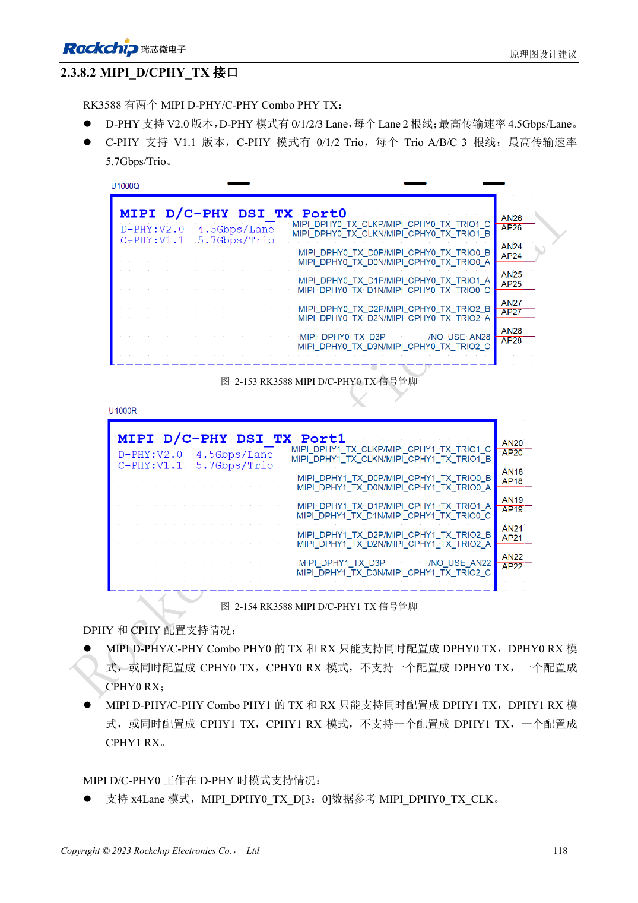
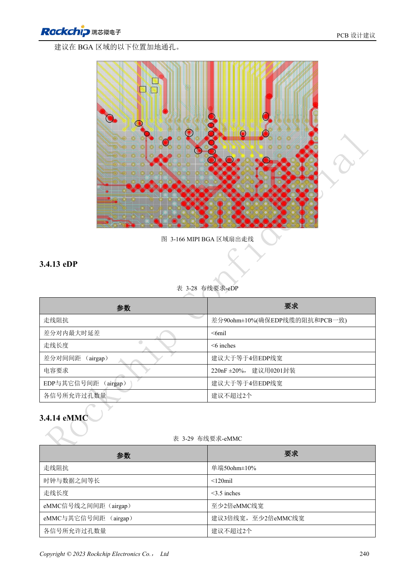

<!-- rk3588-hardware-v13-20261109 -->

# RK3588 MIPI 显示：D-PHY、C-PHY 与屏幕配套

本文依据 RK3588 Hardware Design Guide V1.3（2023-02-13）中英文原稿整理，面向芯片主板和载板设计审查。AIM7、LM7 载板须遵循模块接口定义；Sige7 可作为软件与外设验证起点。芯片能力不等于板卡接口清单，SDK/BSP、内核、板卡版本及固件需逐项核对。数值为原稿参考，未经 ArmSoM 硬件实测。

**RK3588 Hardware Design Guide V1.3 (2023-02-13), CN** · §2.3.8.2; §3.4.12; §3.4.23

## Lane 与 Trio 要分别设计

两组 D/C Combo PHY 的 D-PHY 使用四条数据 Lane，每 Lane 两根线；C-PHY 使用三组 Trio，每组 A/B/C 三根线。相同 PHY 的 TX/RX 必须同为 D-PHY 或同为 C-PHY，不能一边 D 一边 C。先核对屏幕协议、Lane/Trio 数和时序，再选接线。

## 屏幕不仅需要高速数据

背光电源、使能、复位、触摸 I2C 和中断都需匹配电压与启动顺序。D-PHY 差分阻抗和 C-PHY 单端阻抗不同，不可共用一组 DRC 规则。先在实际 BSP 验证屏幕初始化，再检查亮度变化、休眠唤醒、触摸干扰和长时间显示。

## 设计参数与检查表

| 项目 | 原稿参考值 |
| --- | --- |
| D-PHY 原稿速率 | 4.5Gbps/lane |
| C-PHY 原稿速率 | 5.7Gbps/trio |
| C-PHY 阻抗 | 50Ω ±10% 单端 |
| C-PHY 组内/组间差 | <6mil / <100mil |
| C-PHY 长度 | <5in |

## 参考原图

下图为原稿参考页，包含对应电路图或时序图；点击可查看大图。位号和元件值属于参考设计，不是 ArmSoM 产品原理图。

中文原稿 · PDF 135 · 2-153

中文原稿 · PDF 257 · 3-166

## ArmSoM 开发路径

AIM7 适合基于计算模块设计载板；LM7 面向 LGA 模块集成；Sige7 可用于开发前期的软件与外设评估。使用模块时先检查哪些电源、DDR 与启动电路已在模块内完成，不应把芯片参考电路重复放到载板上。实际连接器、可用接口、电平与系统支持以对应产品资料为准。

- [ArmSoM AIM7](https://www.armsom.org/aim7) · [AIM7 Docs](https://docs.armsom.org/armsom-aim7)
- [ArmSoM Sige7](https://www.armsom.org/sige7) · [Sige7 Docs](https://docs.armsom.org/armsom-sige7)
- [ArmSoM LM7](https://www.armsom.org/lm7) · [LM7 Docs](https://docs.armsom.org/armsom-lm7)

## 继续阅读

- [RK3588 硬件设计系列：30 个主题](/zh/articles/rk3588-hardware-design-series/)
- [RK3588 HDMI TX：FRL、TMDS 与兼容电路](/zh/articles/rk3588-hdmi-tx-hardware-design/)
- [RK3588 DP 与 eDP：PHY 复用、AUX 与耦合](/zh/articles/rk3588-dp-edp-hardware-design/)
