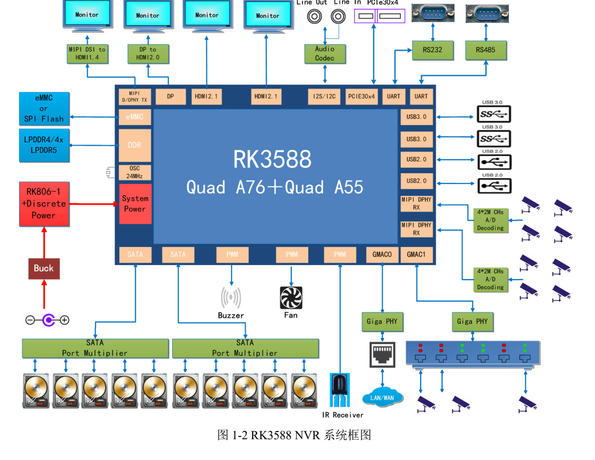
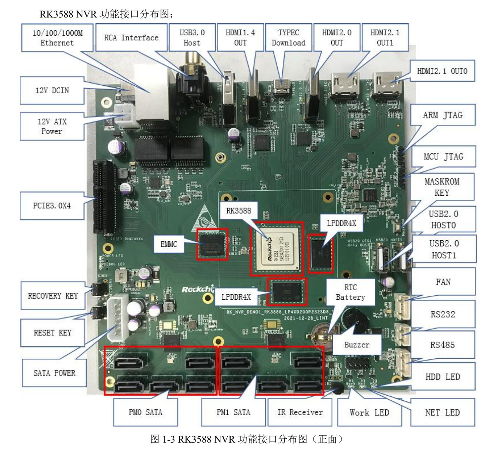

本文按选型和调试任务解读原稿，保留关键参数、边界和原图；不是逐页翻译或完整引脚／寄存器手册。原厂示例不是 ArmSoM 实测。应用前须核对具体板卡版本、原理图、SDK/BSP、内核及驱动；本文未新增硬件验证。

**主要资料：** `Rockchip_RK3588_NVR_User_Guide_V1.0_CN_20220421.pdf` · PDF 49 页.

## 这是一块原厂参考板，不是 ArmSoM 成品配置

原稿基于 `RK_NVR_DEMO1_RK3588_LP4XD200P232SD8_V21_20211228.DSN`，采用 RK3588、单 RK806-1、4GB LPDDR4x 和 32GB eMMC。默认适配器为 12V/3A。这些数据仅属于该参考设计，不能直接作为 AIM7、Sige7 或 LM7 的内存、输入电压或接口数量。

*RK3588 NVR 系统框图 — 中文原图；本批未找到对应英文图. `Rockchip_RK3588_NVR_User_Guide_V1.0_CN_20220421.pdf`, PDF p. 12.*

## 先把接口背后的链路画清楚

| 功能 | 原稿实现 | 产品规划时的核对项 |
| --- | --- | --- |
| SATA | 通过 2 颗 JMB575，最多接入 10 块 SATA 硬盘 | 上游带宽共享、驱动、磁盘供电和并发写入 |
| PCIe | PCIe3.0 x4；参考时钟来自 PI6C557-05BLE | 设备模式、时钟、复位、扩展卡与持续吞吐 |
| 网络 | 2 路千兆 RJ45，外接 RTL8211F-CG | 采集与管理网络如何分配，丢包与拥塞 |
| 相机 | 2×4-lane 或 4×2-lane MIPI DPHY RX，80pin 扩展 | 连接器、lane 分配、供电、传感器驱动 |
| 调试/下载 | MINI USB Debug；Type-C 固件下载 | 两个端口作用不同，先识别再连接 |

“10 路 SATA”是参考板通过扩展实现的端口数量，不是 RK3588 有 10 个独立原生 SATA 控制器，也不能据此承诺 10 盘同时达到各自峰值速度。硬盘启动电流与散热同样不能用默认适配器规格简单覆盖。

*RK3588 NVR 参考板接口位置 — 中文原图；本批未找到对应英文图. `Rockchip_RK3588_NVR_User_Guide_V1.0_CN_20220421.pdf`, PDF p. 14.*

## HDMI 接口要区分原生与桥接

原稿第 45–47 页分别介绍 MIPI 经 IT6161 转 HDMI1.4b、DP 经 IT6563FN 转 HDMI2.0，以及两路 HDMI2.1 输出。第 12 页概述写“三路 HDMI”，第 13 页功能表则列 1 路 HDMI1.4、1 路 HDMI2.0、2 路 HDMI2.1。这个数量表述差异保留在校对记录中；本篇以各链路说明为依据，不据此宣布四路可在任意模式下同时使用。

做监控墙或多屏终端时，先列出每路分辨率、刷新率、色彩格式和信号来源，再核对显示控制器、桥接芯片、连接器与 BSP。接口最高能力不能代替完整并发组合表。

## 从摄像头到录像文件的系统预算

建议把视频产品分成采集、解码／图像处理、可选推理、编码、写盘和本地显示几段。每段记录流数、码率、缓冲深度、处理延迟和错误恢复方式。网络相机输入与 MIPI 原始图像输入的带宽和软件路径不同。

磁盘测试应覆盖循环覆盖、满盘、拔除或故障盘、突然断电及重建索引。多盘并发时记录总吞吐与最慢一路，而不是只贴单盘测速。选择 RAID 或文件系统策略属于后续系统设计，不是这份 EVB 手册已交付的功能。

## 下载与恢复：保存配置再操作

原稿 Windows 驱动示例为 `DriverAssitant_v5.1.1`。Loader 流程通过 Type-C 接 PC，按住 RECOVERY 后上电或复位，工具识别 Loader 后再释放；MASKROM 流程使用对应按键并确认工具识别。固件选择涉及 Loader、Parameter、Uboot 等文件，须使用与板卡和存储匹配的一套文件，先备份数据。

这些是参考板流程，不应将其 ADC 引脚、12V 供电步骤或短接方法移植到 ArmSoM 板卡。量产恢复方案应预留可接近的下载端口、串口日志和版本记录。

## 扩展板先检查 I2C 和电平

第 23 页列出 ES8311：I2C3、`0x18`、1.8V；FUSB302BMPX：I2C6、`0x22`、3.3V；HYM8563TS：I2C6、`0x51`、3.3V。IT6161 在原表中写 `0x98`，本篇不把它直接当作 Linux 7-bit 地址，须核对器件地址约定。检查总线复用、电源域和上拉后再连接扩展件。

原稿末页还沿用“RK3588S EVB”的标题文字，这是模板残留，不能用来改变该 NVR 设计的 RK3588 型号。

## 用 ArmSoM 平台缩小开发范围

Sige7 可作为整板应用验证起点；AIM7、LM7 可用于不同模块与载板方案的评估。先按产品文档确认真实接口和软件支持，再决定存储扩展、视频输入与散热。本文提供参考设计拆解，没有声明这些产品默认具有 10 个 SATA 口或完整 NVR 软件。

## 产品与开发资料

- **AIM7** — [产品页](https://www.armsom.org/aim7) · [官方文档](https://docs.armsom.org/armsom-aim7)
- **Sige7** — [产品页](https://www.armsom.org/sige7) · [官方文档](https://docs.armsom.org/armsom-sige7)
- **LM7** — [产品页](https://www.armsom.org/lm7) · [官方文档](https://docs.armsom.org/armsom-lm7)

## 延伸阅读

- [RK3588 硬件测试路线](/zh/articles/rk3588-hardware-test-report/)
