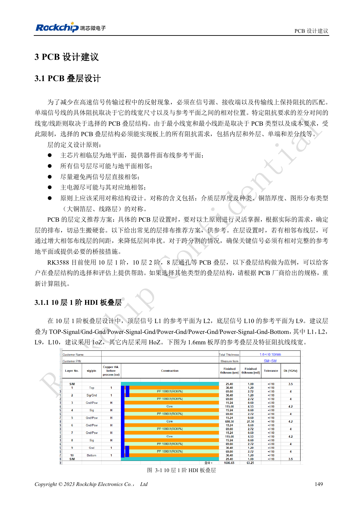
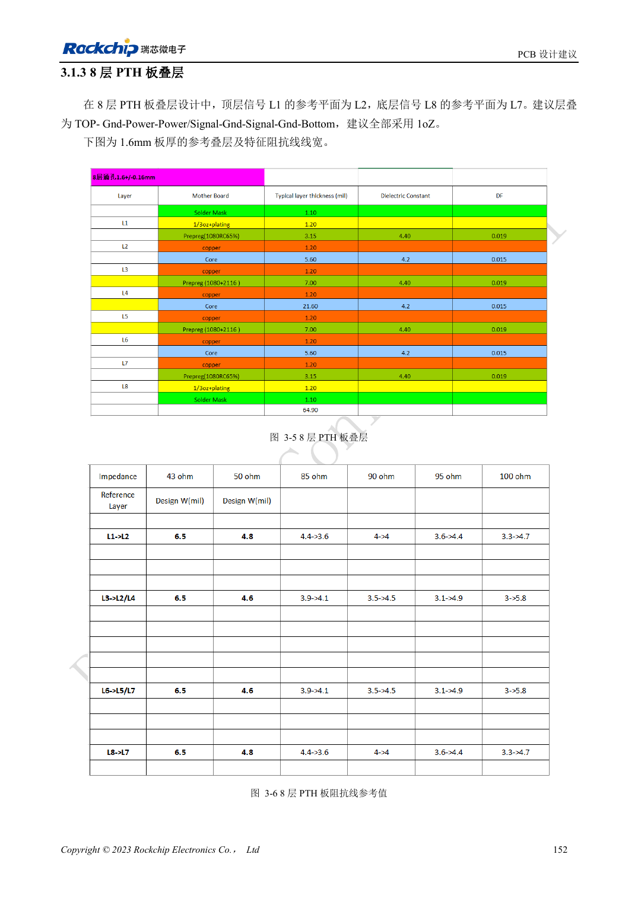
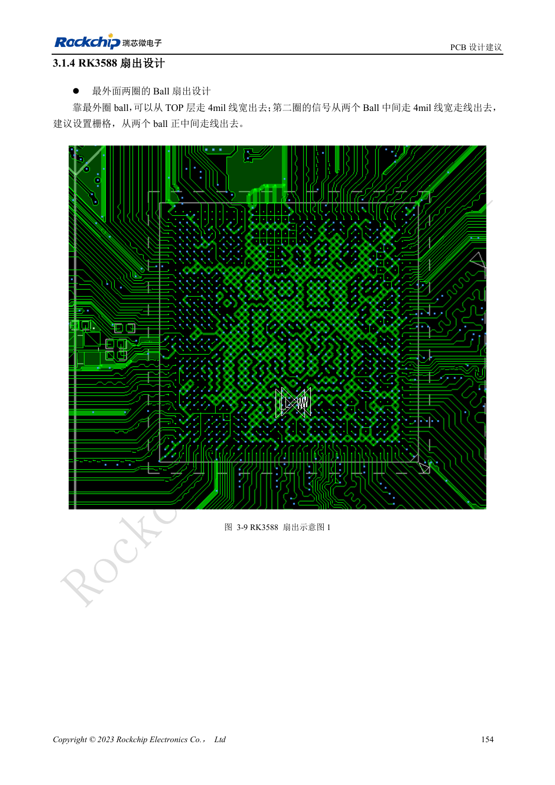

<!-- rk3588-hardware-v13-20261109 -->

# RK3588 PCB 叠层与扇出：HDI 和通孔板选择

本文依据 RK3588 Hardware Design Guide V1.3（2023-02-13）中英文原稿整理，面向芯片主板和载板设计审查。AIM7、LM7 载板须遵循模块接口定义；Sige7 可作为软件与外设验证起点。芯片能力不等于板卡接口清单，SDK/BSP、内核、板卡版本及固件需逐项核对。数值为原稿参考，未经 ArmSoM 硬件实测。

**RK3588 Hardware Design Guide V1.3 (2023-02-13), CN** · §3.1; §3.2

## 层数不是唯一决策

指南给出 10 层一阶 HDI、10 层二阶 HDI 和 8 层 PTH 示例。叠层应满足内外层单端及差分阻抗、回流、铜厚、加工与成本，而不是只复制层数。信号尽量邻接地，避免相邻信号层耦合，结构保持对称。换材料或板厚后必须由板厂重新计算线宽线距。

## 扇出约束必须回到工艺

最外两圈球位参考可用 4mil 扇出，但不能用局部扇出宽度替代全链路阻抗线宽。检查过孔、反焊盘、焊盘到电源铜的连接以及 DDR 模板。AIM7/LM7 载板使用模块连接器或 LGA 焊盘，不需复刻 SoC BGA 扇出；应按模块生产与连接文档确定工艺。

## 设计参数与检查表

| 项目 | 原稿参考值 |
| --- | --- |
| 参考叠层 | 10 层 HDI; 8 层 PTH |
| 板厚示例 | 1.6mm |
| 外排局部扇出 | 4mil |
| 走线长度范围 | PCB + 过孔 + 封装 |

## 参考原图

下图为原稿参考页，包含对应电路图或时序图；点击可查看大图。位号和元件值属于参考设计，不是 ArmSoM 产品原理图。

中文原稿 · PDF 166 · 3-1

中文原稿 · PDF 169 · 3-5

中文原稿 · PDF 171 · 3-9

## ArmSoM 开发路径

AIM7 适合基于计算模块设计载板；LM7 面向 LGA 模块集成；Sige7 可用于开发前期的软件与外设评估。使用模块时先检查哪些电源、DDR 与启动电路已在模块内完成，不应把芯片参考电路重复放到载板上。实际连接器、可用接口、电平与系统支持以对应产品资料为准。

- [ArmSoM AIM7](https://www.armsom.org/aim7) · [AIM7 Docs](https://docs.armsom.org/armsom-aim7)
- [ArmSoM Sige7](https://www.armsom.org/sige7) · [Sige7 Docs](https://docs.armsom.org/armsom-sige7)
- [ArmSoM LM7](https://www.armsom.org/lm7) · [LM7 Docs](https://docs.armsom.org/armsom-lm7)

## 继续阅读

- [RK3588 硬件设计系列：30 个主题](/zh/articles/rk3588-hardware-design-series/)
- [RK3588 UART、SPI、CAN、I2C 与 PWM 分配](/zh/articles/rk3588-serial-control-hardware/)
- [RK3588 高速 PCB：8GT/s 以上的焊盘与过孔优化](/zh/articles/rk3588-high-speed-pcb-review/)
