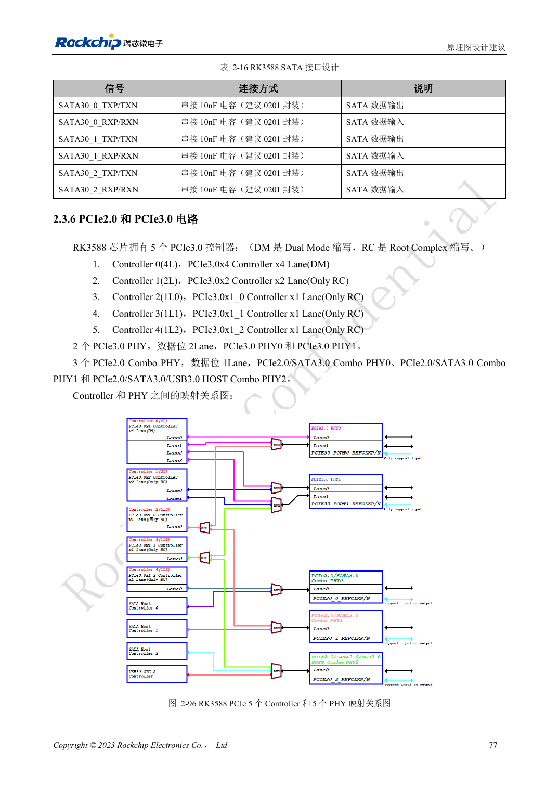
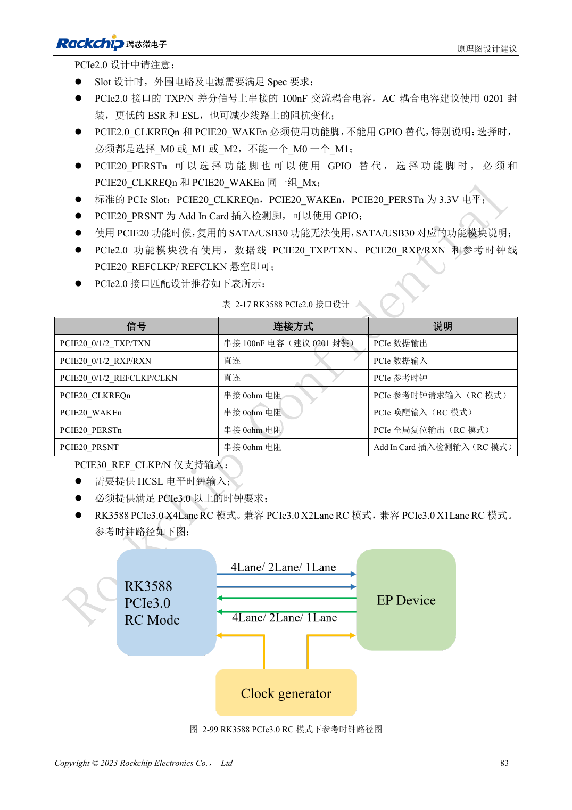

<!-- rk3588-hardware-v13-20261109 -->

# RK3588 PCIe：通道分配、参考时钟与电源

本文依据 RK3588 Hardware Design Guide V1.3（2023-02-13）中英文原稿整理，面向芯片主板和载板设计审查。AIM7、LM7 载板须遵循模块接口定义；Sige7 可作为软件与外设验证起点。芯片能力不等于板卡接口清单，SDK/BSP、内核、板卡版本及固件需逐项核对。数值为原稿参考，未经 ArmSoM 硬件实测。

**RK3588 Hardware Design Guide V1.3 (2023-02-13), CN** · §2.3.6; §2.2.2.16; §3.4.5–3.4.6

## 控制器能力不等于独立接口数

五个 PCIe 控制器与两组 PCIe3 PHY、三组 PCIe2 Combo PHY 有映射和复用关系。不能把 x4、x2 和各 x1 简单相加。PCIe3 REFCLK 仅输入，需要符合要求的 HCSL 时钟；PCIe2 REFCLK 可输入/输出，默认向 EP 输出。原生 ROM 不直接从 PCIe SSD 启动。

## 控制脚和电源不能漏审

PCIe2 CLKREQn/WAKEn 必须使用功能脚并同属一组 Mx；PERSTn 可用 GPIO，但使用功能脚时也要同组。标准插槽控制信号为 3.3V，按实际 IO 域转换。PCIe3 只启用一个端口时两个端口电源仍要供电。验证冷启动枚举、目标速率、休眠和长时间传输，不仅看设备是否出现。

## 设计参数与检查表

| 项目 | 原稿参考值 |
| --- | --- |
| PCIe 数据阻抗 | 85Ω ±10% |
| REFCLK 阻抗 | 100Ω ±10% |
| PCIe2 / PCIe3 耦合 | 100nF / 220nF; ±20% |
| 数据 / REFCLK 对内差 | <6mil / <12mil |
| 长度/过孔 | <6in / 建议 ≤2 |

## 参考原图

下图为原稿参考页，包含对应电路图或时序图；点击可查看大图。位号和元件值属于参考设计，不是 ArmSoM 产品原理图。

中文原稿 · PDF 94 · 2-96

中文原稿 · PDF 100 · 2-99

## ArmSoM 开发路径

AIM7 适合基于计算模块设计载板；LM7 面向 LGA 模块集成；Sige7 可用于开发前期的软件与外设评估。使用模块时先检查哪些电源、DDR 与启动电路已在模块内完成，不应把芯片参考电路重复放到载板上。实际连接器、可用接口、电平与系统支持以对应产品资料为准。

- [ArmSoM AIM7](https://www.armsom.org/aim7) · [AIM7 Docs](https://docs.armsom.org/armsom-aim7)
- [ArmSoM Sige7](https://www.armsom.org/sige7) · [Sige7 Docs](https://docs.armsom.org/armsom-sige7)
- [ArmSoM LM7](https://www.armsom.org/lm7) · [LM7 Docs](https://docs.armsom.org/armsom-lm7)

## 继续阅读

- [RK3588 硬件设计系列：30 个主题](/zh/articles/rk3588-hardware-design-series/)
- [RK3588 SATA：三路控制器与 Combo PHY 复用](/zh/articles/rk3588-sata-hardware-design/)
- [RK3588 摄像头：CSI、D/C PHY 与 CIF 接口规划](/zh/articles/rk3588-camera-hardware-design/)
