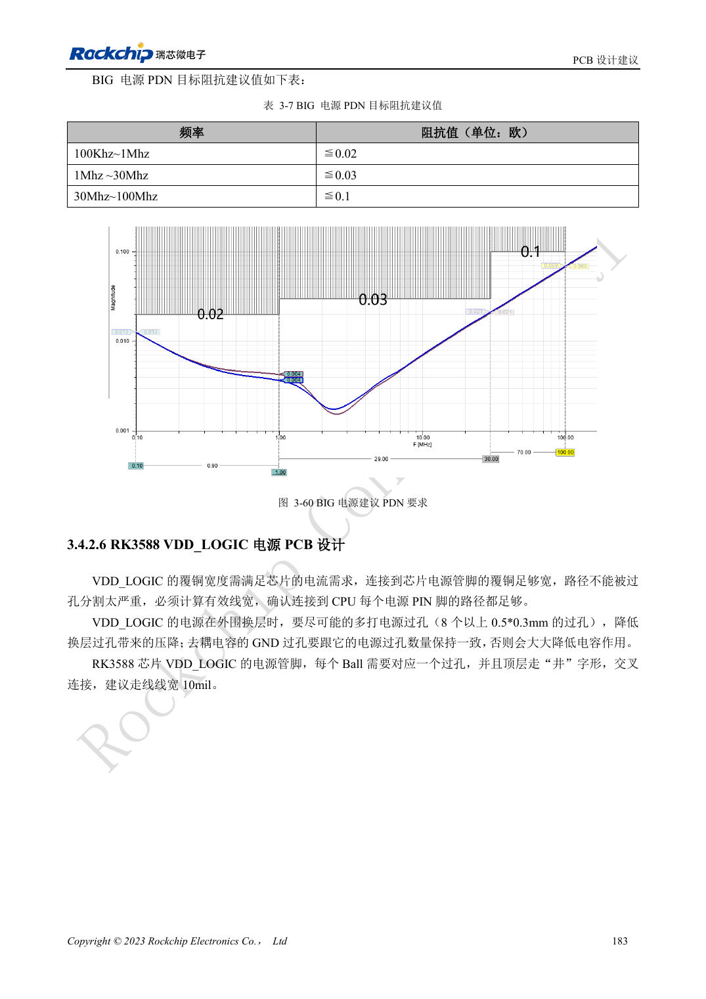

<!-- rk3588-hardware-v13-20261109 -->

# RK3588 电源 PCB 与 PDN：铜皮、回流和去耦

本文依据 RK3588 Hardware Design Guide V1.3（2023-02-13）中英文原稿整理，面向芯片主板和载板设计审查。AIM7、LM7 载板须遵循模块接口定义；Sige7 可作为软件与外设验证起点。芯片能力不等于板卡接口清单，SDK/BSP、内核、板卡版本及固件需逐项核对。数值为原稿参考，未经 ArmSoM 硬件实测。

**RK3588 Hardware Design Guide V1.3 (2023-02-13), CN** · §3.4.2

## 电容数量不是唯一指标

大电流 Buck 输入输出电容的负极过孔应与正极数量匹配，不能只给正极加孔。电源铜皮检查有效宽度与被过孔切割后的瓶颈，关键电源连接不宜采用热焊盘式细颈。RK806 要兼顾短电源路径与热分布，不是越近越好。

## 按频段检查目标阻抗

表 3-7 的 BIG PDN 目标随频率变化，不能用一个电容值替代整段阻抗要求。模型需要包含稳压器、平面、过孔、封装和电容 ESR/ESL。目标值是参考设计建议，不是 ArmSoM 实测。验证负载跳变的压降与振铃，并和温度、频率错误一起记录。

## 设计参数与检查表

| 项目 | 原稿参考值 |
| --- | --- |
| BIG PDN 100kHz–1MHz | ≤0.02Ω |
| BIG PDN 1–30MHz | ≤0.03Ω |
| BIG PDN 30–100MHz | ≤0.1Ω |
| 过孔电流参考（<1V） | 0.5A; 原稿 0.5×0.3mm 过孔示例 |

## 参考原图

下图为原稿参考页，包含对应电路图或时序图；点击可查看大图。位号和元件值属于参考设计，不是 ArmSoM 产品原理图。

中文原稿 · PDF 200 · 3-60

## ArmSoM 开发路径

AIM7 适合基于计算模块设计载板；LM7 面向 LGA 模块集成；Sige7 可用于开发前期的软件与外设评估。使用模块时先检查哪些电源、DDR 与启动电路已在模块内完成，不应把芯片参考电路重复放到载板上。实际连接器、可用接口、电平与系统支持以对应产品资料为准。

- [ArmSoM AIM7](https://www.armsom.org/aim7) · [AIM7 Docs](https://docs.armsom.org/armsom-aim7)
- [ArmSoM Sige7](https://www.armsom.org/sige7) · [Sige7 Docs](https://docs.armsom.org/armsom-sige7)
- [ArmSoM LM7](https://www.armsom.org/lm7) · [LM7 Docs](https://docs.armsom.org/armsom-lm7)

## 继续阅读

- [RK3588 硬件设计系列：30 个主题](/zh/articles/rk3588-hardware-design-series/)
- [RK3588 高速 PCB：8GT/s 以上的焊盘与过孔优化](/zh/articles/rk3588-high-speed-pcb-review/)
- [RK3588 热设计：参考热阻与整机验证](/zh/articles/rk3588-thermal-hardware-design/)
