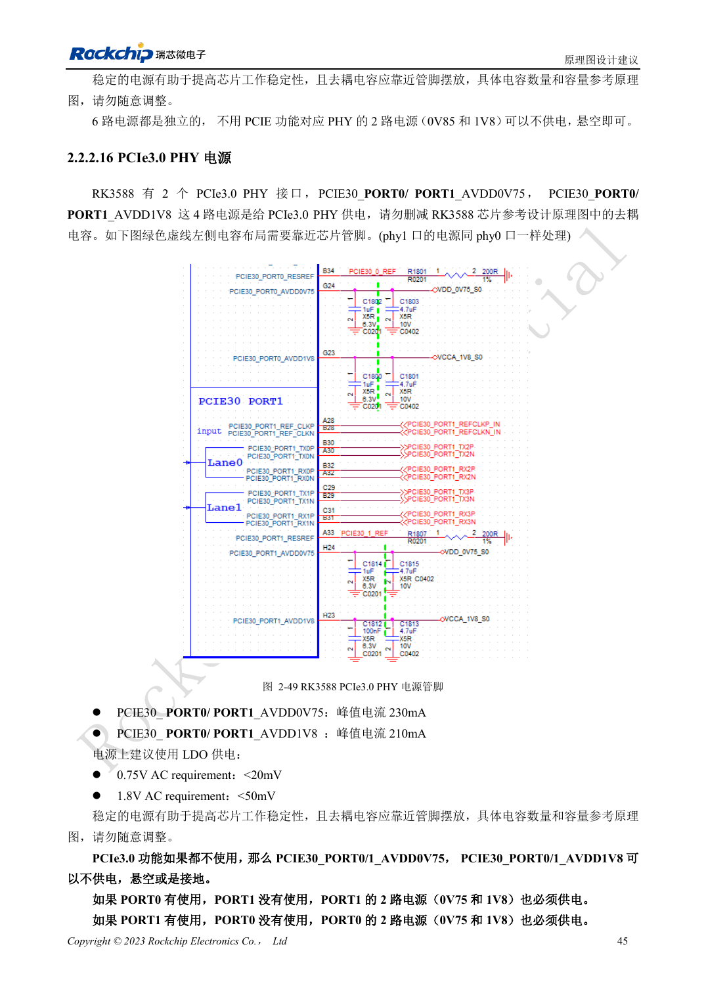
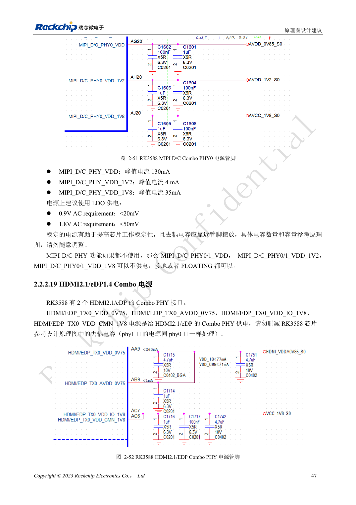

<!-- rk3588-hardware-v13-20261109 -->

# RK3588 电源域：首次供电与未用 PHY

本文依据 RK3588 Hardware Design Guide V1.3（2023-02-13）中英文原稿整理，面向芯片主板和载板设计审查。AIM7、LM7 载板须遵循模块接口定义；Sige7 可作为软件与外设验证起点。芯片能力不等于板卡接口清单，SDK/BSP、内核、板卡版本及固件需逐项核对。数值为原稿参考，未经 ArmSoM 硬件实测。

**RK3588 Hardware Design Guide V1.3 (2023-02-13), CN** · §2.2.1; §2.2.2

## 不用功能不等于可删电源

表 2-9 将 CPU、GPU、NPU、VDENC、DDR、PMU、SARADC、OTP、EMMCIO、VCCIO2、USB2 PHY 和 TYPEC0 相关供电列为首次上电必须项。逐路记录启动、运行、睡眠、负载、纹波与去耦。软件关功能不代表可以删除初次供电。

## 按具体 PHY 判断

PCIe3.0 任一端口使用时，两端口的 0.75V 与 1.8V 都必须供电。PCIe2.0 的 Combo PHY 规则不可套用。MIPI CSI 章节有 0V75 电源名与 0V9 峰值电流条目不一致，本文保留疑点，实际设计应回查原理图和规格，不猜测电压。

## 设计参数与检查表

| 项目 | 原稿参考值 |
| --- | --- |
| PCIe3.0 模拟纹波 | 0.75V: <20mV; 1.8V: <50mV |
| PCIe2.0 模拟纹波 | 0.85V: <20mV; 1.8V: <50mV |
| PCIe3.0 单端口工作 | 两个端口均供电 |

## 参考原图

下图为原稿参考页，包含对应电路图或时序图；点击可查看大图。位号和元件值属于参考设计，不是 ArmSoM 产品原理图。

中文原稿 · PDF 62 · 2-49

中文原稿 · PDF 64 · 2-51

## ArmSoM 开发路径

AIM7 适合基于计算模块设计载板；LM7 面向 LGA 模块集成；Sige7 可用于开发前期的软件与外设评估。使用模块时先检查哪些电源、DDR 与启动电路已在模块内完成，不应把芯片参考电路重复放到载板上。实际连接器、可用接口、电平与系统支持以对应产品资料为准。

- [ArmSoM AIM7](https://www.armsom.org/aim7) · [AIM7 Docs](https://docs.armsom.org/armsom-aim7)
- [ArmSoM Sige7](https://www.armsom.org/sige7) · [Sige7 Docs](https://docs.armsom.org/armsom-sige7)
- [ArmSoM LM7](https://www.armsom.org/lm7) · [LM7 Docs](https://docs.armsom.org/armsom-lm7)

## 继续阅读

- [RK3588 硬件设计系列：30 个主题](/zh/articles/rk3588-hardware-design-series/)
- [RK3588 启动与恢复：Maskrom、JTAG 和 UART](/zh/articles/rk3588-boot-debug-hardware/)
- [RK3588 上下电时序：RESETn 与 S0/S3](/zh/articles/rk3588-power-sequencing-design/)
