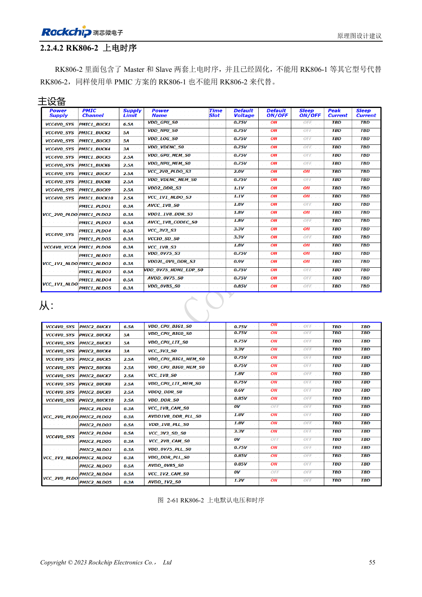

<!-- rk3588-hardware-v13-20261109 -->

# RK3588 上下电时序：RESETn 与 S0/S3

本文依据 RK3588 Hardware Design Guide V1.3（2023-02-13）中英文原稿整理，面向芯片主板和载板设计审查。AIM7、LM7 载板须遵循模块接口定义；Sige7 可作为软件与外设验证起点。芯片能力不等于板卡接口清单，SDK/BSP、内核、板卡版本及固件需逐项核对。数值为原稿参考，未经 ArmSoM 硬件实测。

**RK3588 Hardware Design Guide V1.3 (2023-02-13), CN** · §2.1.10.3; §2.2.1.2–2.2.1.3

## 具体时序优先

低压先上的原则不能代替各模块的明确顺序：例如 MIPI_D/C_PHY_VDD→1.8V→1.2V。应使用具体电源树，不按数字大小排序。最后电源稳定后至少 1ms 释放 RESETn，还需满足共享复位外设的要求。下电先拉低 RESETn，再关闭电源。

## 把睡眠与倒灌纳入测试

可变电平域的固定 1.8V 脚和可选电压脚必须一起属于 S0 或 S3，不能一开一关。测量冷启动、热复位、睡眠和掉电，检查 USB、HDMI、外部控制器是否向未上电 IO 倒灌。模块载板遵循模块输入与使能要求，不重新实现 SoC 内部供电。

## 设计参数与检查表

| 项目 | 原稿参考值 |
| --- | --- |
| 复位释放 | ≥1ms 最后电源稳定后 |
| 下电 | RESETn 拉低 → 关闭供电 |
| MIPI D/C 参考 | VDD → 1.8V → 1.2V |

## 参考原图

下图为原稿参考页，包含对应电路图或时序图；点击可查看大图。位号和元件值属于参考设计，不是 ArmSoM 产品原理图。

中文原稿 · PDF 72 · 2-61

## ArmSoM 开发路径

AIM7 适合基于计算模块设计载板；LM7 面向 LGA 模块集成；Sige7 可用于开发前期的软件与外设评估。使用模块时先检查哪些电源、DDR 与启动电路已在模块内完成，不应把芯片参考电路重复放到载板上。实际连接器、可用接口、电平与系统支持以对应产品资料为准。

- [ArmSoM AIM7](https://www.armsom.org/aim7) · [AIM7 Docs](https://docs.armsom.org/armsom-aim7)
- [ArmSoM Sige7](https://www.armsom.org/sige7) · [Sige7 Docs](https://docs.armsom.org/armsom-sige7)
- [ArmSoM LM7](https://www.armsom.org/lm7) · [LM7 Docs](https://docs.armsom.org/armsom-lm7)

## 继续阅读

- [RK3588 硬件设计系列：30 个主题](/zh/articles/rk3588-hardware-design-series/)
- [RK3588 电源域：首次供电与未用 PHY](/zh/articles/rk3588-power-rail-planning/)
- [RK3588 与 RK806：单、双 PMIC 电源树](/zh/articles/rk3588-rk806-pmic-design/)
