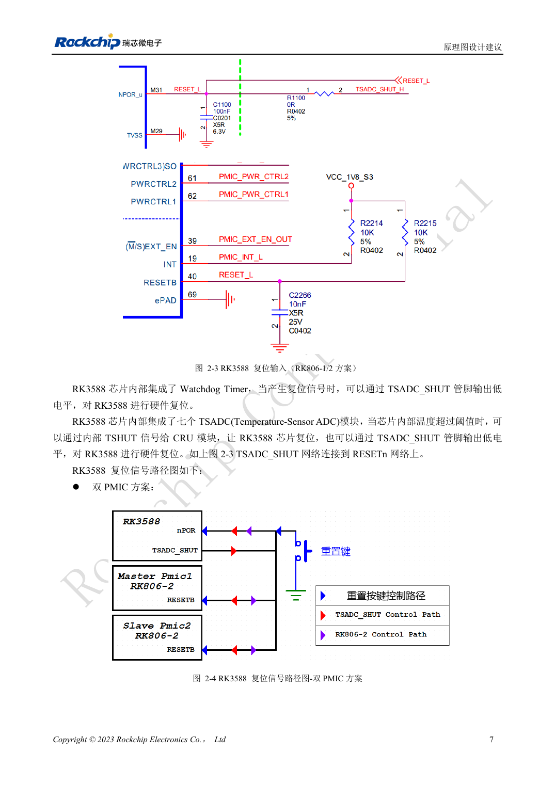
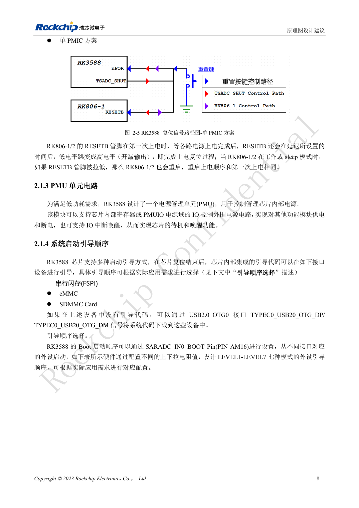

<!-- rk3588-hardware-v13-20261109 -->

# RK3588 复位、看门狗与过温保护

本文依据 RK3588 Hardware Design Guide V1.3（2023-02-13）中英文原稿整理，面向芯片主板和载板设计审查。AIM7、LM7 载板须遵循模块接口定义；Sige7 可作为软件与外设验证起点。芯片能力不等于板卡接口清单，SDK/BSP、内核、板卡版本及固件需逐项核对。数值为原稿参考，未经 ArmSoM 硬件实测。

**RK3588 Hardware Design Guide V1.3 (2023-02-13), CN** · §2.1.2; §3.4.1

## 复位脉宽与上电等待不同

NPOR_u（M31）为低有效外部输入。指南写至少 100 个 24MHz 周期，也写至少 4μs；100/24MHz≈4.167μs，因此不能把精确 4.000μs 当作合格。100nF 靠近引脚，上拉到 PMUIO1_1V8。最后一路电源稳定后至少 1ms 才释放复位，是另一项条件。

## 验证复位网络的全部参与者

RK806-1/2 的 RESETB 在上电延时后释放，工作或睡眠期间拉低会重新执行电源时序。看门狗及七个 TSADC 温度模块也可参与复位保护。同步观察 RESETn、电源和串口。按键路径应为按键→TVS→100Ω→滤波电容→CPU/PMIC，复位线远离 DCDC、金属接口和板边。

## 设计参数与检查表

| 项目 | 原稿参考值 |
| --- | --- |
| NPOR_u | M31; 低有效 |
| 最短复位时间 | 100 周期 @24MHz ≈4.167μs |
| 滤波电容 | 100nF |
| 上拉 | PMUIO1_1V8 |

## 参考原图

下图为原稿参考页，包含对应电路图或时序图；点击可查看大图。位号和元件值属于参考设计，不是 ArmSoM 产品原理图。

中文原稿 · PDF 24 · 2-3

中文原稿 · PDF 25 · 2-5

## ArmSoM 开发路径

AIM7 适合基于计算模块设计载板；LM7 面向 LGA 模块集成；Sige7 可用于开发前期的软件与外设评估。使用模块时先检查哪些电源、DDR 与启动电路已在模块内完成，不应把芯片参考电路重复放到载板上。实际连接器、可用接口、电平与系统支持以对应产品资料为准。

- [ArmSoM AIM7](https://www.armsom.org/aim7) · [AIM7 Docs](https://docs.armsom.org/armsom-aim7)
- [ArmSoM Sige7](https://www.armsom.org/sige7) · [Sige7 Docs](https://docs.armsom.org/armsom-sige7)
- [ArmSoM LM7](https://www.armsom.org/lm7) · [LM7 Docs](https://docs.armsom.org/armsom-lm7)

## 继续阅读

- [RK3588 硬件设计系列：30 个主题](/zh/articles/rk3588-hardware-design-series/)
- [RK3588 时钟电路：24MHz、32kHz 与布局](/zh/articles/rk3588-clock-hardware-design/)
- [RK3588 启动与恢复：Maskrom、JTAG 和 UART](/zh/articles/rk3588-boot-debug-hardware/)
