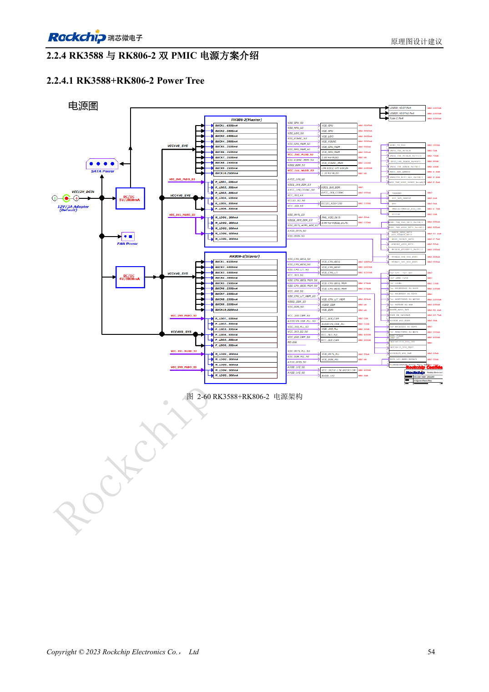
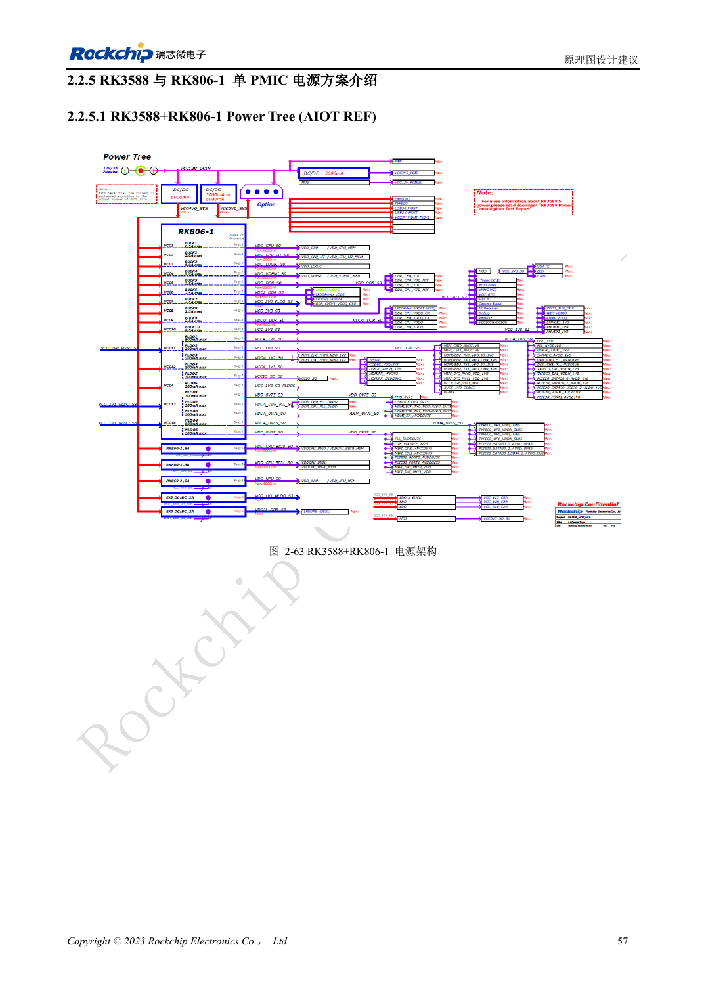

<!-- rk3588-hardware-v13-20261109 -->

# RK3588 与 RK806：单、双 PMIC 电源树

本文依据 RK3588 Hardware Design Guide V1.3（2023-02-13）中英文原稿整理，面向芯片主板和载板设计审查。AIM7、LM7 载板须遵循模块接口定义；Sige7 可作为软件与外设验证起点。芯片能力不等于板卡接口清单，SDK/BSP、内核、板卡版本及固件需逐项核对。数值为原稿参考，未经 ArmSoM 硬件实测。

**RK3588 Hardware Design Guide V1.3 (2023-02-13), CN** · §2.2.3–2.2.5

## 选择完整参考方案

RK806-2 双 PMIC 与 RK806-1 单 PMIC 加外部电源是不同架构，不能直接删掉一颗。输出分配、默认电压、时序、控制总线、睡眠和复位必须一起迁移。PMIC 的 2.7–5.5V 输入不是 ArmSoM 整板输入范围。

## 主从同步与布局

双 PMIC 用 EXT_EN 设置主从、SYNC/SYNC_CLK 同步，按参考连接 VDC、PWRON、RESET。单 PMIC 设主模式，SYNC/SYNC_CLK 留空。优先大电流路径和电容地回路，同时评估热量集中。最大电流不是所有温度下的持续输出承诺。

## 设计参数与检查表

| 项目 | 原稿参考值 |
| --- | --- |
| RK806 输入 | 2.7–5.5V |
| 封装 | 7×7mm QFN68 |
| 双 PMIC 参考 | RK806-2 |
| 单 PMIC 参考 | RK806-1 + 外部电源 |

## 参考原图

下图为原稿参考页，包含对应电路图或时序图；点击可查看大图。位号和元件值属于参考设计，不是 ArmSoM 产品原理图。

中文原稿 · PDF 71 · 2-60

中文原稿 · PDF 74 · 2-63

## ArmSoM 开发路径

AIM7 适合基于计算模块设计载板；LM7 面向 LGA 模块集成；Sige7 可用于开发前期的软件与外设评估。使用模块时先检查哪些电源、DDR 与启动电路已在模块内完成，不应把芯片参考电路重复放到载板上。实际连接器、可用接口、电平与系统支持以对应产品资料为准。

- [ArmSoM AIM7](https://www.armsom.org/aim7) · [AIM7 Docs](https://docs.armsom.org/armsom-aim7)
- [ArmSoM Sige7](https://www.armsom.org/sige7) · [Sige7 Docs](https://docs.armsom.org/armsom-sige7)
- [ArmSoM LM7](https://www.armsom.org/lm7) · [LM7 Docs](https://docs.armsom.org/armsom-lm7)

## 继续阅读

- [RK3588 硬件设计系列：30 个主题](/zh/articles/rk3588-hardware-design-series/)
- [RK3588 上下电时序：RESETn 与 S0/S3](/zh/articles/rk3588-power-sequencing-design/)
- [RK3588 DDR 原理图：LPDDR4/4X/5 与容量配置](/zh/articles/rk3588-ddr-circuit-design/)
