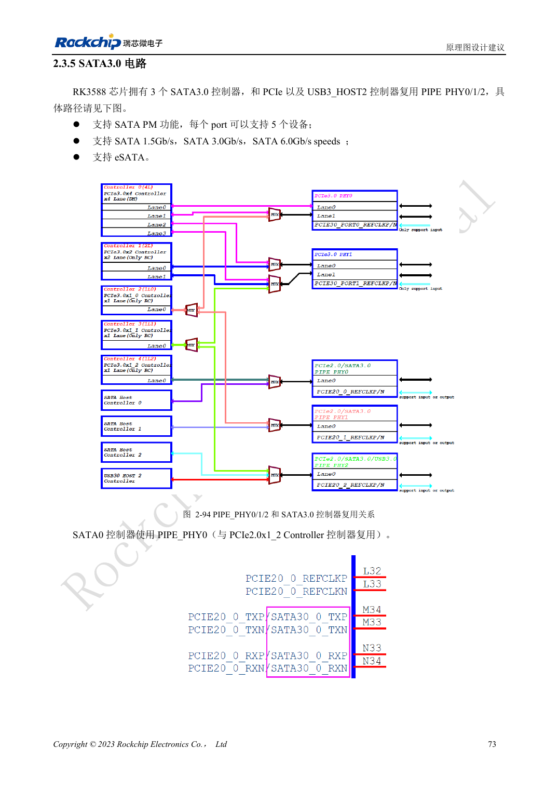

<!-- rk3588-hardware-v13-20261109 -->

# RK3588 SATA：三路控制器与 Combo PHY 复用

本文依据 RK3588 Hardware Design Guide V1.3（2023-02-13）中英文原稿整理，面向芯片主板和载板设计审查。AIM7、LM7 载板须遵循模块接口定义；Sige7 可作为软件与外设验证起点。芯片能力不等于板卡接口清单，SDK/BSP、内核、板卡版本及固件需逐项核对。数值为原稿参考，未经 ArmSoM 硬件实测。

**RK3588 Hardware Design Guide V1.3 (2023-02-13), CN** · §2.3.5; §3.4.9

## 先画复用矩阵

SATA0/1/2 使用 PIPE_PHY0/1/2，与 PCIe 共用，PHY2 还涉及 USB3 HOST2。指南列出 1.5/3/6Gbps 以及 Port Multiplier，但不等于任意 ArmSoM 板都引出三路 SATA，更不等于所有设备共享后仍满速。先选端口，再配置软件与连接器。

## 信号与硬盘电源分别验证

参考在 TX 和 RX 都串 10nF，推荐 0201；不能套用 PCIe 的耦合电容。SATA_CP_DET、MP_SWITCH、CP_POD 是共用控制资源，热插拔要单独设计。硬盘启动电流由外部电源提供并验证，测试持续写入、错误计数、热插拔与掉电恢复。

## 设计参数与检查表

| 项目 | 原稿参考值 |
| --- | --- |
| SATA 耦合 | 10nF ±20%; TX 与 RX |
| 差分目标 | 100Ω ±10%; 原稿备选 90Ω ±10% |
| 长度/对内差 | <6in / <6mil |
| 过孔数量建议 | 建议 ≤2 |

## 参考原图

下图为原稿参考页，包含对应电路图或时序图；点击可查看大图。位号和元件值属于参考设计，不是 ArmSoM 产品原理图。

中文原稿 · PDF 90 · 2-94

## ArmSoM 开发路径

AIM7 适合基于计算模块设计载板；LM7 面向 LGA 模块集成；Sige7 可用于开发前期的软件与外设评估。使用模块时先检查哪些电源、DDR 与启动电路已在模块内完成，不应把芯片参考电路重复放到载板上。实际连接器、可用接口、电平与系统支持以对应产品资料为准。

- [ArmSoM AIM7](https://www.armsom.org/aim7) · [AIM7 Docs](https://docs.armsom.org/armsom-aim7)
- [ArmSoM Sige7](https://www.armsom.org/sige7) · [Sige7 Docs](https://docs.armsom.org/armsom-sige7)
- [ArmSoM LM7](https://www.armsom.org/lm7) · [LM7 Docs](https://docs.armsom.org/armsom-lm7)

## 继续阅读

- [RK3588 硬件设计系列：30 个主题](/zh/articles/rk3588-hardware-design-series/)
- [RK3588 USB 与 Type-C：控制器、PHY 和恢复口](/zh/articles/rk3588-usb-typec-hardware-design/)
- [RK3588 PCIe：通道分配、参考时钟与电源](/zh/articles/rk3588-pcie-hardware-design/)
