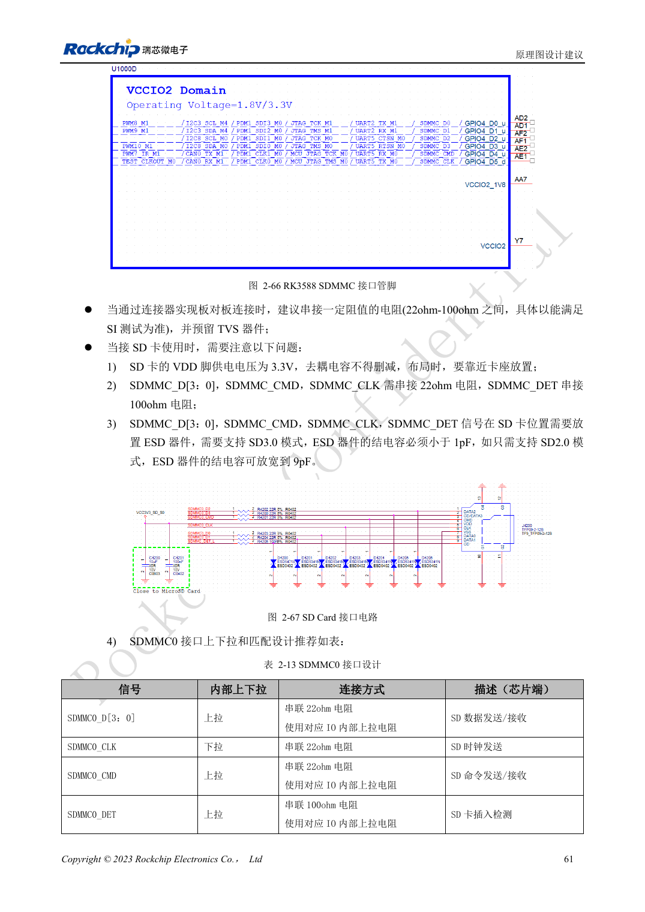

<!-- rk3588-hardware-v13-20261109 -->

# RK3588 SDMMC 与 SDIO Wi-Fi：电压切换和防护

本文依据 RK3588 Hardware Design Guide V1.3（2023-02-13）中英文原稿整理，面向芯片主板和载板设计审查。AIM7、LM7 载板须遵循模块接口定义；Sige7 可作为软件与外设验证起点。芯片能力不等于板卡接口清单，SDK/BSP、内核、板卡版本及固件需逐项核对。数值为原稿参考，未经 ArmSoM 硬件实测。

**RK3588 Hardware Design Guide V1.3 (2023-02-13), CN** · §2.3.1; §3.4.15–3.4.16; §3.4.21

## 卡电源与 IO 电压分开理解

SD 卡 VDD 为 3.3V，不能因为 SD3.0 协商后 VCCIO2 切换到 1.8V，就把卡电源也改成 1.8V。SDMMC 与 JTAG 的启动选择还取决于 SDMMC_DET。指南要求数据、CMD、CLK 串 22Ω，DET 串 100Ω，卡座旁保留去耦和 ESD。

## Wi-Fi 还需要时钟与射频检查

模块 IO、UART/PCM 方向和 32.768kHz 幅度必须核对，天线预留 π 匹配。晶体负载按模组需求选，指南 Wi-Fi 常温频率容限为 10ppm。SD3.0 防护器件结电容要求 <1pF，不能为了 ESD 任意增加总线负载。测试连接、吞吐、休眠唤醒和反复开关电源。

## 设计参数与检查表

| 项目 | 原稿参考值 |
| --- | --- |
| SD 卡 VDD | 3.3V |
| SD3.0 ESD 电容 | <1pF |
| 仅 SD2.0 ESD 参考 | ≤9pF |
| Data/CMD/CLK; DET | 22Ω; 100Ω |
| PCB 阻抗/长度 | 50Ω ±10% / <4in |
| 时钟与数据长度差 | <120mil |

## 参考原图

下图为原稿参考页，包含对应电路图或时序图；点击可查看大图。位号和元件值属于参考设计，不是 ArmSoM 产品原理图。

中文原稿 · PDF 78 · 2-67

## ArmSoM 开发路径

AIM7 适合基于计算模块设计载板；LM7 面向 LGA 模块集成；Sige7 可用于开发前期的软件与外设评估。使用模块时先检查哪些电源、DDR 与启动电路已在模块内完成，不应把芯片参考电路重复放到载板上。实际连接器、可用接口、电平与系统支持以对应产品资料为准。

- [ArmSoM AIM7](https://www.armsom.org/aim7) · [AIM7 Docs](https://docs.armsom.org/armsom-aim7)
- [ArmSoM Sige7](https://www.armsom.org/sige7) · [Sige7 Docs](https://docs.armsom.org/armsom-sige7)
- [ArmSoM LM7](https://www.armsom.org/lm7) · [LM7 Docs](https://docs.armsom.org/armsom-lm7)

## 继续阅读

- [RK3588 硬件设计系列：30 个主题](/zh/articles/rk3588-hardware-design-series/)
- [RK3588 FSPI Flash：启动、供电与匹配](/zh/articles/rk3588-fspi-boot-hardware/)
- [RK3588 USB 与 Type-C：控制器、PHY 和恢复口](/zh/articles/rk3588-usb-typec-hardware-design/)
