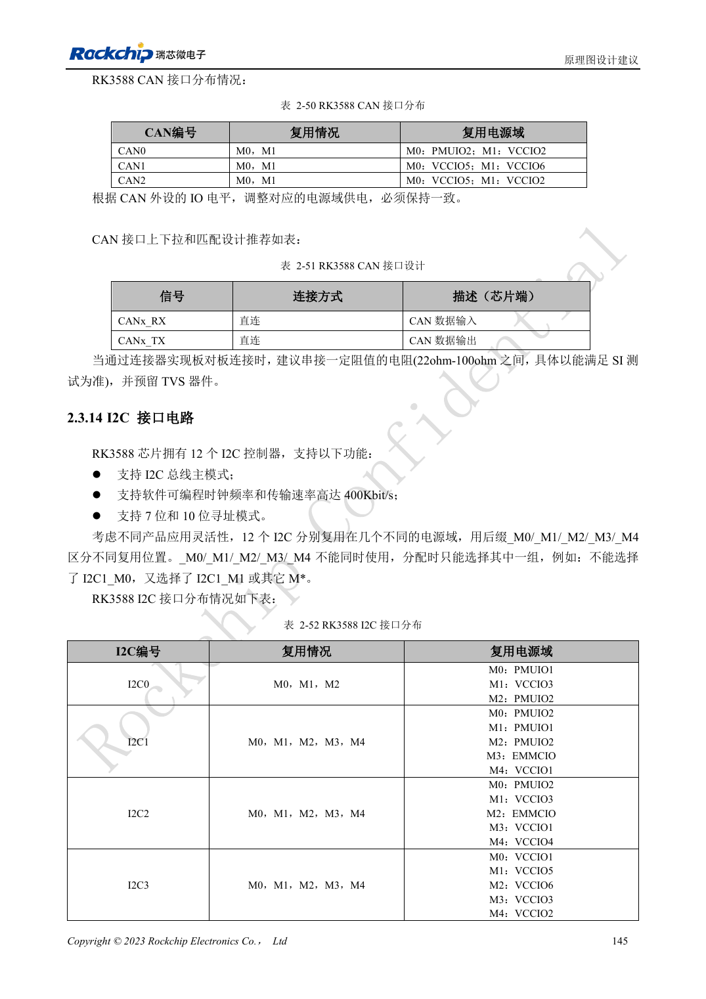

<!-- rk3588-hardware-v13-20261109 -->

# RK3588 UART、SPI、CAN、I2C 与 PWM 分配

本文依据 RK3588 Hardware Design Guide V1.3（2023-02-13）中英文原稿整理，面向芯片主板和载板设计审查。AIM7、LM7 载板须遵循模块接口定义；Sige7 可作为软件与外设验证起点。芯片能力不等于板卡接口清单，SDK/BSP、内核、板卡版本及固件需逐项核对。数值为原稿参考，未经 ArmSoM 硬件实测。

**RK3588 Hardware Design Guide V1.3 (2023-02-13), CN** · §2.3.11–2.3.15

## 同一外设的 Mx 不要混拼

UART、SPI、CAN、I2C 的不同 M0/M1/M2 位置是复用选项，不是可同时使用的独立控制器。同一组信号应按指南选择完整复用组并核对电源域。SPI2 默认用于 PMIC，不建议为增加外设随意占用。CAN 还需要外部收发器，不能将 SoC TX/RX 当总线差分线。

## 把外设协议与引脚表分开核实

I2C 上拉参考 2.2kΩ，实际取决于总线负载和电平；HDMI DDC 是专用总线。V1.3 CAN 章节写 CAN2.0B、1Mbps，不据此推广为 CAN FD。原稿 I2C 表出现 PMUIO3/4/5/6 等与电源域表不一致的名称，必须按实际 TRM 和原理图复核，不能直接用于引脚配置。

## 设计参数与检查表

| 项目 | 原稿参考值 |
| --- | --- |
| UART / 通用 SPI | 10 / 5 控制器 |
| CAN 原稿范围 | 3 控制器; CAN2.0B; 1Mbps |
| I2C 参考 | 最高 400Kbit/s; 2.2kΩ 上拉 |
| 原稿 PWM 数量 | 4 控制器 ×4 通道 |

## 参考原图

下图为原稿参考页，包含对应电路图或时序图；点击可查看大图。位号和元件值属于参考设计，不是 ArmSoM 产品原理图。

中文原稿 · PDF 162 · table:2-50

## ArmSoM 开发路径

AIM7 适合基于计算模块设计载板；LM7 面向 LGA 模块集成；Sige7 可用于开发前期的软件与外设评估。使用模块时先检查哪些电源、DDR 与启动电路已在模块内完成，不应把芯片参考电路重复放到载板上。实际连接器、可用接口、电平与系统支持以对应产品资料为准。

- [ArmSoM AIM7](https://www.armsom.org/aim7) · [AIM7 Docs](https://docs.armsom.org/armsom-aim7)
- [ArmSoM Sige7](https://www.armsom.org/sige7) · [Sige7 Docs](https://docs.armsom.org/armsom-sige7)
- [ArmSoM LM7](https://www.armsom.org/lm7) · [LM7 Docs](https://docs.armsom.org/armsom-lm7)

## 继续阅读

- [RK3588 硬件设计系列：30 个主题](/zh/articles/rk3588-hardware-design-series/)
- [RK3588 GPIO 与 SARADC：电源域和按键边界](/zh/articles/rk3588-gpio-saradc-hardware/)
- [RK3588 PCB 叠层与扇出：HDI 和通孔板选择](/zh/articles/rk3588-pcb-stackup-fanout/)
