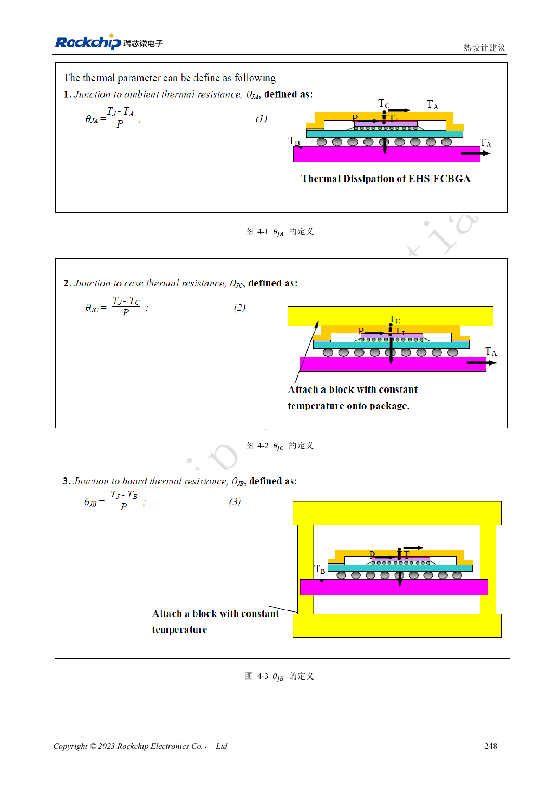

<!-- rk3588-hardware-v13-20261109 -->

# RK3588 热设计：参考热阻与整机验证

本文依据 RK3588 Hardware Design Guide V1.3（2023-02-13）中英文原稿整理，面向芯片主板和载板设计审查。AIM7、LM7 载板须遵循模块接口定义；Sige7 可作为软件与外设验证起点。芯片能力不等于板卡接口清单，SDK/BSP、内核、板卡版本及固件需逐项核对。数值为原稿参考，未经 ArmSoM 硬件实测。

**RK3588 Hardware Design Guide V1.3 (2023-02-13), CN** · §4

## 仿真热阻不等于模块温升

表 4-1 的热阻来自指定封装和 JEDEC PCB 有限元模型：101×114mm、1.6mm、10 层、无散热片。不能直接套用到 AIM7 模块、LM7 载板或 Sige7 的机箱。θJA、θJB、θJC 的参考点不同，不能互换后计算散热器。

## 热路径和软件保护一起验收

确认芯片到导热界面、散热器、外壳和环境的路径，检查安装压力与电气绝缘。原稿建议 RK3588 与 RK806 间隔 20–50mm，仅为板级参考，模块内部不能据此改造。用实际 BSP 温控策略测试持续负载、频率、温度和应用延迟，不能通过关闭保护证明性能。

## 设计参数与检查表

| 项目 | 原稿参考值 |
| --- | --- |
| 原稿 θJA / θJB / θJC | 8.7 / 3.5 / 0.12 °C/W; 仿真 |
| 原稿 PCB | 101×114mm; 1.6mm; 10 层 |
| PMIC 与 SoC 间距参考 | RK3588–RK806: 20–50mm |

## 参考原图

下图为原稿参考页，包含对应电路图或时序图；点击可查看大图。位号和元件值属于参考设计，不是 ArmSoM 产品原理图。

中文原稿 · PDF 265 · 4-1

## ArmSoM 开发路径

AIM7 适合基于计算模块设计载板；LM7 面向 LGA 模块集成；Sige7 可用于开发前期的软件与外设评估。使用模块时先检查哪些电源、DDR 与启动电路已在模块内完成，不应把芯片参考电路重复放到载板上。实际连接器、可用接口、电平与系统支持以对应产品资料为准。

- [ArmSoM AIM7](https://www.armsom.org/aim7) · [AIM7 Docs](https://docs.armsom.org/armsom-aim7)
- [ArmSoM Sige7](https://www.armsom.org/sige7) · [Sige7 Docs](https://docs.armsom.org/armsom-sige7)
- [ArmSoM LM7](https://www.armsom.org/lm7) · [LM7 Docs](https://docs.armsom.org/armsom-lm7)

## 继续阅读

- [RK3588 硬件设计系列：30 个主题](/zh/articles/rk3588-hardware-design-series/)
- [RK3588 电源 PCB 与 PDN：铜皮、回流和去耦](/zh/articles/rk3588-power-pcb-pdn-design/)
- [RK3588 ESD 与 EMI：接口保护和整机回流](/zh/articles/rk3588-esd-emi-hardware-design/)
