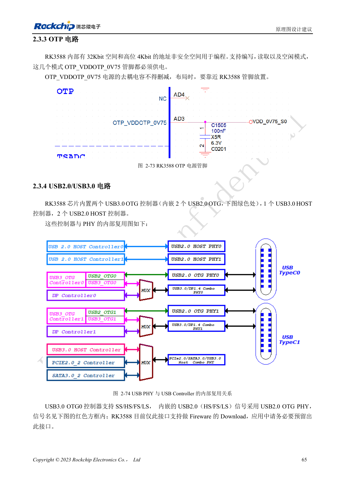
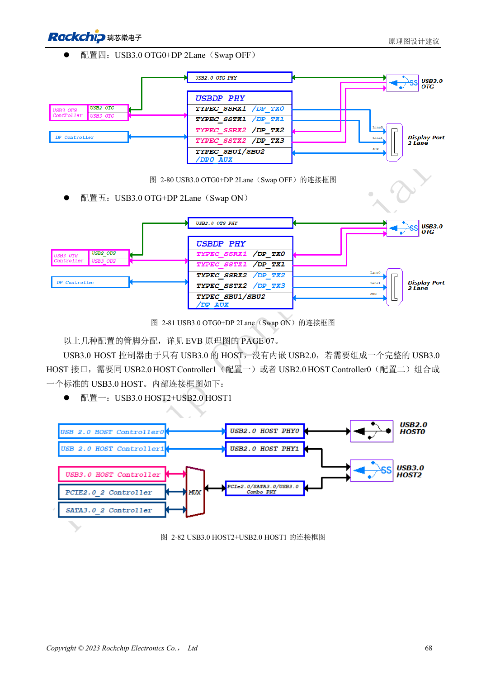

<!-- rk3588-hardware-v13-20261109 -->

# RK3588 USB 与 Type-C：控制器、PHY 和恢复口

本文依据 RK3588 Hardware Design Guide V1.3（2023-02-13）中英文原稿整理，面向芯片主板和载板设计审查。AIM7、LM7 载板须遵循模块接口定义；Sige7 可作为软件与外设验证起点。芯片能力不等于板卡接口清单，SDK/BSP、内核、板卡版本及固件需逐项核对。数值为原稿参考，未经 ArmSoM 硬件实测。

**RK3588 Hardware Design Guide V1.3 (2023-02-13), CN** · §2.3.4; §3.4.10–3.4.11

## 区分控制器和物理端口

芯片有两个 USB3 OTG、一个 USB3 HOST、两个 USB2 HOST；独立 USB3 HOST 没有内嵌 USB2，完整主机口需与一个 USB2 HOST 配合。OTG0 的 USB2 路径用于固件下载，必须保留。Type-C 的 USB3 与 DP 分配、正反插和外部控制器需一起设计。

## 验证供电角色和完整链路

USB3 HOST2 与 SATA/PCIe 共用资源，不能把三个功能都算成同时可用接口。检查 VBUS 源/受电角色、防倒灌、连接器与线缆。先验证 USB2 恢复，再做 USB3 枚举与持续传输、热插拔及 Type-C 两种方向。载板长度预算应包含模块和连接器。

## 设计参数与检查表

| 项目 | 原稿参考值 |
| --- | --- |
| USB2 差分阻抗 | 90Ω ±10%; 对内差 <20mil |
| USB3 差分阻抗 | 90Ω ±10%; 对内差 <6mil |
| USB3 长度/过孔 | <6in; 建议 ≤2 |
| USB3 ESD 电容 | ≤0.2pF |

## 参考原图

下图为原稿参考页，包含对应电路图或时序图；点击可查看大图。位号和元件值属于参考设计，不是 ArmSoM 产品原理图。

中文原稿 · PDF 82 · 2-74

中文原稿 · PDF 85 · 2-82

## ArmSoM 开发路径

AIM7 适合基于计算模块设计载板；LM7 面向 LGA 模块集成；Sige7 可用于开发前期的软件与外设评估。使用模块时先检查哪些电源、DDR 与启动电路已在模块内完成，不应把芯片参考电路重复放到载板上。实际连接器、可用接口、电平与系统支持以对应产品资料为准。

- [ArmSoM AIM7](https://www.armsom.org/aim7) · [AIM7 Docs](https://docs.armsom.org/armsom-aim7)
- [ArmSoM Sige7](https://www.armsom.org/sige7) · [Sige7 Docs](https://docs.armsom.org/armsom-sige7)
- [ArmSoM LM7](https://www.armsom.org/lm7) · [LM7 Docs](https://docs.armsom.org/armsom-lm7)

## 继续阅读

- [RK3588 硬件设计系列：30 个主题](/zh/articles/rk3588-hardware-design-series/)
- [RK3588 SDMMC 与 SDIO Wi-Fi：电压切换和防护](/zh/articles/rk3588-sdmmc-sdio-wifi-design/)
- [RK3588 SATA：三路控制器与 Combo PHY 复用](/zh/articles/rk3588-sata-hardware-design/)
