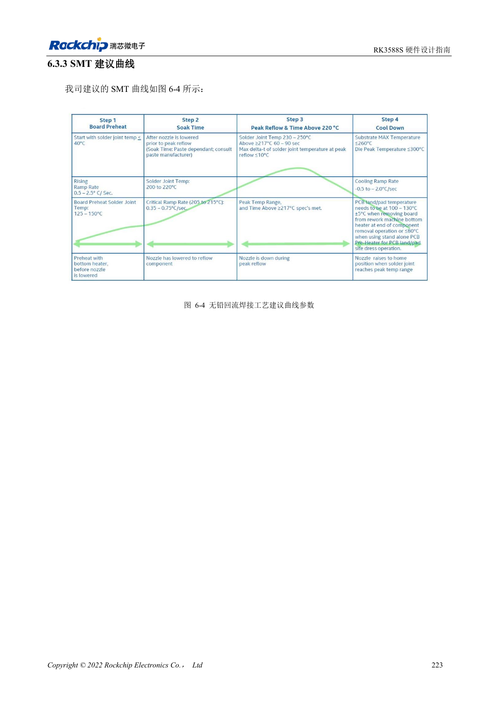
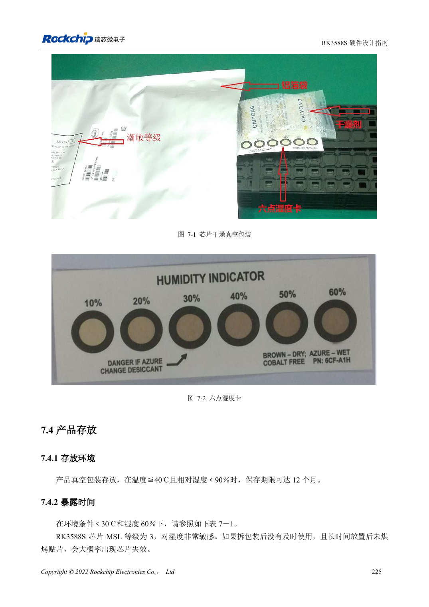

<!-- rk3588s-hardware-v12-20261109 -->

# RK3588S 焊接与存储：回流曲线、MSL3 和烘烤记录

本文依据 RK3588S Hardware Design Guide V1.2（2023-12-14）中文原稿，面向电路与 PCB 设计审查。CM7S 载板需遵循模块接口定义，Sige7S 可用于软件与外设评估。芯片能力不等于板卡接口清单；SDK/BSP、内核、板卡版本、固件及复用须逐项核对。数值为原稿参考，未经 ArmSoM 硬件实测。

**RK3588S Hardware Design Guide V1.2 (2023-12-14), CN** · §6–7

## 工艺参数适用于芯片封装

指南回流曲线针对 RK3588S 芯片，不是 CM7S 整模块或 Sige7S 成品板的返修许可。锡膏冷藏参考 2–10℃，常温回温 3–4 小时；实际合金、助焊剂、板材热容量和连接器耐热限制由生产工艺统一确认。模块连接方式必须按产品装配资料处理。

## 以累计暴露时间管理湿敏器件

RK3588S 标为 MSL3，在 ≤30℃/60%RH 条件下暴露寿命 168 小时。开袋后记录湿度卡、时间和保存环境，不能每次重新装袋就把计时归零。表 7-2 烘烤时间按超时是否超过 72 小时及温度分别列出，且限定封装厚度 ≤1.4mm。原表 MSL1 行“300℃”疑似错误，本篇不将其作为生产条件。

## 设计参数与检查表

| 项目 | 原稿参考值 |
| --- | --- |
| MSL3 暴露寿命 | 168h，≤30°C /60%RH |
| 烘烤 125°C +10/-0°C（超时 >72h / ≤72h） | 9h /7h |
| 烘烤 90°C +8/-0°C（超时 >72h / ≤72h） | 33h /23h |
| 烘烤 40°C +5/-0°C（超时 >72h / ≤72h） | 13 天 /9 天 |
| 烘烤表封装限制 | 厚度 ≤1.4mm |

## 参考原图

本批没有对应英文设计指南，四语统一采用中文原稿截图，图注已本地化。点击图片查看清晰原图；图片用于核对电路和布局，正文与参数表可复制。页码为 PDF 物理页码。

中文原稿 · PDF 238 · 6-4

中文原稿 · PDF 240 · 7-2

## ArmSoM 开发路径

CM7S 适合定制载板：先确认模块已经完成的电源、DDR 与启动电路，再设计连接器外侧。Sige7S 可作为软件和外设评估起点。两种产品均须以对应版本资料核对接口是否引出、连接器针脚、电平、系统镜像与散热条件，不能把芯片原理图直接当成产品接线图。

- [ArmSoM CM7S](https://www.armsom.org/cm7s) · [CM7S Docs](https://docs.armsom.org/armsom-cm7s)
- [ArmSoM Sige7S](https://www.armsom.org/sige7s) · [Sige7S Docs](https://docs.armsom.org/armsom-sige7s)

## 继续阅读

- [RK3588S 硬件设计系列：30 个主题](/zh/articles/rk3588s-hardware-design-series/)
- [RK3588S ESD 与 EMI：接口保护和整机回流](/zh/articles/rk3588s-esd-emi-hardware-design/)
