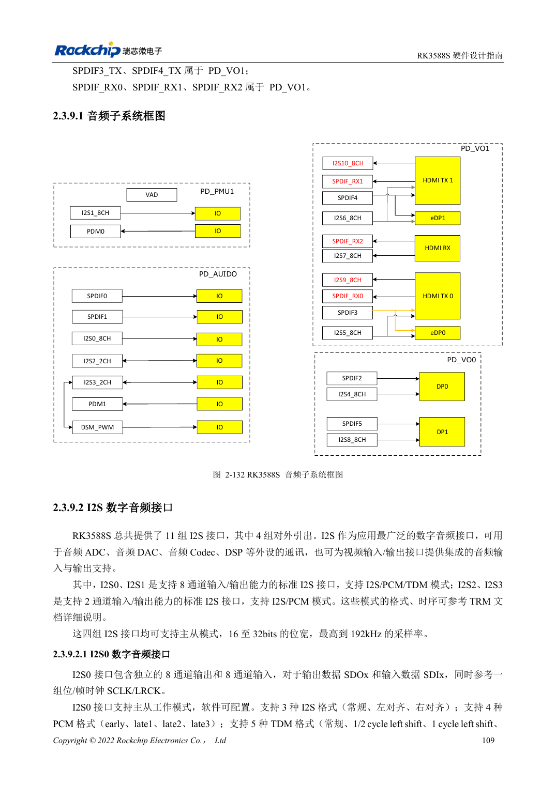
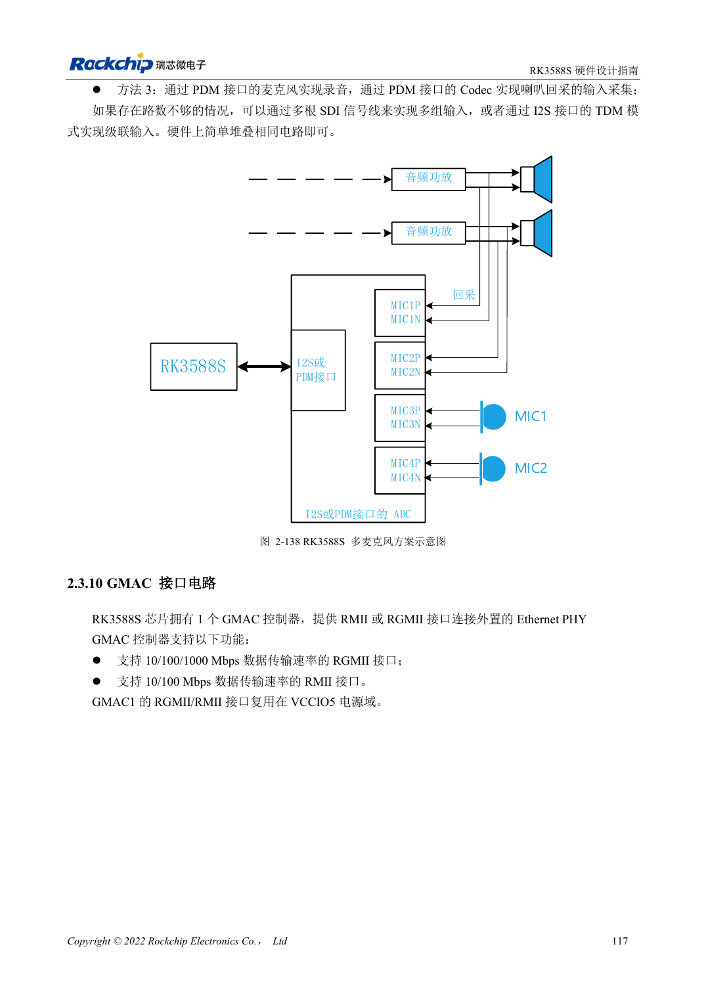

<!-- rk3588s-hardware-v12-20261109 -->

# RK3588S 音频硬件：I2S、PDM 与多麦克风

本文依据 RK3588S Hardware Design Guide V1.2（2023-12-14）中文原稿，面向电路与 PCB 设计审查。CM7S 载板需遵循模块接口定义，Sige7S 可用于软件与外设评估。芯片能力不等于板卡接口清单；SDK/BSP、内核、板卡版本、固件及复用须逐项核对。数值为原稿参考，未经 ArmSoM 硬件实测。

**RK3588S Hardware Design Guide V1.2 (2023-12-14), CN** · §2.3.9; §3.4.18

## 区分内部与外部音频接口

11 组 I2S 中只有 4 组对外引出，其余用于视频配套。I2S0/1 支持 8 通道与 I2S/PCM/TDM，I2S2/3 为 2 通道 I2S/PCM。不能把内部接口数作为载板可用接口数。选择 Codec/ADC/DAC 后确定主从、MCLK、SCLK/LRCK、位宽与采样率。

## 时钟分配和模拟路径一起检查

多设备 I2S/PDM 时钟采用菊花链，避免长支路；时钟建议在 SoC 端串 22Ω且分开包地。模拟麦克风和功放线路远离 DDR、显示、RF 与电感。多麦克风加回采还要验证通道同步与软件映射，不只检查是否录到声音。

## 设计参数与检查表

| 项目 | 原稿参考值 |
| --- | --- |
| 外部 I2S | 4 组 |
| I2S0/1; I2S2/3 | 8 通道; 2 通道 |
| 原稿位宽/采样率 | 16–32bit / 最高 192kHz |
| 时钟串阻参考 | 22Ω |

## 参考原图

本批没有对应英文设计指南，四语统一采用中文原稿截图，图注已本地化。点击图片查看清晰原图；图片用于核对电路和布局，正文与参数表可复制。页码为 PDF 物理页码。

中文原稿 · PDF 124 · 2-132

中文原稿 · PDF 132 · 2-138

## ArmSoM 开发路径

CM7S 适合定制载板：先确认模块已经完成的电源、DDR 与启动电路，再设计连接器外侧。Sige7S 可作为软件和外设评估起点。两种产品均须以对应版本资料核对接口是否引出、连接器针脚、电平、系统镜像与散热条件，不能把芯片原理图直接当成产品接线图。

- [ArmSoM CM7S](https://www.armsom.org/cm7s) · [CM7S Docs](https://docs.armsom.org/armsom-cm7s)
- [ArmSoM Sige7S](https://www.armsom.org/sige7s) · [Sige7S Docs](https://docs.armsom.org/armsom-sige7s)

## 继续阅读

- [RK3588S 硬件设计系列：30 个主题](/zh/articles/rk3588s-hardware-design-series/)
- [RK3588S DP 与 eDP：PHY 复用、AUX 与耦合](/zh/articles/rk3588s-dp-edp-hardware-design/)
- [RK3588S 以太网硬件：GMAC、PHY 与时钟方向](/zh/articles/rk3588s-gmac-hardware-design/)
