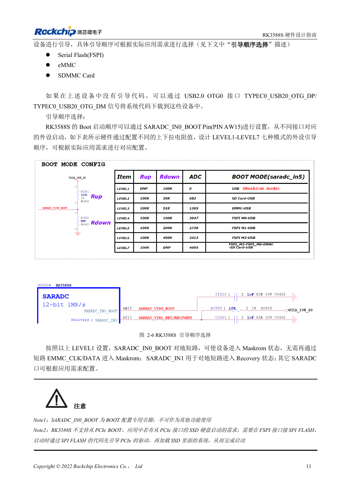
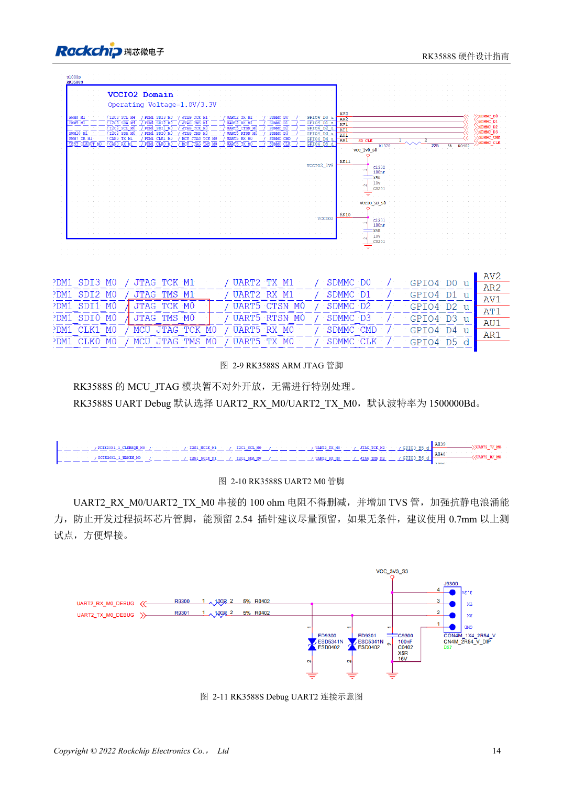

<!-- rk3588s-hardware-v12-20261109 -->

# RK3588S 启动与恢复：Maskrom、JTAG 和 UART

本文依据 RK3588S Hardware Design Guide V1.2（2023-12-14）中文原稿，面向电路与 PCB 设计审查。CM7S 载板需遵循模块接口定义，Sige7S 可用于软件与外设评估。芯片能力不等于板卡接口清单；SDK/BSP、内核、板卡版本、固件及复用须逐项核对。数值为原稿参考，未经 ArmSoM 硬件实测。

**RK3588S Hardware Design Guide V1.2 (2023-12-14), CN** · §2.1.4–2.1.6; §2.3.2

## 留下可用的恢复路径

SARADC_IN0_BOOT（AW15）专用于启动选择，LEVEL1 用于 Maskrom。下载必须预留 USB2.0 OTG0。Boot ROM 不直接从 PCIe SSD 启动，参考路径是先由 FSPI Flash 的代码初始化 PCIe，再加载 SSD 系统。系统位于 NVMe 不等于 ROM 原生支持 NVMe 启动。

## 保留调试与默认上拉

SDMMC_DET 在复位前稳定：低为 SDMMC，高为 ARM JTAG。日志默认 UART2_M0、1500000bps，RX/TX 的 100Ω 串阻和 TVS 应保留。SARADC_IN1 的 10kΩ 上拉避免悬空导致下载状态异常。模块用户先查连接器针脚与电平，不能把 SoC 球位当载板针脚。

## 设计参数与检查表

| 项目 | 原稿参考值 |
| --- | --- |
| 启动引脚 | SARADC_IN0_BOOT / AW15 |
| 调试 | UART2_M0 / 1500000bps |
| SDMMC_DET | 0: SDMMC; 1: ARM JTAG |
| 恢复上拉 | SARADC_IN1: 10kΩ |

## 参考原图

本批没有对应英文设计指南，四语统一采用中文原稿截图，图注已本地化。点击图片查看清晰原图；图片用于核对电路和布局，正文与参数表可复制。页码为 PDF 物理页码。

中文原稿 · PDF 26 · 2-6

中文原稿 · PDF 29 · 2-10

## ArmSoM 开发路径

CM7S 适合定制载板：先确认模块已经完成的电源、DDR 与启动电路，再设计连接器外侧。Sige7S 可作为软件和外设评估起点。两种产品均须以对应版本资料核对接口是否引出、连接器针脚、电平、系统镜像与散热条件，不能把芯片原理图直接当成产品接线图。

- [ArmSoM CM7S](https://www.armsom.org/cm7s) · [CM7S Docs](https://docs.armsom.org/armsom-cm7s)
- [ArmSoM Sige7S](https://www.armsom.org/sige7s) · [Sige7S Docs](https://docs.armsom.org/armsom-sige7s)

## 继续阅读

- [RK3588S 硬件设计系列：30 个主题](/zh/articles/rk3588s-hardware-design-series/)
- [RK3588S 复位、看门狗与过温保护](/zh/articles/rk3588s-reset-watchdog-hardware/)
- [RK3588S 电源域：首次供电与未用 PHY](/zh/articles/rk3588s-power-rail-planning/)
