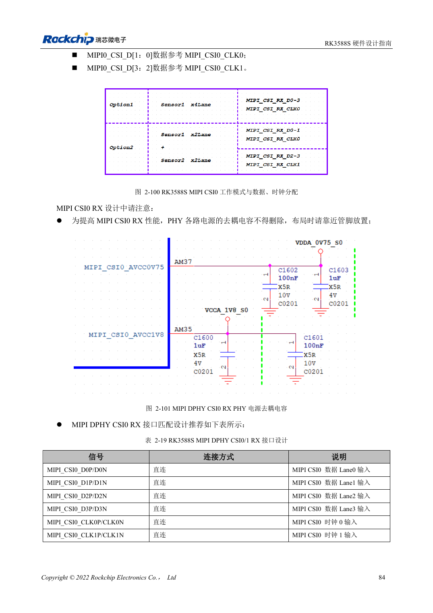
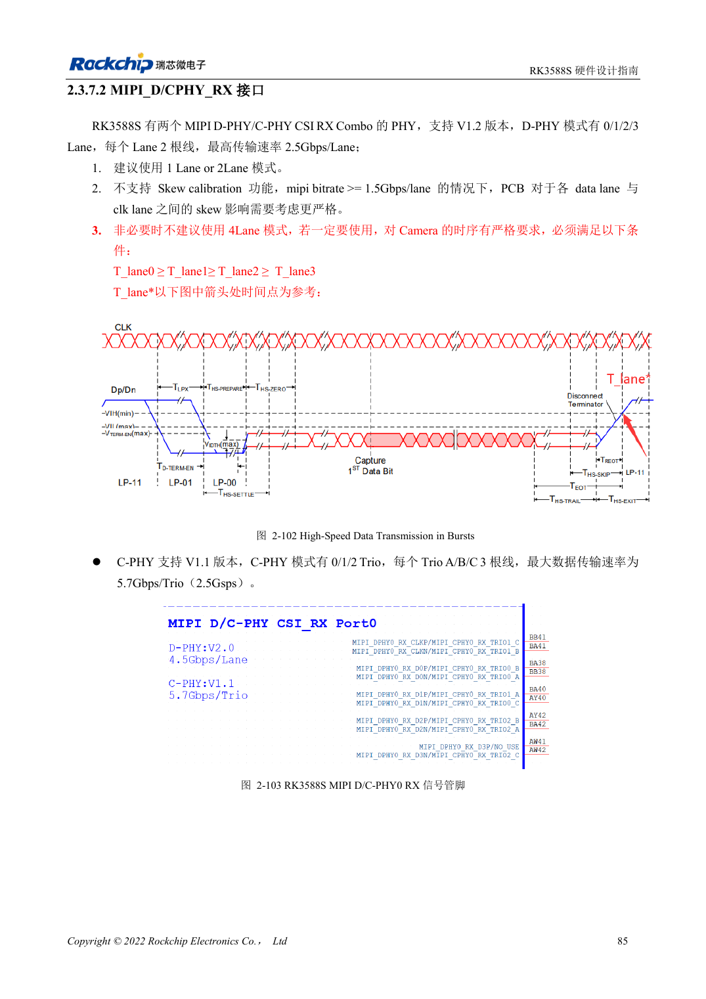

<!-- rk3588s-hardware-v12-20261109 -->

# RK3588S 摄像头：CSI、D/C PHY 与 CIF 接口规划

本文依据 RK3588S Hardware Design Guide V1.2（2023-12-14）中文原稿，面向电路与 PCB 设计审查。CM7S 载板需遵循模块接口定义，Sige7S 可用于软件与外设评估。芯片能力不等于板卡接口清单；SDK/BSP、内核、板卡版本、固件及复用须逐项核对。数值为原稿参考，未经 ArmSoM 硬件实测。

**RK3588S Hardware Design Guide V1.2 (2023-12-14), CN** · §2.3.7.1–2.3.7.3; §3.4.10; §3.4.22

## 专用 DPHY 与 Combo PHY 分开规划

RK3588S 有一组专用 DPHY RX，可用 1×4 Lane 或 2×2 Lane；另有两组 D/C Combo RX。专用 DPHY 参考速率 2.5Gbps/lane。Combo 的 DPHY 模式不支持 skew calibration，优先 1/2 Lane；4 Lane 方案必须满足 T_lane0≥T_lane1≥T_lane2≥T_lane3，达到 1.5Gbps/lane 及以上时尤其要复核时序。

## CIF 电平与系统验证

CIF 分布在 VCCIO5、VCCIO6，两域供电需要同步且与传感器 IO 相符，I2C 上拉也要匹配。MIPI 接线不代表 BSP 已支持传感器：还需驱动、设备树和 ISP 配置。验证从单路采集开始，再测试目标多路模式、持续运行、丢帧、时钟稳定和温升。

## 设计参数与检查表

| 项目 | 原稿参考值 |
| --- | --- |
| 专用 DPHY RX 原稿速率 | 2.5Gbps/lane |
| DPHY 目标阻抗 | 100Ω ±10%; 备选 95Ω ±10% |
| DPHY 对内/时钟数据差 | <6mil / <12mil |

## 参考原图

本批没有对应英文设计指南，四语统一采用中文原稿截图，图注已本地化。点击图片查看清晰原图；图片用于核对电路和布局，正文与参数表可复制。页码为 PDF 物理页码。

中文原稿 · PDF 99 · 2-100

中文原稿 · PDF 100 · 2-102

## ArmSoM 开发路径

CM7S 适合定制载板：先确认模块已经完成的电源、DDR 与启动电路，再设计连接器外侧。Sige7S 可作为软件和外设评估起点。两种产品均须以对应版本资料核对接口是否引出、连接器针脚、电平、系统镜像与散热条件，不能把芯片原理图直接当成产品接线图。

- [ArmSoM CM7S](https://www.armsom.org/cm7s) · [CM7S Docs](https://docs.armsom.org/armsom-cm7s)
- [ArmSoM Sige7S](https://www.armsom.org/sige7s) · [Sige7S Docs](https://docs.armsom.org/armsom-sige7s)

## 继续阅读

- [RK3588S 硬件设计系列：30 个主题](/zh/articles/rk3588s-hardware-design-series/)
- [RK3588S PCIe：通道分配、参考时钟与电源](/zh/articles/rk3588s-pcie-hardware-design/)
- [RK3588S 与 RK3588S2：摄像头 PHY 和兼容边界](/zh/articles/rk3588s-rk3588s2-hardware-differences/)
