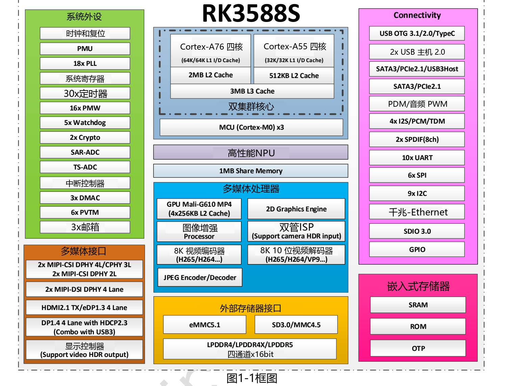

RK3588S 的吸引力不只是八核 CPU，而是把通用计算、图形、神经网络推理、视频编解码和相机处理放进同一颗 SoC。对希望缩短硬件开发周期的团队，ArmSoM 提供两条路线：用 **Sige7S 单板计算机**搭建应用原型，或用 **CM7S 核心板**开发自己的载板。

## CPU、GPU 和 NPU 各自负责什么

RK3588S 集成四个 Cortex-A76 与四个 Cortex-A55。前者适合复杂应用与较重的计算线程，后者可承担后台服务；任务如何分配仍取决于操作系统调度器。V1.3 原稿给出每个 A76 的 64KB 指令缓存、64KB 数据缓存和 512KB L2，每个 A55 的 32KB 指令缓存、32KB 数据缓存和 128KB L2，以及共享的 3MB L3。

Mali-G610 MP4 用于图形和兼容的软件计算任务；独立 NPU 的标称上限为 6 TOPS。TOPS 不是整机帧率，也不能直接换算为大模型 tokens/s。模型结构、量化精度、输入尺寸、算子支持和数据搬运都会影响应用结果。

## 芯片规格速查

| 模块 | V1.3 资料中的能力 | 选型时应核对 |
|---|---|---|
| CPU | 4× Cortex-A76 + 4× Cortex-A55，Armv8-A | 镜像、散热与实际工作频率 |
| GPU | Mali-G610 MP4；OpenGL ES 3.2、OpenCL 2.2、Vulkan 1.2 | 镜像中实际安装的驱动与 API |
| NPU | 最高 6 TOPS，INT4/INT8/INT16/FP16 混合运算 | 精度对应吞吐、SDK 与模型支持 |
| 内存控制器 | LPDDR4/LPDDR4X/LPDDR5，4×16-bit，最高 32GB 地址空间 | 产品实际采用的内存类型和容量 |
| 解码 | H.265/VP9 8K60；H.264 8K30；AV1 4K60 | 格式、位深、驱动与并发带宽 |
| 编码 | H.264/H.265，最高 8K30 | 输入格式和实际编码链路 |
| ISP | 最高 48MP 级输入能力 | 传感器、镜头与 IQ 标定 |

## RK3588S 不能直接套用 RK3588 的接口表

芯片名称接近，不代表板级扩展能力相同。V1.3 对 RK3588S 列出单个千兆以太网控制器，以及 PCIe 2.1/SATA/USB 复用的 Combo PHY。不能据此宣传 PCIe 3.0 x4、双网口或把全部复用接口算成可同时使用。

同样，芯片支持 LPDDR5 不意味着 CM7S、Sige7S 就安装了 LPDDR5；产品文档列出的这两款平台采用 LPDDR4/LPDDR4X 配置。采购与设计应以具体 SKU、硬件版本和原理图为准。

## RK3588S 可以落地哪些应用？

RK3588S 的优势在于让“采集、计算、推理、显示”在同一平台协同工作。下面八类场景是基于芯片能力和板卡形态提出的产品开发方向，不代表已经完成的客户项目或性能测试。选型时应把应用所需接口、软件支持和持续负载放在一起评估。

### 1. 机器视觉与工业外观检测

在产线检测设备中，摄像头采集零件或包装图像，图像处理单元完成缩放和格式转换，NPU 运行经过适配的检测或分类模型，CPU 再将结果交给上位机或业务系统。RK3588S 可以把图像处理和本地决策集中在设备端，减少每帧图像都上传服务器的需求。

可先用 Sige7S 配合已验证的 USB 摄像头搭建识别原型；需要专用相机、触发信号或自定义结构时，可评估 CM7S 载板。真实项目还要解决光源、曝光、镜头、标定和误检漏检问题；实时触发、隔离 IO 或确定性控制可能需要独立控制器。

### 2. 智能摄像头与视频分析网关

对于门店、仓储或园区的视频分析，可围绕“视频流接入 → 硬件解码 → 图像预处理 → 目标检测 → 事件记录”设计应用。RK3588S 的视频单元和 NPU 可以分别承担媒体处理与模型推理，CPU 负责告警规则、接口服务和数据管理。

Sige7S 适合先验证单路完整流程，再逐步增加负载；CM7S 则适合做专用网关。可接入多少路不能从 8K 解码或 6 TOPS 直接推算，应按实际码流、模型、网络、内存和散热测试。录像留存还需要规划存储容量与写入寿命。

### 3. 数字标牌、自助终端与交互屏

商场导览、会议室看板、自助点单机和展览互动装置，需要同时呈现视频、网页或图形界面。RK3588S 的 GPU、视频解码器和显示控制器能为这类组合提供硬件基础；应用可把内容播放、触摸交互和本地业务整合到同一设备。

Sige7S 可用于外接显示器的快速验证，CM7S 适合嵌入定制屏幕设备。多屏、触摸、旋转显示和硬件解码要在选定镜像中逐项验证；芯片支持某个显示标准，不等于所有接口组合都能同时达到最高规格。

### 4. 机器人感知与移动设备上层计算

机器人可让 RK3588S 处理视觉识别、用户界面、任务规划或日志管理，而由专门的 MCU 或控制器处理电机闭环和安全停机。这种分工便于将计算密集型任务与确定性控制拆开。

Sige7S 适合桌面验证算法和设备通信；空间、接口布局或供电需要定制时，可选择 CM7S 路线。是否能运行目标 ROS 软件包、相机驱动或导航流程，需要核对 ARM64 依赖及系统版本，不能把 Linux 可启动等同于整套机器人软件已适配。

### 5. 本地语音交互与 AI 助手

会议终端、展厅设备或离线交互装置，可以将语音采集、识别、文本处理和语音合成组合起来。RK3588S 提供 CPU 与 NPU 资源，但不同模型可能走不同的软件路径；视觉模型通常从 RKNN-Toolkit2 评估，语言模型需单独核对 RKNN-LLM 的支持范围。

先在 Sige7S 上验证一个完整交互回合，再决定内存容量和是否采用 CM7S 定制硬件。选型指标应包括首个响应时间、持续生成速度、上下文长度、峰值内存和麦克风效果。本文不承诺特定模型规模或 tokens/s。

### 6. ARM Linux 工作站与教学实验平台

八核 CPU、图形能力和可配置内存，让 RK3588S 可以用于评估 ARM Linux 桌面、程序开发、容器服务和嵌入式课程。教学时还可以围绕 GPIO、视频处理和模型部署逐步安排实验，把软件与硬件连接起来。

Sige7S 的成品板形态适合连接显示器、键盘和网络后开展实验。实际体验取决于镜像、桌面环境、驱动和存储；x86 专用软件不能因为装了 Linux 就直接运行。CM7S 则更适合课程之后的定制产品设计阶段。

### 7. 家庭媒体服务与轻量存储设备

RK3588S 可作为本地媒体管理、文件服务或应用容器的计算平台。CPU 处理服务逻辑，兼容的软件可利用硬件视频能力；是否能进行某种转码，仍取决于媒体框架、驱动与输入输出格式。

Sige7S 可用于验证基础服务；需要专用存储连接和机箱结构时，可评估 CM7S 载板。设计重点是网络带宽、磁盘连接、供电、数据备份和散热。不要把 RK3588S 宣传成自带多盘 SATA 或 PCIe 3.0 扩展的高端 NAS 平台，复用接口必须按原理图核对。

### 8. 工业 HMI、设备监控与协议网关

工业设备的人机界面常需显示状态、记录数据、提供网络管理，并与控制器通信。RK3588S 可以承担这些上层任务，将图形界面、数据处理和远程维护整合在一起。

Sige7S 适合先完成界面和通信流程；CM7S 可配合载板增加合适的收发器、隔离电路和连接器。现场总线的电气规范、EMC、工作温度和长期运行需要整机验证，不能仅依据 SoC 控制器列表判断工业适用性。

### 如何从一个场景开始选板

| 项目阶段或约束 | 可优先评估的路线 | 首先验证什么 |
|---|---|---|
| 需要尽快看到完整应用 | Sige7S | 输入到输出的完整流程和外设支持 |
| 已有确定的外壳、接口或连接器要求 | CM7S + 定制载板 | 引脚、供电、结构、信号完整性 |
| 软件先行，稍后开发载板 | CM7S + CM7S-IO | 在匹配底板上固定软件版本与测试基线 |
| AI、视频和 UI 同时运行 | 两条路线都需验证 | 端到端延迟、内存带宽、温度和持续性能 |

从最小可运行链路开始，再增加相机数量、模型复杂度和显示负载，能更早发现瓶颈。对 ArmSoM 产品的选择，应由应用形态和验证结果驱动，而不是只比较 CPU 核心数或 TOPS。

## 从芯片能力走向实际产品

想先验证软件、外设和演示流程，可以从 Sige7S 开始；已有明确的外壳、连接器和工业接口要求，可以评估 CM7S 加定制载板。它们共享 RK3588S 平台，但不能因此认定设备树、镜像或附件完全互换。

本文的性能数字来自资料，并非 ArmSoM 本次实测。开发前应固定板卡版本、系统镜像、内核和 SDK，再记录功能与持续负载测试结果。

## 继续阅读与产品资料

- [CM7S 与 Sige7S 怎么选？两种 RK3588S 产品开发路线](/zh/articles/cm7s-sige7s-rk3588s-selection/)
- [用 RK3588S 做边缘 AI 与多媒体设备：CM7S、Sige7S 应用规划](/zh/articles/rk3588s-edge-ai-multimedia/)
- [RK3588S Datasheet V1.3：下载、框图、封装与电气参数阅读指南](/zh/articles/rk3588s-datasheet-v13/)

### 产品与开发资料

- [CM7S](https://www.armsom.org/cm7s) · [CM7S Docs](https://docs.armsom.org/armsom-cm7s)
- [Sige7S](https://www.armsom.org/sige7s) · [Sige7S Docs](https://docs.armsom.org/armsom-sige7s)
- [Rockchip RKNN-Toolkit2](https://github.com/airockchip/rknn-toolkit2) · [RKNN-LLM](https://github.com/airockchip/rknn-llm)
