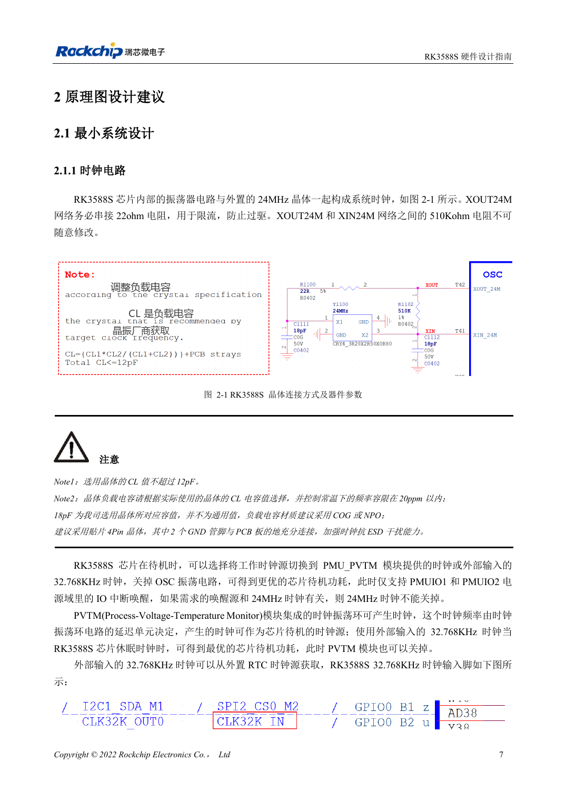
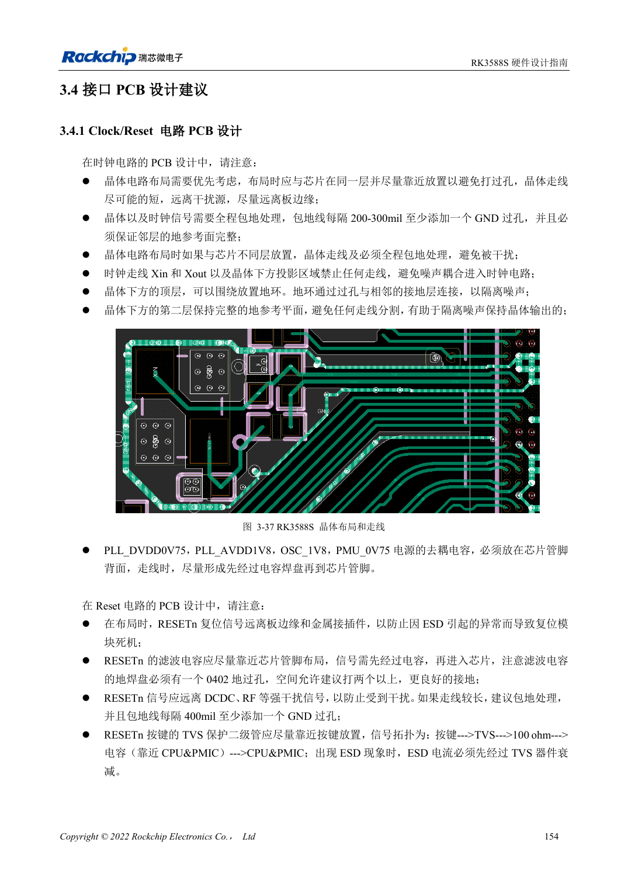

<!-- rk3588s-hardware-v12-20261109 -->

# RK3588S 时钟电路：24MHz、32kHz 与布局

本文依据 RK3588S Hardware Design Guide V1.2（2023-12-14）中文原稿，面向电路与 PCB 设计审查。CM7S 载板需遵循模块接口定义，Sige7S 可用于软件与外设评估。芯片能力不等于板卡接口清单；SDK/BSP、内核、板卡版本、固件及复用须逐项核对。数值为原稿参考，未经 ArmSoM 硬件实测。

**RK3588S Hardware Design Guide V1.2 (2023-12-14), CN** · §2.1.1; §3.4.1

## 按晶体选负载

XOUT24M 的 22Ω 串阻限流，XOUT24M 与 XIN24M 之间的 510kΩ 不可随意修改。晶体 CL 不超过 12pF。原图 18pF 只是参考晶体的负载值，需根据实际 CL 和寄生重新选择，优先 C0G/NP0 和四脚晶体。探头电容也会影响振荡。

## 同时检查唤醒与 PCB

停止 24MHz 前确认唤醒源不依赖它。低功耗路径使用 PMU_PVTM 或外部 32.768kHz，并检查 PMUIO1/2 的 IO 唤醒。晶体与 SoC 尽量同面靠近，晶体和 XIN/XOUT 投影区域不走其他信号，保持邻层地完整，包地每隔 200–300mil 打地过孔。

## 设计参数与检查表

| 项目 | 原稿参考值 |
| --- | --- |
| 24MHz 频差 | ≤20ppm |
| 32.768kHz 频差 | ±30ppm |
| 32kHz 占空比 | 45–55% |
| 32kHz 幅度 | 0.7×VDD … VDD; VDD=PMUIO1 |

## 参考原图

本批没有对应英文设计指南，四语统一采用中文原稿截图，图注已本地化。点击图片查看清晰原图；图片用于核对电路和布局，正文与参数表可复制。页码为 PDF 物理页码。

中文原稿 · PDF 22 · 2-1

中文原稿 · PDF 169 · 3-37

## ArmSoM 开发路径

CM7S 适合定制载板：先确认模块已经完成的电源、DDR 与启动电路，再设计连接器外侧。Sige7S 可作为软件和外设评估起点。两种产品均须以对应版本资料核对接口是否引出、连接器针脚、电平、系统镜像与散热条件，不能把芯片原理图直接当成产品接线图。

- [ArmSoM CM7S](https://www.armsom.org/cm7s) · [CM7S Docs](https://docs.armsom.org/armsom-cm7s)
- [ArmSoM Sige7S](https://www.armsom.org/sige7s) · [Sige7S Docs](https://docs.armsom.org/armsom-sige7s)

## 继续阅读

- [RK3588S 硬件设计系列：30 个主题](/zh/articles/rk3588s-hardware-design-series/)
- [RK3588S 与 CM7S 载板设计：从资源分配到验证](/zh/articles/rk3588s-cm7s-carrier-design/)
- [RK3588S 复位、看门狗与过温保护](/zh/articles/rk3588s-reset-watchdog-hardware/)
