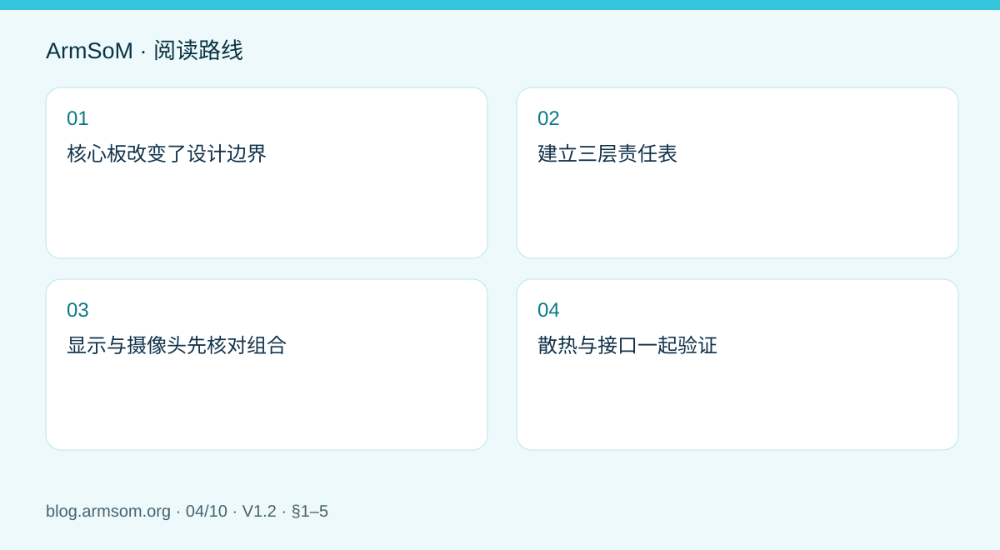
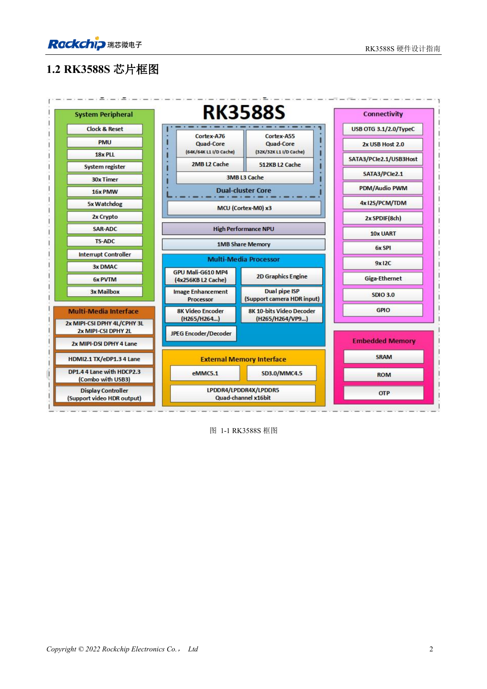
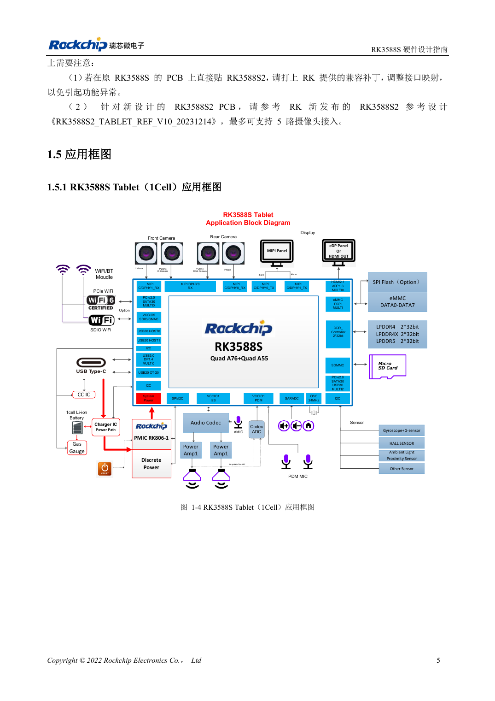

# RK3588S 硬件设计指南：从芯片参考设计到 CM7s 载板

## 适用范围与资料

本篇为围绕工程问题编写的专题导读，不是整本 PDF 的逐页翻译。原文示例不代表 ArmSoM 实测；具体电压、引脚、SDK/BSP 和内核应按实际板卡版本核对。

**Rockchip:** `RK3588S Hardware Design Guide-V1.2-20231214.pdf` · V1.2 · §1–5

## 核心板改变了设计边界

CM7s 将 RK3588S 计算平台集成到模块中。开发载板时，应从模块实际引脚、机械尺寸、连接器和供电要求出发，而不是把 EVB 原理图全部复制。芯片指南中的 DDR 扇出和芯片电源设计用于理解系统，载板开发重点则是外设供电、接口连接、保护和整机散热。

RK3588S 与 RK3588 不是接口完全相同的芯片；也不能用 RK3588S2 的资料替代 RK3588S 引脚定义。选型时锁定完整型号、模块版本和所用手册。

## 建立三层责任表

| 层级 | 主要工作 | 需要核对的资料 |
| --- | --- | --- |
| 模块 | 已集成的处理器、内存、启动与电源部分 | CM7s 原理图及版本 |
| 载板 | 引出信号、外设电源、连接器与防护 | 模块引脚表和载板电路 |
| 整机 | 线缆、散热器、外壳、EMC 与业务负载 | 结构图和验证计划 |

这个划分不是把责任简单移交给模块。模块和载板连接处仍须核对电压域、复位和使能时序、未使用引脚处理，以及接口是否被其他功能复用。

## 显示与摄像头先核对组合

从具体屏幕和传感器开始确定链路：视频通道之外，还要保留 I2C、时钟、复位、背光或摄像头电源。记录分辨率、帧率、lane 配置、线缆和连接器，确认软件驱动与设备树匹配。不能从 SoC 接口数量推导 CM7s 载板的实际并发数量。

## 散热与接口一起验证

AI、视频、显示和存储同时运行时，功耗与局部温升可能不同于空闲桌面。为处理器到散热器、外壳或空气建立明确的热路径，并为连接器、固定孔和绝缘留出空间。验证时记录环境温度、系统温度、降频状态和业务吞吐，避免把短时峰值当作持续性能。

可先在 Sige7s 或配套 CM7s IO 平台上验证应用，再迁移到定制载板。两者的可用接口和结构不同，验证结果只对测试配置有效。

## 原文配图

中文稿原图。 参考设计，不是 ArmSoM 板卡原理图。

`RK3588S Hardware Design Guide-V1.2-20231214.pdf` · PDF p. 17.

## 相关产品与开发资料

- **CM7s** — [产品页面](https://www.armsom.org/cm7s) · [开发文档](https://docs.armsom.org/armsom-cm7s)
- **Sige7s** — [产品页面](https://www.armsom.org/sige7s) · [开发文档](https://docs.armsom.org/armsom-sige7s)

## 继续阅读本系列

- [RK3576 硬件设计入门：最小系统与首次上电检查](/zh/articles/rk3576-hardware-bringup/)
- [ArmSoM CM5 载板设计检查表：供电、启动与接口规划](/zh/articles/019-cm5-carrier-production/)
- [RK3576 高速接口设计：原理图与 PCB 如何配合检查](/zh/articles/rk3576-high-speed-interface-design/)
- [RK3588 边缘 AI 设备设计：供电、散热与扩展接口规划](/zh/articles/rk3588-edge-ai-hardware-design/)
- [RK3588 高速 PCB 设计：叠层、阻抗与布线检查](/zh/articles/rk3588-high-speed-pcb-review/)
- [RK3506 工业 HMI 硬件设计：结合 CM1 与 Forge1 选择开发路径](/zh/articles/rk3506-industrial-hmi-hardware/)
- [RK3308 系列芯片差异与兼容检查：P2 Pro 音频项目参考](/zh/articles/rk3308-hardware-variant-compatibility/)
- [RK3588S 与 RK3588S2 有什么区别？改版前需要核对什么](/zh/articles/rk3588s-rk3588s2-hardware-differences/)
- [Rockchip 设备从样机到量产：工艺要求与测试清单](/zh/articles/rockchip-hardware-production-checklist/)

<!-- rk3588s-hardware-v12-20261109 -->

## RK3588S 与 CM7S 载板设计：从资源分配到验证

本文依据 RK3588S Hardware Design Guide V1.2（2023-12-14）中文原稿，面向电路与 PCB 设计审查。CM7S 载板需遵循模块接口定义，Sige7S 可用于软件与外设评估。芯片能力不等于板卡接口清单；SDK/BSP、内核、板卡版本、固件及复用须逐项核对。数值为原稿参考，未经 ArmSoM 硬件实测。

**RK3588S Hardware Design Guide V1.2 (2023-12-14), CN** · §1.2–1.5; §2.2.5.3

## 先区分芯片主板和模块载板

指南的 Tablet 框图是 SoC 参考方案，不是 CM7S 或 Sige7S 的接口清单。CM7S 已集成计算核心，载板应以模块连接器定义为入口；Sige7S 适合先验证软件、显示和外设。列出摄像头、视频格式、推理任务、网络流量和存储负载，再逐一确认引脚、PHY、供电与 BSP。

## 分阶段测试

先检查冷启动、串口和恢复，再单独验证外设，最后叠加持续负载。表 2-12 的峰值电流来自各模块极限场景，条件包括结温 100℃、裸板无散热片和稳定后运行 15 分钟；不可相加后称为 ArmSoM 实测功耗。记录电源最低点、温度、频率、丢帧和错误计数。

## 设计参数与检查表

| 项目 | 原稿参考值 |
| --- | --- |
| 原稿测试条件 | 100°C; 15 min; 无散热片 |
| CPU BIG0/BIG1 示例 | 0.980V; 4.00A 各 |
| GPU 示例 | 0.850V; 6.50A |

## 参考原图

本批没有对应英文设计指南，四语统一采用中文原稿截图，图注已本地化。点击图片查看清晰原图；图片用于核对电路和布局，正文与参数表可复制。页码为 PDF 物理页码。

中文原稿 · PDF 17 · 1-1

中文原稿 · PDF 20 · 1-4

## ArmSoM 开发路径

CM7S 适合定制载板：先确认模块已经完成的电源、DDR 与启动电路，再设计连接器外侧。Sige7S 可作为软件和外设评估起点。两种产品均须以对应版本资料核对接口是否引出、连接器针脚、电平、系统镜像与散热条件，不能把芯片原理图直接当成产品接线图。

- [ArmSoM CM7S](https://www.armsom.org/cm7s) · [CM7S Docs](https://docs.armsom.org/armsom-cm7s)
- [ArmSoM Sige7S](https://www.armsom.org/sige7s) · [Sige7S Docs](https://docs.armsom.org/armsom-sige7s)

## 继续阅读

- [RK3588S 硬件设计系列：30 个主题](/zh/articles/rk3588s-hardware-design-series/)
- [RK3588S 时钟电路：24MHz、32kHz 与布局](/zh/articles/rk3588s-clock-hardware-design/)
