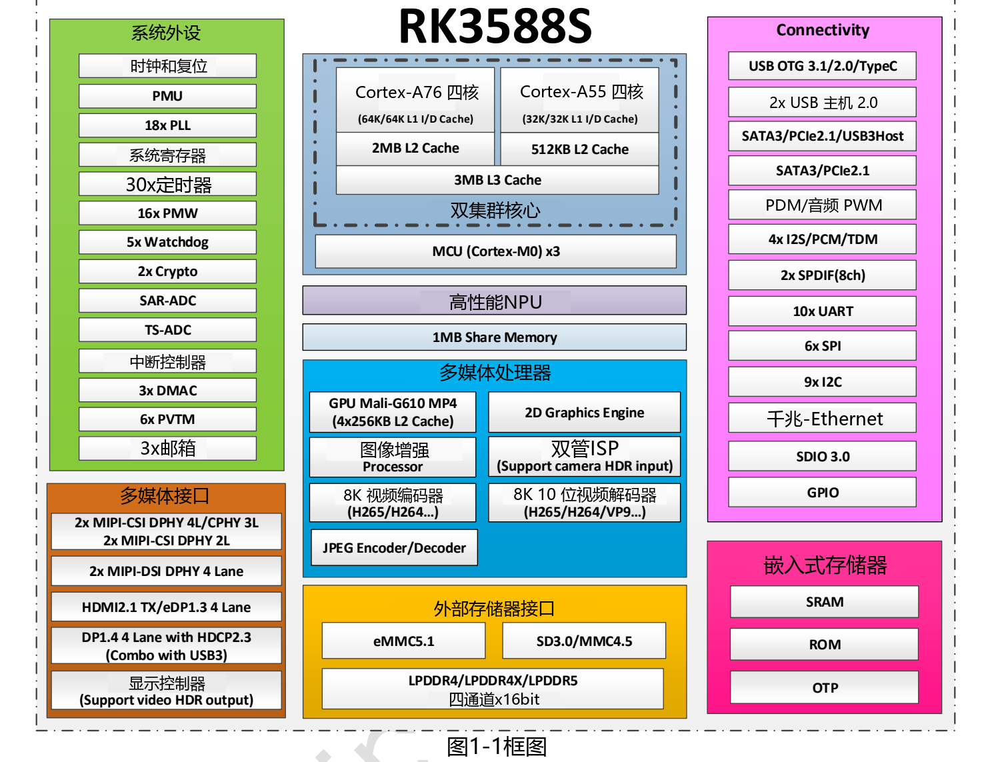
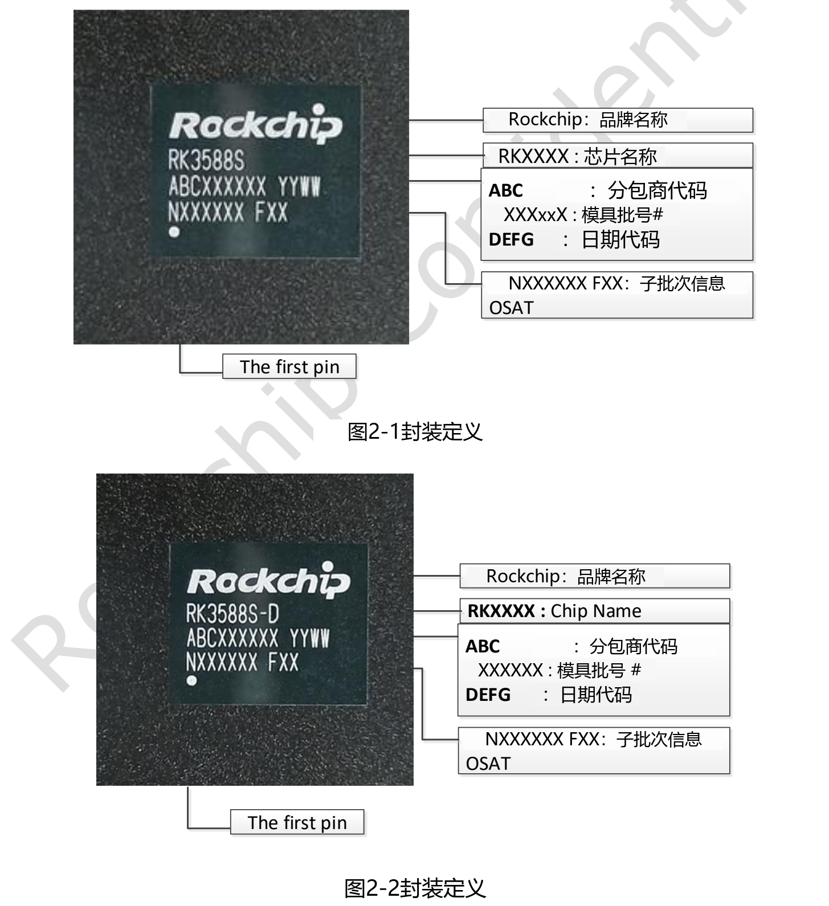
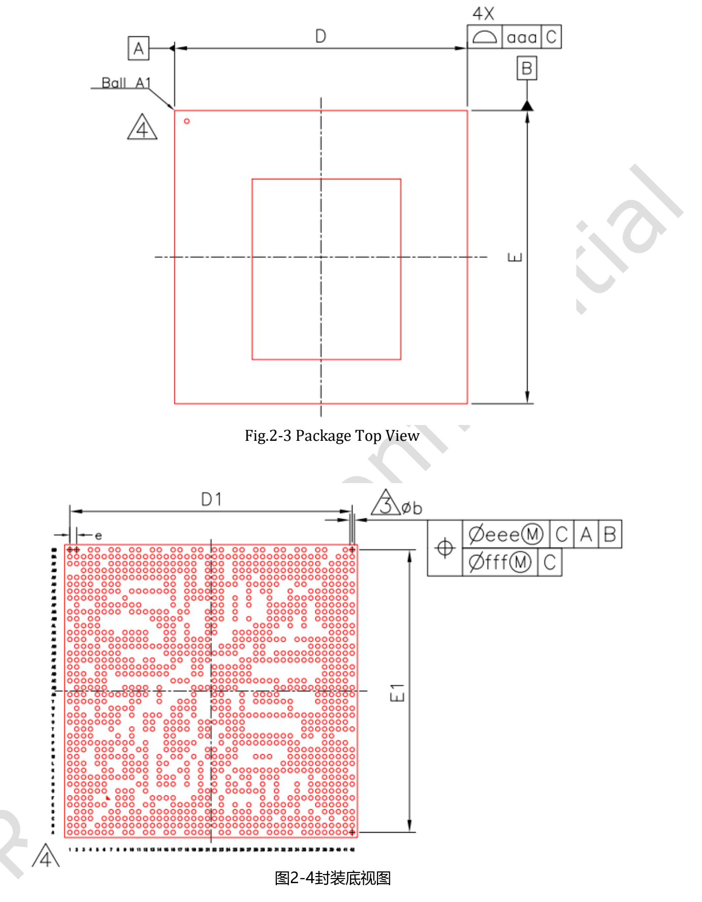
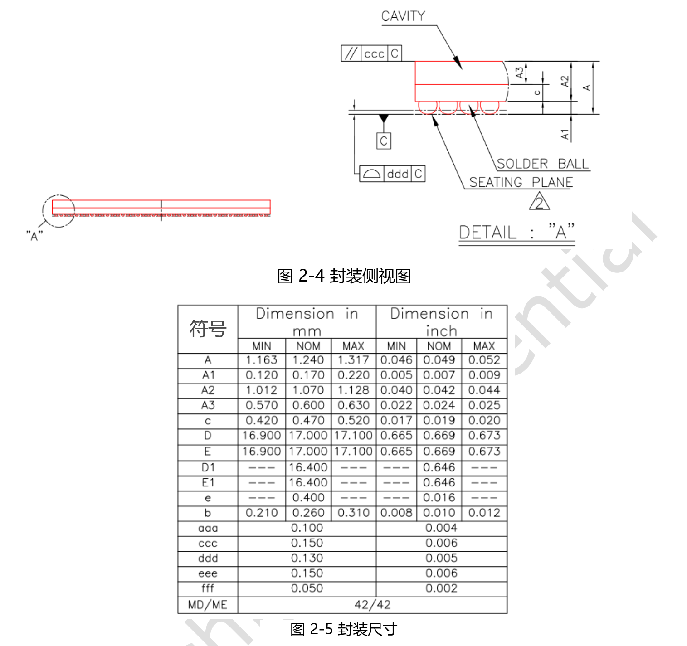

这篇指南对应用户提供的 **Rockchip RK3588S Datasheet V1.3，文件日期 2022-03-10，共 35 页**。它是芯片级参考资料，不能替代 CM7S 或 Sige7S 的原理图、机械文件和当前 SDK 文档，也不应被当作最新版本声明。

[下载原始 PDF（V1.3，约 2.46 MiB）](/assets/rk3588s/Rockchip-RK3588S-Datasheet-V1.3-20220310.pdf) · [下载可编辑英文技术正文及表格](/docs/rk3588s/technical-reference-en.md)

本页是中文阅读指南；附件保留英文技术内容，并非完整中文译本。英文技术参考覆盖 PDF 第 6–35 页，去除封面、修订表、免责声明及重复页眉页脚，保留参数与原稿疑点。复杂合并单元格的适用范围请结合 PDF 核对。

## 四章分别解决什么问题

| 原稿范围 | 内容 | 适合的读者任务 |
|---|---|---|
| 第 6–16 页，第 1 章 | CPU、内存、视频、NPU、图形、接口和框图 | 判断芯片能力与系统架构 |
| 第 17–28 页，第 2 章 | 订货、标记、封装、引脚清单 | 核对芯片封装与信号名称 |
| 第 29–34 页，第 3 章 | 绝对额定值、推荐条件、IO、PLL、PHY、ADC | 芯片级电气设计与校核 |
| 第 35 页，第 4 章 | 热管理与封装热阻 | 理解热参数适用条件 |

## 芯片框图与封装图

图中文字沿用英文原图，未重绘或改动尺寸。原稿列出 FCCSP1253L，17 × 17 mm 本体、0.26 mm 焊球、0.4 mm 间距。**这些是芯片封装尺寸，不是 CM7S 或 Sige7S 外形尺寸。**

## 不要把绝对额定值当成工作目标

第 3.1 节列出的绝对额定值用于说明器件可能受损的边界；正常设计应按第 3.2 节推荐工作条件，并结合电源时序和硬件设计指南。IO 阈值依赖对应电压域，芯片 GPIO 不能默认按 5V 逻辑使用。

原稿的最高 CPU、GPU、NPU 频率栏存在 TBD，不能用产品宣传频率填回旧版表格。产品页面中的频率属于另一来源、另一时间点的信息。

## 热参数如何理解

| 参数 | V1.3 典型值 | 原稿单位 |
|---|---|---|
| 结到环境热阻 θJA | 8.2 | °C/W |
| 结到板热阻 θJB | 3.7 | °C/W |
| 结到壳热阻 θJC | 0.01 | °C/W |

原稿说明这些是参考仿真数据，测试 PCB 为 10 层、200 × 130 mm，环境温度 25°C。它们不是 ArmSoM 整机测试结果，不能直接用于推算任意外壳中的温升。第 4.1 节要求结温低于 125°C；这不是允许产品环境温度达到 125°C。

## 已发现的原稿差异

- 封面为 V1.3，第 20 页起部分页眉仍写 V1.2。
- 功能正文写 5 个 SPI 控制器，框图写 6× SPI；保留差异，设计前核对 TRM 与引脚复用。
- HDMI/eDP 的数量描述与框图需要进一步核对，不能据此承诺具体板卡的双路输出。
- 第 34 页两张不同表均标为 Table 3-10；图索引和正文图号也存在不一致。
- 热阻、负电流的 Min/Max 写法及未说明条件的重复 PHY 参数行均按原稿保留，不自行纠正。

用于 CM7S 定制载板时，优先核对模块引脚和电源要求；用于 Sige7S 应用开发时，优先核对板载接口、镜像和驱动。芯片资料用于解释底层边界，不能替代板级验证。

## 继续阅读与产品资料

- [RK3588S 芯片详解：从八核 CPU、6 TOPS NPU 到 ArmSoM 产品落地](/zh/articles/rk3588s-chip-guide/)
- [CM7S 与 Sige7S 怎么选？两种 RK3588S 产品开发路线](/zh/articles/cm7s-sige7s-rk3588s-selection/)
- [用 RK3588S 做边缘 AI 与多媒体设备：CM7S、Sige7S 应用规划](/zh/articles/rk3588s-edge-ai-multimedia/)

### 产品与开发资料

- [CM7S](https://www.armsom.org/cm7s) · [CM7S Docs](https://docs.armsom.org/armsom-cm7s)
- [Sige7S](https://www.armsom.org/sige7s) · [Sige7S Docs](https://docs.armsom.org/armsom-sige7s)
- [Rockchip RKNN-Toolkit2](https://github.com/airockchip/rknn-toolkit2) · [RKNN-LLM](https://github.com/airockchip/rknn-llm)
