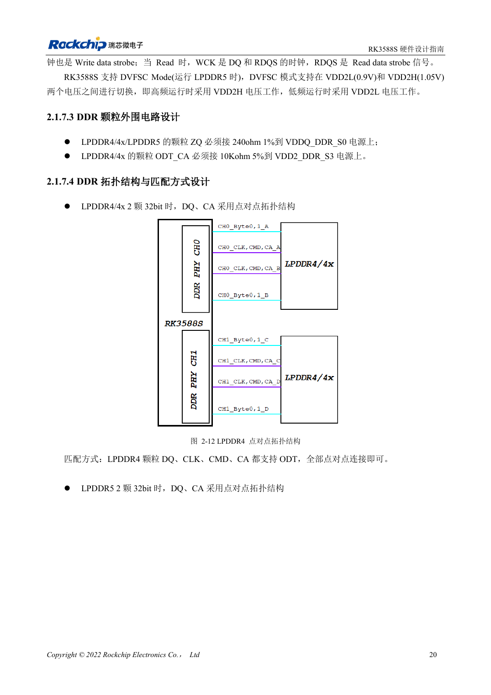
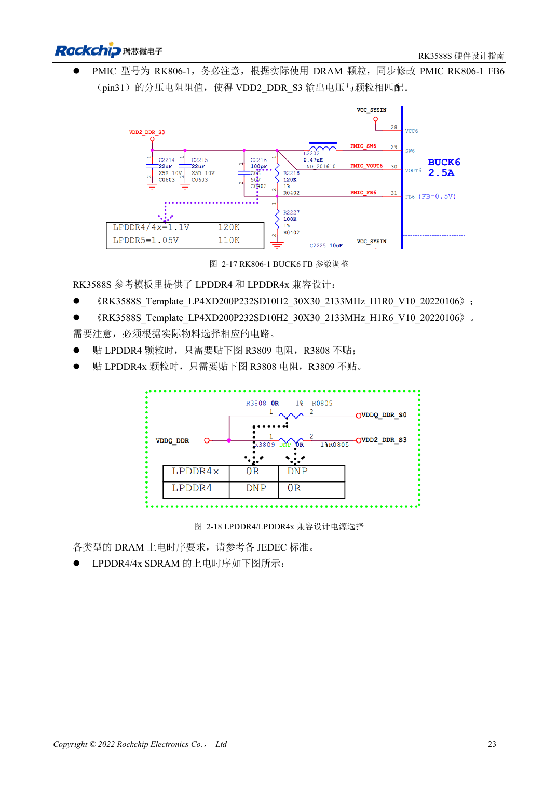

<!-- rk3588s-hardware-v12-20261109 -->

# RK3588S DDR 原理图：LPDDR4/4X/5 与容量配置

本文依据 RK3588S Hardware Design Guide V1.2（2023-12-14）中文原稿，面向电路与 PCB 设计审查。CM7S 载板需遵循模块接口定义，Sige7S 可用于软件与外设评估。芯片能力不等于板卡接口清单；SDK/BSP、内核、板卡版本、固件及复用须逐项核对。数值为原稿参考，未经 ArmSoM 硬件实测。

**RK3588S Hardware Design Guide V1.2 (2023-12-14), CN** · §2.1.7

## 容量与模板一起选择

V1.2 描述四个 16bit 通道、总线 64bit，每通道最大寻址 8GB、总共 32GB。图纸中的 32bit CH0/CH1 不能用不同容量，例如 4GB+2GB。此为该版指南范围，不推断其他变体或后续 BSP。颗粒型号、封装、固件和模板需成套确认。

## 电压与映射不可只改名字

两颗 32bit 颗粒采用 DQ/CA 点对点。兼容模板中 LPDDR4 装 R3809、不装 R3808，LPDDR4X 相反；位号仅适用于原模板，换图纸须核对网络。LPDDR5 需对应 WCK、映射和电源。CM7S 已集成 DDR，载板重点是输入电源、接口和散热。

## 设计参数与检查表

| 项目 | 原稿参考值 |
| --- | --- |
| V1.2 总线 | 4×16bit =64bit |
| V1.2 寻址 | 8GB/通道; 32GB 总计 |
| CH0 / CH1 | 容量相同 |

## 参考原图

本批没有对应英文设计指南，四语统一采用中文原稿截图，图注已本地化。点击图片查看清晰原图；图片用于核对电路和布局，正文与参数表可复制。页码为 PDF 物理页码。

中文原稿 · PDF 35 · 2-12

中文原稿 · PDF 38 · 2-18

## ArmSoM 开发路径

CM7S 适合定制载板：先确认模块已经完成的电源、DDR 与启动电路，再设计连接器外侧。Sige7S 可作为软件和外设评估起点。两种产品均须以对应版本资料核对接口是否引出、连接器针脚、电平、系统镜像与散热条件，不能把芯片原理图直接当成产品接线图。

- [ArmSoM CM7S](https://www.armsom.org/cm7s) · [CM7S Docs](https://docs.armsom.org/armsom-cm7s)
- [ArmSoM Sige7S](https://www.armsom.org/sige7s) · [Sige7S Docs](https://docs.armsom.org/armsom-sige7s)

## 继续阅读

- [RK3588S 硬件设计系列：30 个主题](/zh/articles/rk3588s-hardware-design-series/)
- [RK3588S 与 RK806：单、双 PMIC 电源树](/zh/articles/rk3588s-rk806-pmic-design/)
- [RK3588S DDR 布线：等长与等延时](/zh/articles/rk3588s-ddr-pcb-routing/)
