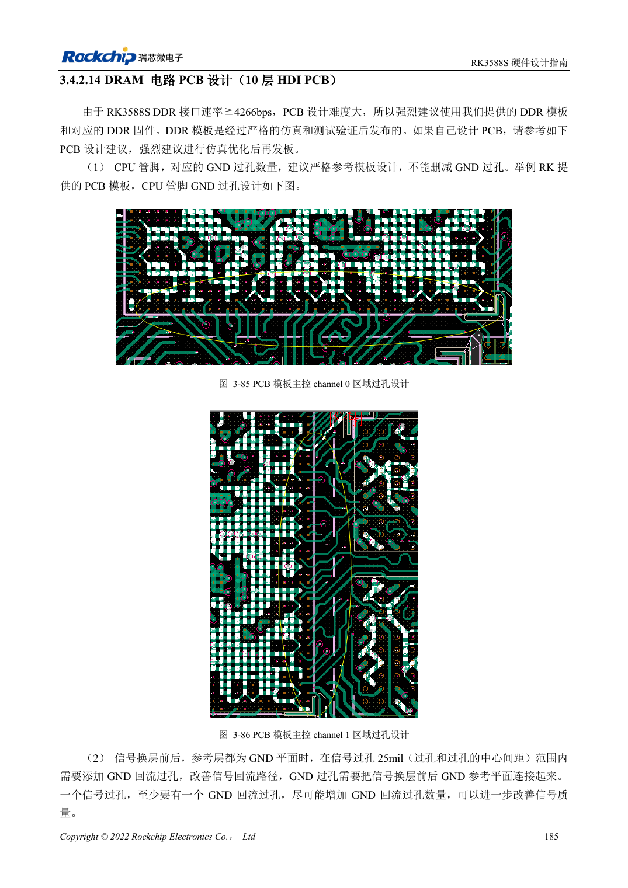
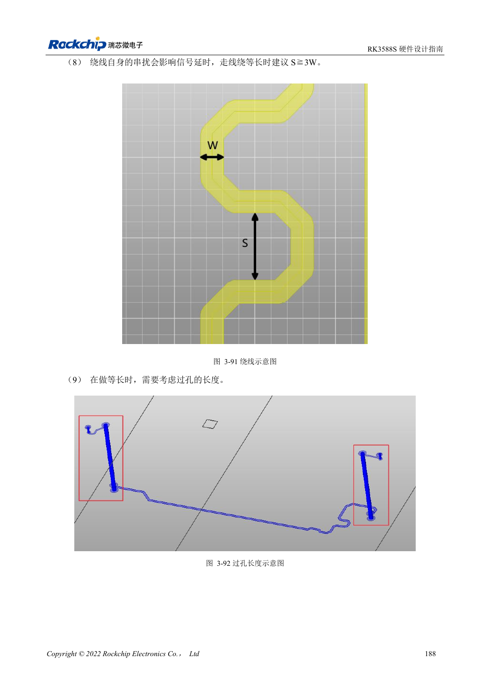

<!-- rk3588s-hardware-v12-20261109 -->

# RK3588S DDR 布线：等长与等延时

本文依据 RK3588S Hardware Design Guide V1.2（2023-12-14）中文原稿，面向电路与 PCB 设计审查。CM7S 载板需遵循模块接口定义，Sige7S 可用于软件与外设评估。芯片能力不等于板卡接口清单；SDK/BSP、内核、板卡版本、固件及复用须逐项核对。数值为原稿参考，未经 ArmSoM 硬件实测。

**RK3588S Hardware Design Guide V1.2 (2023-12-14), CN** · §3.4.2.14

## 采用 RK3588S 的独立布线表

§3.4.2.14 的表 3-13、3-14、3-15 分别针对 LPDDR5、LPDDR4X、LPDDR4。原稿基于 10 层 HDI 内层布线，按等长约束；不能套用 RK3588 另一份指南的 8 层通孔板 16ps 规则。DQ/DM 为 45Ω、地址控制为 50Ω、差分为 90Ω，容差均为 ±10%。

## 建立字节组与间距约束

LPDDR5 同 Byte 的 DQ/DM 相对 DQS/WCLK ≤25mil，地址控制相对 CLK ≤40mil，差分对内 ≤5mil；DQS/WCLK 与 CLK 之间 ≤200mil。LPDDR4X 对应 DQS 与 CLK 为 ≤250mil。数据间距至少 2 倍线宽，数据到选通信号建议 3 倍、至少 2 倍。用训练日志、温度、目标频率压力和重复冷启动验证余量。

## 设计参数与检查表

| 项目 | 原稿参考值 |
| --- | --- |
| LPDDR5 DQ/DM 阻抗 | 45Ω ±10% |
| LPDDR5 地址/控制 | 50Ω ±10% |
| LPDDR5 差分目标 | 90Ω ±10% |
| 字节内长度差 | DQ/DM ↔ DQS/WCLK: ≤25mil |
| 地址长度差 | ≤40mil |
| 差分对内差 | ≤5mil |

## 参考原图

本批没有对应英文设计指南，四语统一采用中文原稿截图，图注已本地化。点击图片查看清晰原图；图片用于核对电路和布局，正文与参数表可复制。页码为 PDF 物理页码。

中文原稿 · PDF 200 · 3-85

中文原稿 · PDF 203 · 3-91

## ArmSoM 开发路径

CM7S 适合定制载板：先确认模块已经完成的电源、DDR 与启动电路，再设计连接器外侧。Sige7S 可作为软件和外设评估起点。两种产品均须以对应版本资料核对接口是否引出、连接器针脚、电平、系统镜像与散热条件，不能把芯片原理图直接当成产品接线图。

- [ArmSoM CM7S](https://www.armsom.org/cm7s) · [CM7S Docs](https://docs.armsom.org/armsom-cm7s)
- [ArmSoM Sige7S](https://www.armsom.org/sige7s) · [Sige7S Docs](https://docs.armsom.org/armsom-sige7s)

## 继续阅读

- [RK3588S 硬件设计系列：30 个主题](/zh/articles/rk3588s-hardware-design-series/)
- [RK3588S DDR 原理图：LPDDR4/4X/5 与容量配置](/zh/articles/rk3588s-ddr-circuit-design/)
- [RK3588S eMMC：时钟、上拉与 Strobe](/zh/articles/rk3588s-emmc-hardware-design/)
