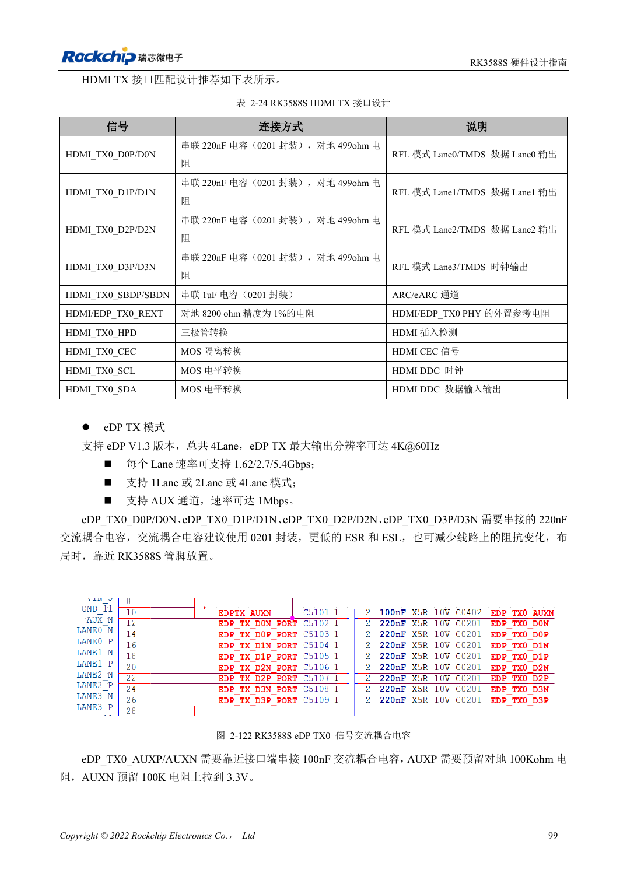
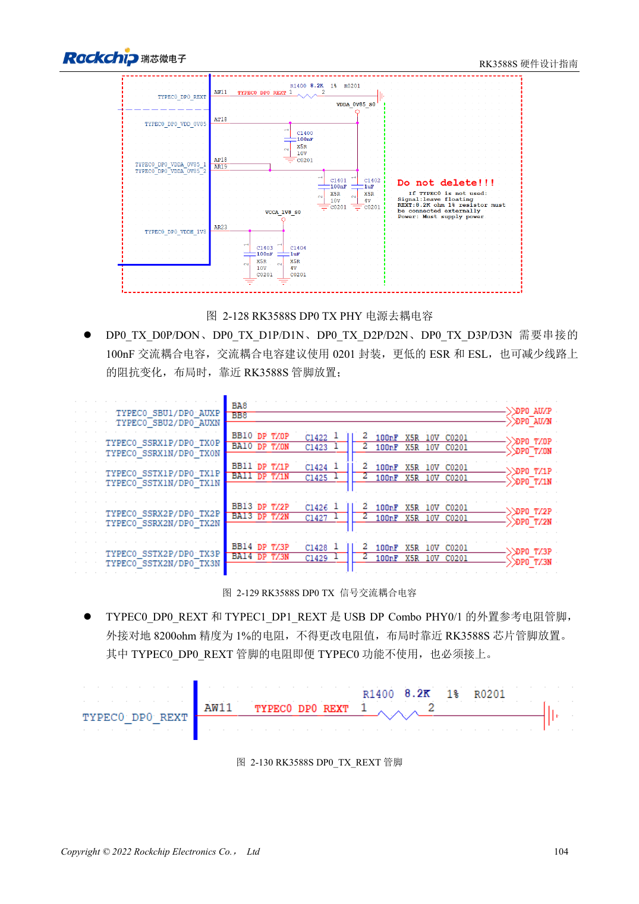

<!-- rk3588s-hardware-v12-20261109 -->

# RK3588S DP 与 eDP：PHY 复用、AUX 与耦合

本文依据 RK3588S Hardware Design Guide V1.2（2023-12-14）中文原稿，面向电路与 PCB 设计审查。CM7S 载板需遵循模块接口定义，Sige7S 可用于软件与外设评估。芯片能力不等于板卡接口清单；SDK/BSP、内核、板卡版本、固件及复用须逐项核对。数值为原稿参考，未经 ArmSoM 硬件实测。

**RK3588S Hardware Design Guide V1.2 (2023-12-14), CN** · §2.3.8.1; §2.3.8.3; §3.4.3; §3.4.11

## 相似名称不代表同一电路

DP0 与 USB Type-C 共用 PHY，eDP 与 HDMI TX 共用 PHY。DP 主链路推荐 100nF，eDP 主链路为 220nF，AUX 为 100nF。不能把 DP 和 eDP 的阻抗、耦合与引脚直接互换。线缆、连接器、显示器输入和 BSP 都属于链路的一部分。

## TYPEC0 的必接项与版本边界

TYPEC0_DP0 的三路电源和 8.2kΩ、1% REXT 即使不使用该接口也要按指南保留。eDP 主链路 220nF、AUX 100nF，按连接器和线缆阻抗复核。RK3588S 只有一组 DP Combo；原稿残留 TYPEC1 或 TX1 文字，不用于推导第二组接口。

## 设计参数与检查表

| 项目 | 原稿参考值 |
| --- | --- |
| 独立 DP / USB-DP 阻抗 | 100Ω / 95Ω; ±10% |
| eDP 阻抗 | 90Ω ±10%; 匹配线缆 |
| DP / eDP 主链路耦合 | 100nF / 220nF |
| AUX 耦合 | 100nF |
| 长度/对内差 | <6in / <6mil |

## 参考原图

本批没有对应英文设计指南，四语统一采用中文原稿截图，图注已本地化。点击图片查看清晰原图；图片用于核对电路和布局，正文与参数表可复制。页码为 PDF 物理页码。

中文原稿 · PDF 114 · 2-122

中文原稿 · PDF 119 · 2-129

## ArmSoM 开发路径

CM7S 适合定制载板：先确认模块已经完成的电源、DDR 与启动电路，再设计连接器外侧。Sige7S 可作为软件和外设评估起点。两种产品均须以对应版本资料核对接口是否引出、连接器针脚、电平、系统镜像与散热条件，不能把芯片原理图直接当成产品接线图。

- [ArmSoM CM7S](https://www.armsom.org/cm7s) · [CM7S Docs](https://docs.armsom.org/armsom-cm7s)
- [ArmSoM Sige7S](https://www.armsom.org/sige7s) · [Sige7S Docs](https://docs.armsom.org/armsom-sige7s)

## 继续阅读

- [RK3588S 硬件设计系列：30 个主题](/zh/articles/rk3588s-hardware-design-series/)
- [RK3588S MIPI 显示：D-PHY、C-PHY 与屏幕配套](/zh/articles/rk3588s-mipi-display-hardware/)
- [RK3588S 音频硬件：I2S、PDM 与多麦克风](/zh/articles/rk3588s-audio-hardware-design/)
