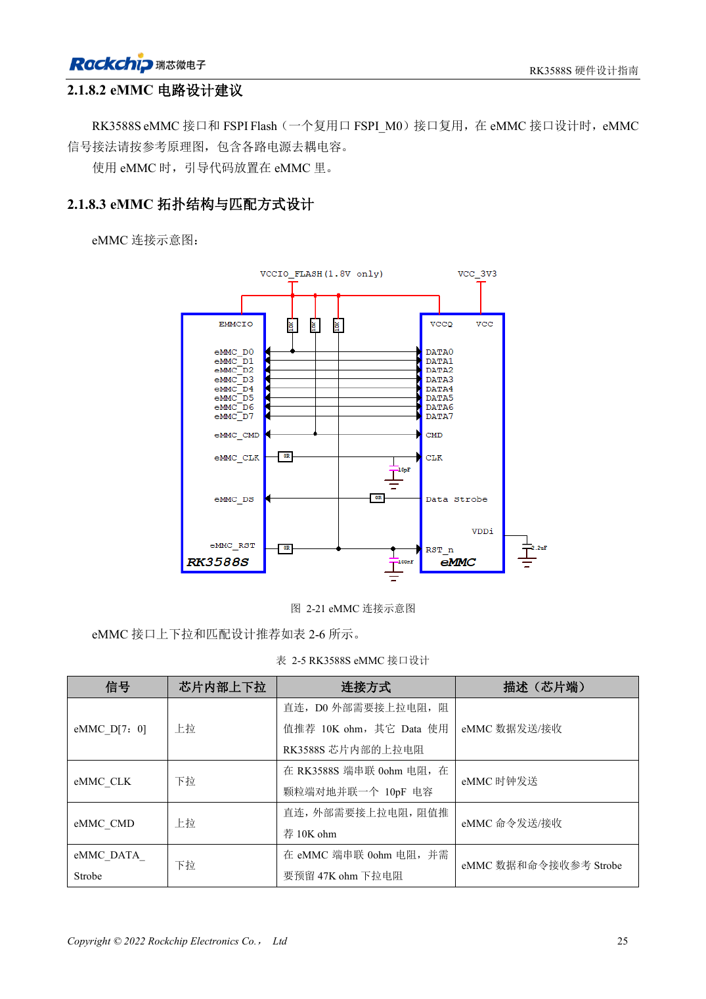
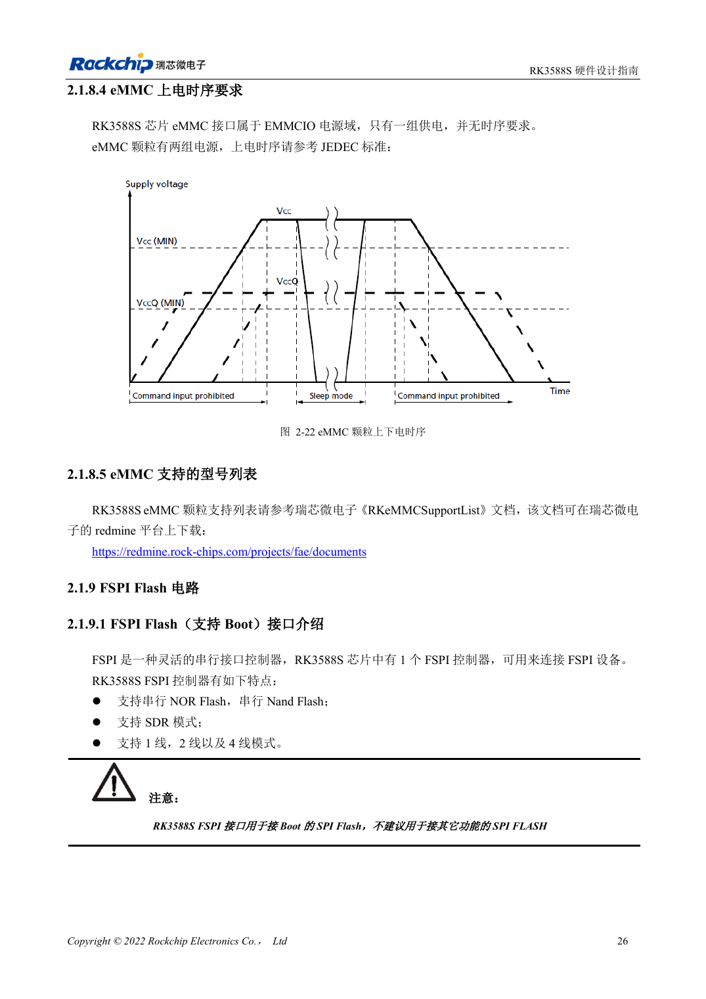

<!-- rk3588s-hardware-v12-20261109 -->

# RK3588S eMMC：时钟、上拉与 Strobe

本文依据 RK3588S Hardware Design Guide V1.2（2023-12-14）中文原稿，面向电路与 PCB 设计审查。CM7S 载板需遵循模块接口定义，Sige7S 可用于软件与外设评估。芯片能力不等于板卡接口清单；SDK/BSP、内核、板卡版本、固件及复用须逐项核对。数值为原稿参考，未经 ArmSoM 硬件实测。

**RK3588S Hardware Design Guide V1.2 (2023-12-14), CN** · §2.1.8; §3.4.12

## 落实 V1.2 时钟接法

表 2-5 要求 CLK 在 RK3588S 端串 0Ω、在 eMMC 端并 10pF 到地。D0 和 CMD 推荐外接 10kΩ 上拉，其余数据用内部上拉。Strobe 在颗粒端串 0Ω、预留 47kΩ 下拉。不要把所有信号按相同模板连接，元件所在端同样重要。

## 电源与模式一起验收

EMMCIO 与颗粒的两路供电是不同层次，颗粒时序仍需按具体料号核对。确认支持列表及 Loader/BSP 版本，测试目标模式、冷启动、持续读写与断电恢复。CM7S 的 eMMC 通常在模块上，是否可替换或外接应查模块文档，不由 SoC 图推断。

## 设计参数与检查表

| 项目 | 原稿参考值 |
| --- | --- |
| CLK | 0Ω SoC 侧; 10pF eMMC 侧 |
| D0 / CMD | 10kΩ 上拉 |
| 选通 | 0Ω eMMC 侧; 预留 47kΩ 下拉 |
| PCB 阻抗/长度 | 50Ω ±10% / <3.5in |
| 时钟与数据长度差 | <120mil |

## 参考原图

本批没有对应英文设计指南，四语统一采用中文原稿截图，图注已本地化。点击图片查看清晰原图；图片用于核对电路和布局，正文与参数表可复制。页码为 PDF 物理页码。

中文原稿 · PDF 40 · 2-21

中文原稿 · PDF 41 · 2-22

## ArmSoM 开发路径

CM7S 适合定制载板：先确认模块已经完成的电源、DDR 与启动电路，再设计连接器外侧。Sige7S 可作为软件和外设评估起点。两种产品均须以对应版本资料核对接口是否引出、连接器针脚、电平、系统镜像与散热条件，不能把芯片原理图直接当成产品接线图。

- [ArmSoM CM7S](https://www.armsom.org/cm7s) · [CM7S Docs](https://docs.armsom.org/armsom-cm7s)
- [ArmSoM Sige7S](https://www.armsom.org/sige7s) · [Sige7S Docs](https://docs.armsom.org/armsom-sige7s)

## 继续阅读

- [RK3588S 硬件设计系列：30 个主题](/zh/articles/rk3588s-hardware-design-series/)
- [RK3588S DDR 布线：等长与等延时](/zh/articles/rk3588s-ddr-pcb-routing/)
- [RK3588S FSPI Flash：启动、供电与匹配](/zh/articles/rk3588s-fspi-boot-hardware/)
