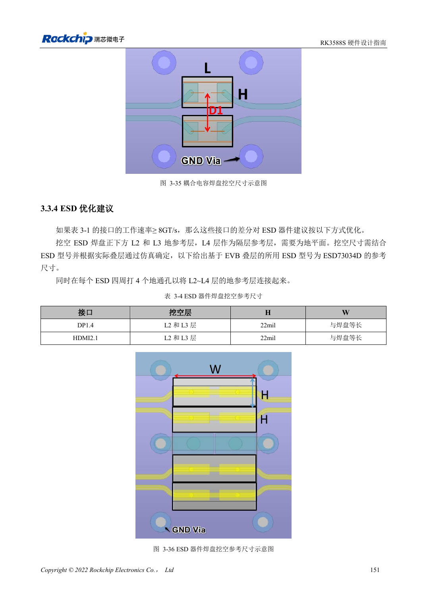

<!-- rk3588s-hardware-v12-20261109 -->

# RK3588S ESD 与 EMI：接口保护和整机回流

本文依据 RK3588S Hardware Design Guide V1.2（2023-12-14）中文原稿，面向电路与 PCB 设计审查。CM7S 载板需遵循模块接口定义，Sige7S 可用于软件与外设评估。芯片能力不等于板卡接口清单；SDK/BSP、内核、板卡版本、固件及复用须逐项核对。数值为原稿参考，未经 ArmSoM 硬件实测。

**RK3588S Hardware Design Guide V1.2 (2023-12-14), CN** · §5; §3.3.4

## 保护元件放在电流进入处

TVS 应靠近连接器或放电点，给它短而低阻抗的地回路。敏感复位、时钟、中断远离板边，指南建议至少 5mm。高速 ESD 的结电容与焊盘必须纳入信号完整性评估，不能认为耐压更高或电容更多总是更好。

## EMI 排查从源与耦合路径开始

优先检查回流中断、长支路、共模转换和开关电源，再选择滤波或屏蔽。散热器也可能耦合辐射，应预留接地条件并实测。原稿一般串阻建议不能覆盖 USB/HDMI/PCIe 各自的约束。以实际外壳、线缆、接地与目标认证条件测试，不把设计建议称为认证通过。

## 设计参数与检查表

| 项目 | 原稿参考值 |
| --- | --- |
| 敏感线距板边 | ≥5mm |
| 时钟源至串阻 | ≤400mil |
| 电源层边缘参考 | 20H; H=电源/地介质间距 |
| 高速 ESD | 使用接口专属电容限值 |

## 参考原图

本批没有对应英文设计指南，四语统一采用中文原稿截图，图注已本地化。点击图片查看清晰原图；图片用于核对电路和布局，正文与参数表可复制。页码为 PDF 物理页码。

中文原稿 · PDF 166 · 3-36

## ArmSoM 开发路径

CM7S 适合定制载板：先确认模块已经完成的电源、DDR 与启动电路，再设计连接器外侧。Sige7S 可作为软件和外设评估起点。两种产品均须以对应版本资料核对接口是否引出、连接器针脚、电平、系统镜像与散热条件，不能把芯片原理图直接当成产品接线图。

- [ArmSoM CM7S](https://www.armsom.org/cm7s) · [CM7S Docs](https://docs.armsom.org/armsom-cm7s)
- [ArmSoM Sige7S](https://www.armsom.org/sige7s) · [Sige7S Docs](https://docs.armsom.org/armsom-sige7s)

## 继续阅读

- [RK3588S 硬件设计系列：30 个主题](/zh/articles/rk3588s-hardware-design-series/)
- [RK3588S 热设计：参考热阻与整机验证](/zh/articles/rk3588s-thermal-hardware-design/)
- [RK3588S 焊接与存储：回流曲线、MSL3 和烘烤记录](/zh/articles/rk3588s-assembly-storage-design/)
