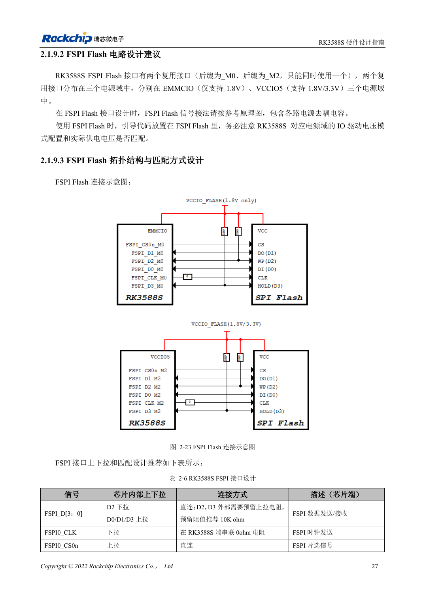

<!-- rk3588s-hardware-v12-20261109 -->

# RK3588S FSPI Flash：启动、供电与匹配

本文依据 RK3588S Hardware Design Guide V1.2（2023-12-14）中文原稿，面向电路与 PCB 设计审查。CM7S 载板需遵循模块接口定义，Sige7S 可用于软件与外设评估。芯片能力不等于板卡接口清单；SDK/BSP、内核、板卡版本、固件及复用须逐项核对。数值为原稿参考，未经 ArmSoM 硬件实测。

**RK3588S Hardware Design Guide V1.2 (2023-12-14), CN** · §2.1.9; §2.1.4; §3.4.15

## 选择启动与电源域

FSPI 可以作为早期引导介质，也可先初始化 PCIe 再加载 SSD 系统。所选复用组决定 IO 域，Flash 电源必须与该组电源域使用同一路电源。不要仅因封装相同就替换 Flash，料号支持、容量、引导固件与写入流程要共同确认。

## 保留调试与恢复余量

表 2-6 给 D2/D3 预留 10kΩ 上拉，CLK 在 SoC 端串 0Ω，CS 直连。把串阻位置、板长和上电时序一起检查，再做重复冷启动与完整读回比对。量产保留 USB 恢复入口，防止错误 Flash 内容使设备无法维修。

## 原稿的复用组矛盾

PDF 第 42 页只列 FSPI_M0 与 FSPI_M2，却写到三个电源域；启动说明还出现 FSPI_M1。本文不由这些文字推导第三个可用接口。M0/M2 分别按 EMMCIO、VCCIO5 的实际引脚表和所用启动固件确认，选型前核对 TRM。

## 设计参数与检查表

| 项目 | 原稿参考值 |
| --- | --- |
| D2 / D3 | 预留 10kΩ 上拉 |
| CLK | 0Ω SoC 侧 |
| 供电 | 与所选 FSPI IO 域同电源 |
| PCB 阻抗/长度 | 50Ω ±10% / <4in |
| 时钟与数据长度差 | <200mil |

## 参考原图

本批没有对应英文设计指南，四语统一采用中文原稿截图，图注已本地化。点击图片查看清晰原图；图片用于核对电路和布局，正文与参数表可复制。页码为 PDF 物理页码。

中文原稿 · PDF 42 · 2-23

## ArmSoM 开发路径

CM7S 适合定制载板：先确认模块已经完成的电源、DDR 与启动电路，再设计连接器外侧。Sige7S 可作为软件和外设评估起点。两种产品均须以对应版本资料核对接口是否引出、连接器针脚、电平、系统镜像与散热条件，不能把芯片原理图直接当成产品接线图。

- [ArmSoM CM7S](https://www.armsom.org/cm7s) · [CM7S Docs](https://docs.armsom.org/armsom-cm7s)
- [ArmSoM Sige7S](https://www.armsom.org/sige7s) · [Sige7S Docs](https://docs.armsom.org/armsom-sige7s)

## 继续阅读

- [RK3588S 硬件设计系列：30 个主题](/zh/articles/rk3588s-hardware-design-series/)
- [RK3588S eMMC：时钟、上拉与 Strobe](/zh/articles/rk3588s-emmc-hardware-design/)
- [RK3588S SDMMC 与 SDIO Wi-Fi：电压切换和防护](/zh/articles/rk3588s-sdmmc-sdio-wifi-design/)
