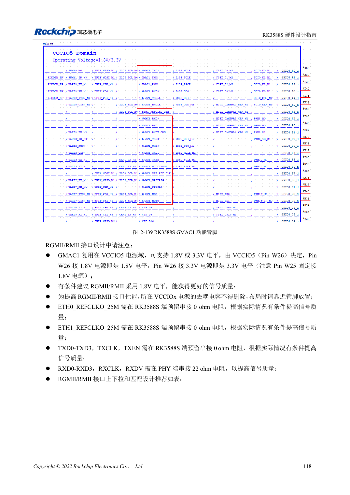
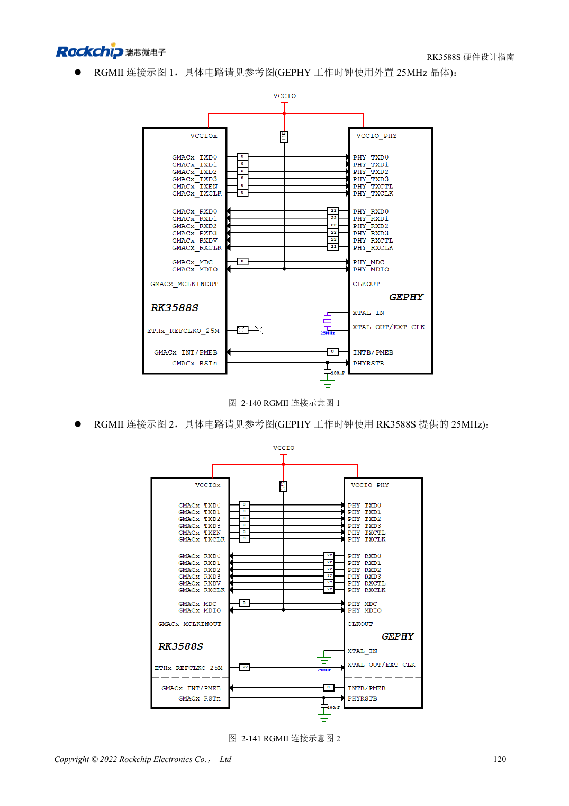

<!-- rk3588s-hardware-v12-20261109 -->

# RK3588S 以太网硬件：GMAC、PHY 与时钟方向

本文依据 RK3588S Hardware Design Guide V1.2（2023-12-14）中文原稿，面向电路与 PCB 设计审查。CM7S 载板需遵循模块接口定义，Sige7S 可用于软件与外设评估。芯片能力不等于板卡接口清单；SDK/BSP、内核、板卡版本、固件及复用须逐项核对。数值为原稿参考，未经 ArmSoM 硬件实测。

**RK3588S Hardware Design Guide V1.2 (2023-12-14), CN** · §2.3.10; §3.4.17

## 一组 GMAC1，电压按 VCCIO5 核对

RK3588S 提供一组外接 RGMII/RMII PHY 的 GMAC1。VCCIO5 的 W26 可选 1.8V/3.3V，W25 固定 1.8V 辅助供电仍要保留。原稿局部 ETH0 字样不代表第二组控制器。RMII 的 50MHz 输入/输出模式需在 MAC 和 PHY 两端一致，避免双输出。

## 延时和匹配分别验证

TX 预留 SoC 端 0Ω，RX 在 PHY 端串 22Ω，MDIO 上拉 1.5–1.8kΩ。PHY 的内部延时、PCB 时延和 BSP 配置要共同审查，不能重复补偿。验证不同速率、双向持续流量、错误计数和复位恢复。RGMII 信号不是双绞线端口，不能直接接 RJ45。

## 设计参数与检查表

| 项目 | 原稿参考值 |
| --- | --- |
| RGMII 阻抗 | 50Ω ±10% 单端 |
| TX/RX 组与时钟差 | <120mil |
| 走线长度 | <5in |
| MDIO 上拉 | 1.5–1.8kΩ |

## 参考原图

本批没有对应英文设计指南，四语统一采用中文原稿截图，图注已本地化。点击图片查看清晰原图；图片用于核对电路和布局，正文与参数表可复制。页码为 PDF 物理页码。

中文原稿 · PDF 133 · 2-139

中文原稿 · PDF 135 · 2-140

## ArmSoM 开发路径

CM7S 适合定制载板：先确认模块已经完成的电源、DDR 与启动电路，再设计连接器外侧。Sige7S 可作为软件和外设评估起点。两种产品均须以对应版本资料核对接口是否引出、连接器针脚、电平、系统镜像与散热条件，不能把芯片原理图直接当成产品接线图。

- [ArmSoM CM7S](https://www.armsom.org/cm7s) · [CM7S Docs](https://docs.armsom.org/armsom-cm7s)
- [ArmSoM Sige7S](https://www.armsom.org/sige7s) · [Sige7S Docs](https://docs.armsom.org/armsom-sige7s)

## 继续阅读

- [RK3588S 硬件设计系列：30 个主题](/zh/articles/rk3588s-hardware-design-series/)
- [RK3588S 音频硬件：I2S、PDM 与多麦克风](/zh/articles/rk3588s-audio-hardware-design/)
- [RK3588S GPIO 与 SARADC：电源域和按键边界](/zh/articles/rk3588s-gpio-saradc-hardware/)
