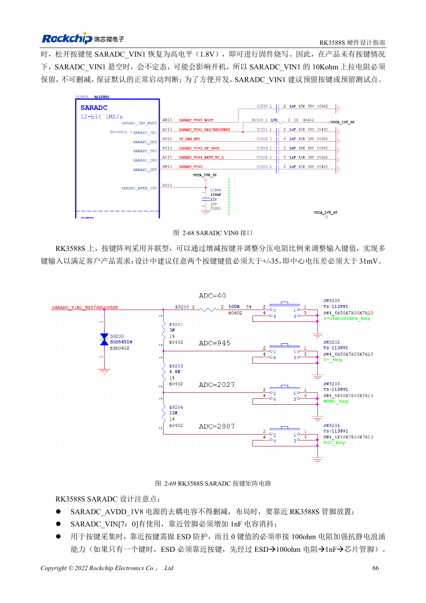

<!-- rk3588s-hardware-v12-20261109 -->

# RK3588S GPIO 与 SARADC：电源域和按键边界

本文依据 RK3588S Hardware Design Guide V1.2（2023-12-14）中文原稿，面向电路与 PCB 设计审查。CM7S 载板需遵循模块接口定义，Sige7S 可用于软件与外设评估。芯片能力不等于板卡接口清单；SDK/BSP、内核、板卡版本、固件及复用须逐项核对。数值为原稿参考，未经 ArmSoM 硬件实测。

**RK3588S Hardware Design Guide V1.2 (2023-12-14), CN** · §2.1.10; §2.3.2; §2.3.16

## 先看电源域再接外设

PMUIO1、EMMCIO、VCCIO1 为固定 1.8V；PMUIO2、VCCIO2、VCCIO4/5/6 可选 1.8V 或 3.3V。固定 1.8V 辅助脚与可选电平脚不能混用 S0/S3。芯片自动识别部分域电压，不表示允许把 5V 信号接入。

## ADC 不全是自由通道

SARADC 为 12bit、1MS/s、0–1.8V，共八路；IN0_BOOT 专用启动，IN1 保留恢复与 10kΩ 上拉。使用通道在芯片附近加 1nF，按键前端先 ESD 再串阻。原文“±35 键值对应 123mV”与 12bit 描述口径不清，不自行换算，应按实际驱动量程与电压实测确定阈值。

## 设计参数与检查表

| 项目 | 原稿参考值 |
| --- | --- |
| SARADC | 12bit; 1MS/s; 0–1.8V |
| 保留输入 | IN0_BOOT; IN1 恢复 |
| 输入滤波 | 1nF |
| 恢复上拉 | 10kΩ |

## 参考原图

本批没有对应英文设计指南，四语统一采用中文原稿截图，图注已本地化。点击图片查看清晰原图；图片用于核对电路和布局，正文与参数表可复制。页码为 PDF 物理页码。

中文原稿 · PDF 81 · 2-69

## ArmSoM 开发路径

CM7S 适合定制载板：先确认模块已经完成的电源、DDR 与启动电路，再设计连接器外侧。Sige7S 可作为软件和外设评估起点。两种产品均须以对应版本资料核对接口是否引出、连接器针脚、电平、系统镜像与散热条件，不能把芯片原理图直接当成产品接线图。

- [ArmSoM CM7S](https://www.armsom.org/cm7s) · [CM7S Docs](https://docs.armsom.org/armsom-cm7s)
- [ArmSoM Sige7S](https://www.armsom.org/sige7s) · [Sige7S Docs](https://docs.armsom.org/armsom-sige7s)

## 继续阅读

- [RK3588S 硬件设计系列：30 个主题](/zh/articles/rk3588s-hardware-design-series/)
- [RK3588S 以太网硬件：GMAC、PHY 与时钟方向](/zh/articles/rk3588s-gmac-hardware-design/)
- [RK3588S UART、SPI、CAN、I2C 与 PWM 分配](/zh/articles/rk3588s-serial-control-hardware/)
