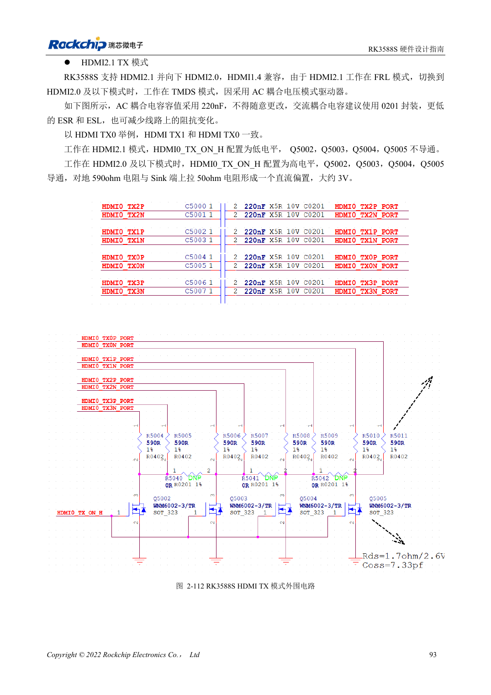
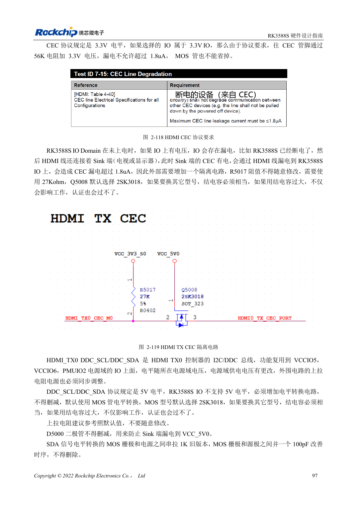

<!-- rk3588s-hardware-v12-20261109 -->

# RK3588S HDMI TX：FRL、TMDS 与兼容电路

本文依据 RK3588S Hardware Design Guide V1.2（2023-12-14）中文原稿，面向电路与 PCB 设计审查。CM7S 载板需遵循模块接口定义，Sige7S 可用于软件与外设评估。芯片能力不等于板卡接口清单；SDK/BSP、内核、板卡版本、固件及复用须逐项核对。数值为原稿参考，未经 ArmSoM 硬件实测。

**RK3588S Hardware Design Guide V1.2 (2023-12-14), CN** · §2.3.8.1; §3.4.6

## FRL 与 TMDS 外围不是同一状态

HDMI2.1 使用 FRL，向 HDMI2.0 及以下兼容时使用 TMDS。参考电路用 220nF 耦合和受控偏置，TMDS 以 590Ω 配合接收端偏置。MOS 的关机状态和寄生电容都会影响验证，不能只因能亮屏就删掉控制电路。HDMI/eDP 共用 PHY 也限制同时使用。

## 验证低速控制与高速信号

REXT 为 8.2kΩ、1%。DDC 必须做 5V 电平转换，CEC 的 TX 参考为 27kΩ并隔离关机漏电。插座 Pin18 要满足 4.8–5.3V。HDMI2.1 ESD 电容不超过 0.2pF。测试热插拔、关机连接、不同显示器和线缆；原稿“暂不支持”功能只代表该版资料，不推断当前 BSP。

## 590Ω 与 499Ω 尚需核对

第 108 页的 TMDS 说明和第 220 页布局示例写 590Ω，表 2-24（第 114 页）却写 499Ω。两处不能静默统一；制作 BOM 前应核对实际参考原理图、PHY 配置与厂商确认。指南只有一组 HDMI/eDP Combo，残留 TX1 字样不能当作第二组接口。

## 设计参数与检查表

| 项目 | 原稿参考值 |
| --- | --- |
| TX 耦合/偏置参考 | 220nF; 590Ω (PDF108/220) 对比 499Ω (PDF114) |
| REXT | 8.2kΩ ±1% |
| PCB 差分阻抗/长度 | 100Ω ±10% / <4in |
| 过孔/间距 | 优先无过孔 / ≥7× 线宽 |

## 参考原图

本批没有对应英文设计指南，四语统一采用中文原稿截图，图注已本地化。点击图片查看清晰原图；图片用于核对电路和布局，正文与参数表可复制。页码为 PDF 物理页码。

中文原稿 · PDF 108 · 2-112

中文原稿 · PDF 112 · 2-119

## ArmSoM 开发路径

CM7S 适合定制载板：先确认模块已经完成的电源、DDR 与启动电路，再设计连接器外侧。Sige7S 可作为软件和外设评估起点。两种产品均须以对应版本资料核对接口是否引出、连接器针脚、电平、系统镜像与散热条件，不能把芯片原理图直接当成产品接线图。

- [ArmSoM CM7S](https://www.armsom.org/cm7s) · [CM7S Docs](https://docs.armsom.org/armsom-cm7s)
- [ArmSoM Sige7S](https://www.armsom.org/sige7s) · [Sige7S Docs](https://docs.armsom.org/armsom-sige7s)

## 继续阅读

- [RK3588S 硬件设计系列：30 个主题](/zh/articles/rk3588s-hardware-design-series/)
- [RK3588S 与 RK3588S2：摄像头 PHY 和兼容边界](/zh/articles/rk3588s-rk3588s2-hardware-differences/)
- [RK3588S MIPI 显示：D-PHY、C-PHY 与屏幕配套](/zh/articles/rk3588s-mipi-display-hardware/)
