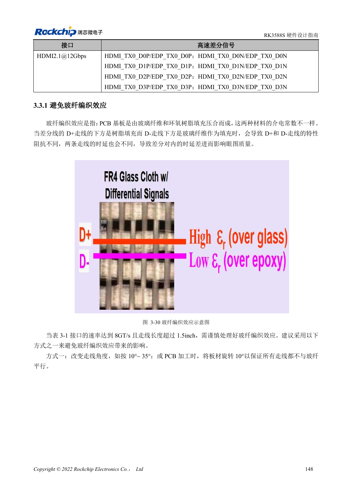
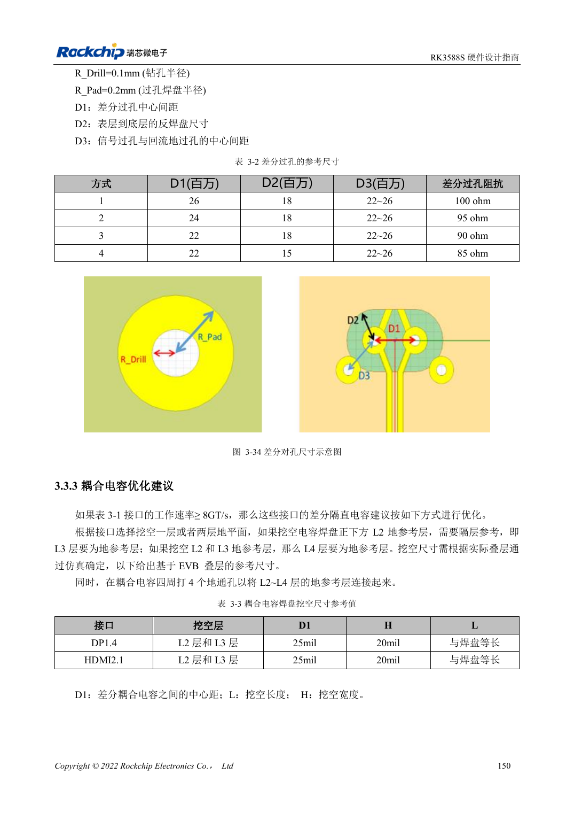
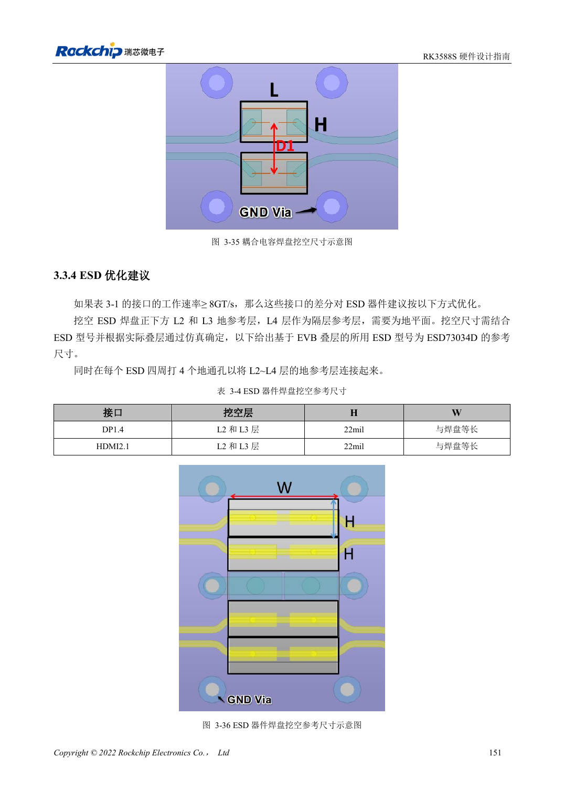

<!-- rk3588s-hardware-v12-20261109 -->

# RK3588S 高速 PCB：8GT/s 以上的焊盘与过孔优化

本文依据 RK3588S Hardware Design Guide V1.2（2023-12-14）中文原稿，面向电路与 PCB 设计审查。CM7S 载板需遵循模块接口定义，Sige7S 可用于软件与外设评估。芯片能力不等于板卡接口清单；SDK/BSP、内核、板卡版本、固件及复用须逐项核对。数值为原稿参考，未经 ArmSoM 硬件实测。

**RK3588S Hardware Design Guide V1.2 (2023-12-14), CN** · §3.2–3.3

## 先按真实接口识别高速链路

表 3-1 列 DP1.4 8.1Gbps 与 HDMI2.1 12Gbps；不能把 RK3588 的 PCIe3.0 规则当作 RK3588S 新增功能。长于 1.5in 且达到 8GT/s 的线路需评估玻纤效应，可采用 10°–35° 角度布线。过孔参考钻孔半径 0.1mm、焊盘半径 0.2mm，换叠层需重新仿真。

## 挖空后仍需连续回流

电容下挖 L2 时 L3 应是地，挖 L2/L3 时 L4 应是地，并在附近连接地层。参考尺寸只针对 EVB 叠层和器件。长于 1.5in 的相关高速线需关注玻纤效应，可采用角度布线等措施。载板与模块、连接器的完整通道要一起仿真或测量。

## 设计参数与检查表

| 项目 | 原稿参考值 |
| --- | --- |
| 玻纤效应检查 | 8GT/s 且长度 >1.5in |
| 角度示例 | 10°–35° |
| 过孔半径参考 | 钻孔 0.1mm; 焊盘 0.2mm |

## 参考原图

本批没有对应英文设计指南，四语统一采用中文原稿截图，图注已本地化。点击图片查看清晰原图；图片用于核对电路和布局，正文与参数表可复制。页码为 PDF 物理页码。

中文原稿 · PDF 163 · 3-30

中文原稿 · PDF 165 · 3-34

中文原稿 · PDF 166 · 3-36

## ArmSoM 开发路径

CM7S 适合定制载板：先确认模块已经完成的电源、DDR 与启动电路，再设计连接器外侧。Sige7S 可作为软件和外设评估起点。两种产品均须以对应版本资料核对接口是否引出、连接器针脚、电平、系统镜像与散热条件，不能把芯片原理图直接当成产品接线图。

- [ArmSoM CM7S](https://www.armsom.org/cm7s) · [CM7S Docs](https://docs.armsom.org/armsom-cm7s)
- [ArmSoM Sige7S](https://www.armsom.org/sige7s) · [Sige7S Docs](https://docs.armsom.org/armsom-sige7s)

## 继续阅读

- [RK3588S 硬件设计系列：30 个主题](/zh/articles/rk3588s-hardware-design-series/)
- [RK3588S PCB 叠层与扇出：HDI 和通孔板选择](/zh/articles/rk3588s-pcb-stackup-fanout/)
- [RK3588S 电源 PCB 与 PDN：铜皮、回流和去耦](/zh/articles/rk3588s-power-pcb-pdn-design/)
