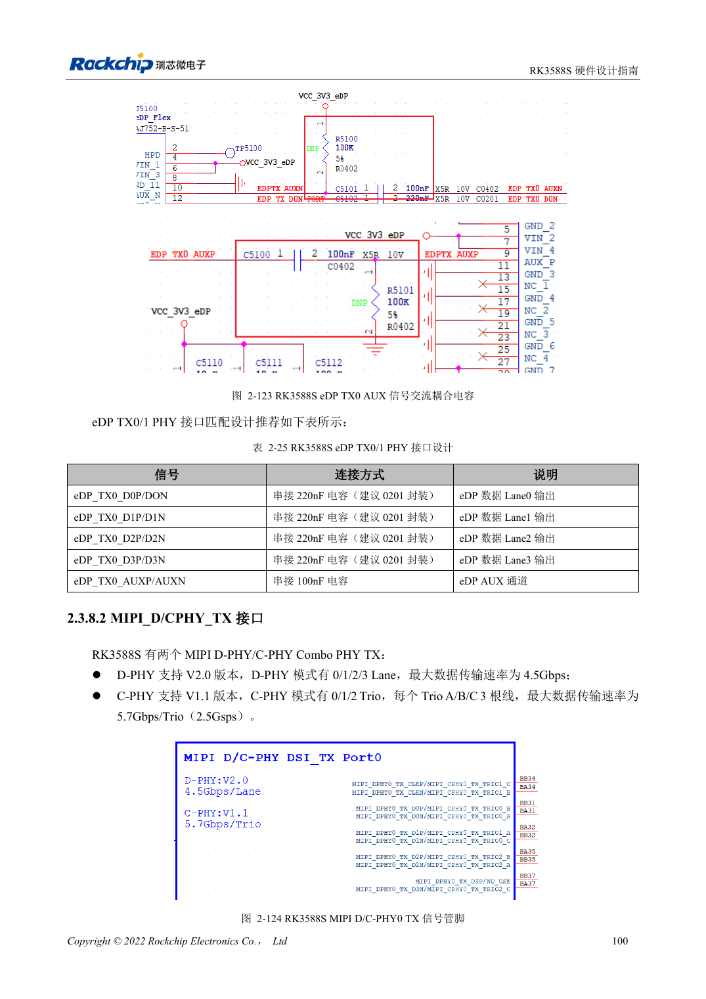
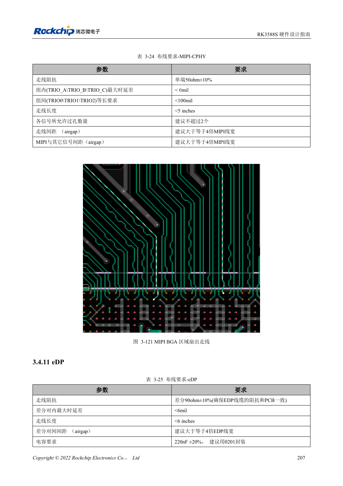

<!-- rk3588s-hardware-v12-20261109 -->

# RK3588S MIPI 显示：D-PHY、C-PHY 与屏幕配套

本文依据 RK3588S Hardware Design Guide V1.2（2023-12-14）中文原稿，面向电路与 PCB 设计审查。CM7S 载板需遵循模块接口定义，Sige7S 可用于软件与外设评估。芯片能力不等于板卡接口清单；SDK/BSP、内核、板卡版本、固件及复用须逐项核对。数值为原稿参考，未经 ArmSoM 硬件实测。

**RK3588S Hardware Design Guide V1.2 (2023-12-14), CN** · §2.3.8.2; §3.4.10; §3.4.21

## Lane 与 Trio 要分别设计

两组 D/C Combo PHY 的 D-PHY 使用四条数据 Lane，每 Lane 两根线；C-PHY 使用三组 Trio，每组 A/B/C 三根线。相同 PHY 的 TX/RX 必须同为 D-PHY 或同为 C-PHY，不能一边 D 一边 C。先核对屏幕协议、Lane/Trio 数和时序，再选接线。

## 屏幕不仅需要高速数据

背光电源、使能、复位、触摸 I2C 和中断都需匹配电压与启动顺序。D-PHY 差分阻抗和 C-PHY 单端阻抗不同，不可共用一组 DRC 规则。先在实际 BSP 验证屏幕初始化，再检查亮度变化、休眠唤醒、触摸干扰和长时间显示。

## 设计参数与检查表

| 项目 | 原稿参考值 |
| --- | --- |
| D-PHY 原稿速率 | 4.5Gbps/lane |
| C-PHY 原稿速率 | 5.7Gbps/trio |
| C-PHY 阻抗 | 50Ω ±10% 单端 |
| C-PHY 组内/组间差 | <6mil / <100mil |
| C-PHY 长度 | <5in |

## 参考原图

本批没有对应英文设计指南，四语统一采用中文原稿截图，图注已本地化。点击图片查看清晰原图；图片用于核对电路和布局，正文与参数表可复制。页码为 PDF 物理页码。

中文原稿 · PDF 115 · 2-124

中文原稿 · PDF 222 · 3-121

## ArmSoM 开发路径

CM7S 适合定制载板：先确认模块已经完成的电源、DDR 与启动电路，再设计连接器外侧。Sige7S 可作为软件和外设评估起点。两种产品均须以对应版本资料核对接口是否引出、连接器针脚、电平、系统镜像与散热条件，不能把芯片原理图直接当成产品接线图。

- [ArmSoM CM7S](https://www.armsom.org/cm7s) · [CM7S Docs](https://docs.armsom.org/armsom-cm7s)
- [ArmSoM Sige7S](https://www.armsom.org/sige7s) · [Sige7S Docs](https://docs.armsom.org/armsom-sige7s)

## 继续阅读

- [RK3588S 硬件设计系列：30 个主题](/zh/articles/rk3588s-hardware-design-series/)
- [RK3588S HDMI TX：FRL、TMDS 与兼容电路](/zh/articles/rk3588s-hdmi-tx-hardware-design/)
- [RK3588S DP 与 eDP：PHY 复用、AUX 与耦合](/zh/articles/rk3588s-dp-edp-hardware-design/)
