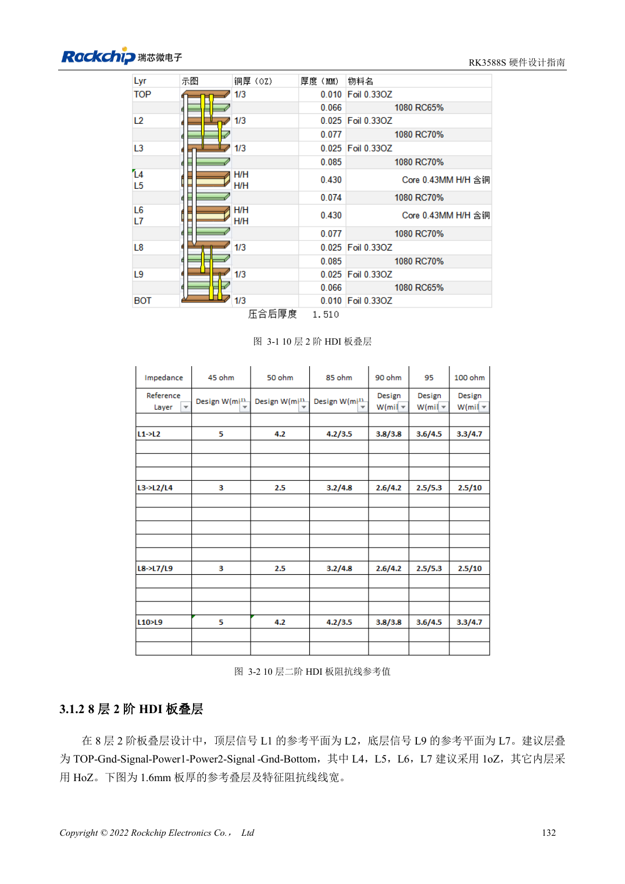
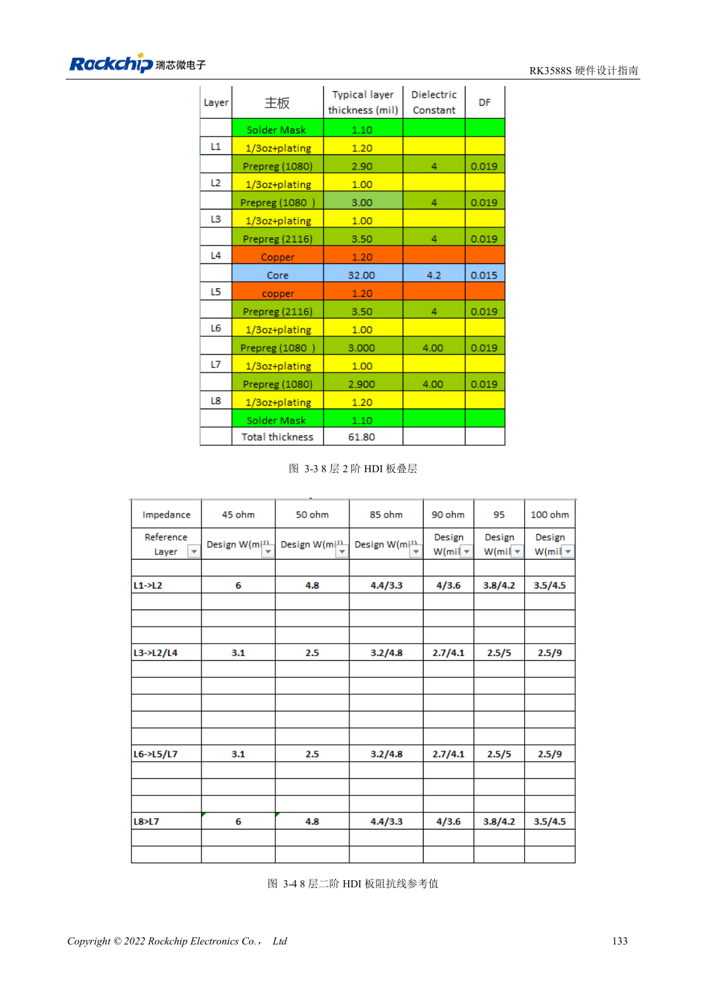
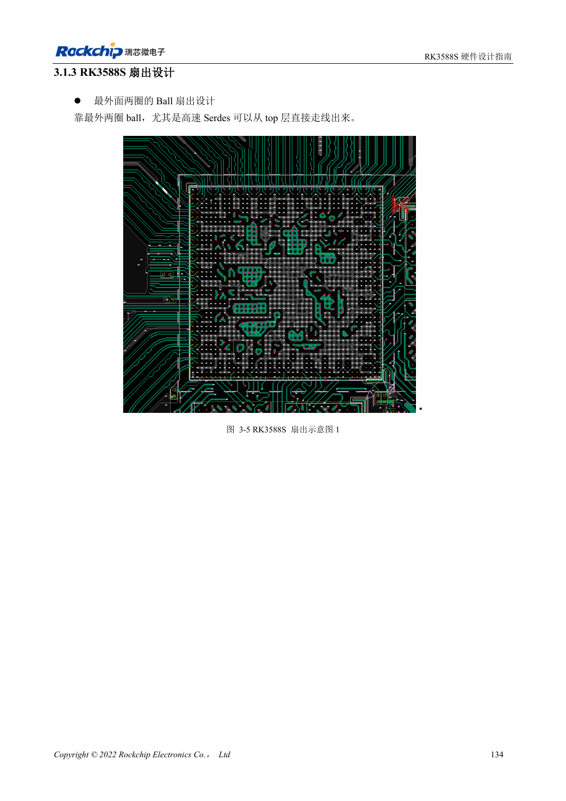

<!-- rk3588s-hardware-v12-20261109 -->

# RK3588S PCB 叠层与扇出：HDI 和通孔板选择

本文依据 RK3588S Hardware Design Guide V1.2（2023-12-14）中文原稿，面向电路与 PCB 设计审查。CM7S 载板需遵循模块接口定义，Sige7S 可用于软件与外设评估。芯片能力不等于板卡接口清单；SDK/BSP、内核、板卡版本、固件及复用须逐项核对。数值为原稿参考，未经 ArmSoM 硬件实测。

**RK3588S Hardware Design Guide V1.2 (2023-12-14), CN** · §3.1–3.2

## 8 层和 10 层都采用二阶 HDI 参考

RK3588S 指南给出 10 层二阶 HDI 与 8 层二阶 HDI，不是 RK3588 的 8 层通孔板方案。板厚参考 1.6mm，信号层尽量邻接地、结构对称。第 147 页的 8 层说明误写底层 L9，应按叠层图与板厂工程资料核对，不能照文字直接建层。

## 扇出和模块载板不要混为一谈

最外两圈球位可在顶层扇出，高速接口优先减少换层。实际线宽、微孔、埋孔和反焊盘由所选工艺与阻抗计算决定。CM7S 载板从模块连接器引出，不需复制 RK3588S 的 BGA 扇出。复核模块内走线、连接器和载板的总通道，而不是只验载板长度。

## 设计参数与检查表

| 项目 | 原稿参考值 |
| --- | --- |
| 参考叠层 | 10 层 / 8 层 二阶 HDI |
| 板厚示例 | 1.6mm |
| 走线长度范围 | PCB + 过孔 + 封装 |

## 参考原图

本批没有对应英文设计指南，四语统一采用中文原稿截图，图注已本地化。点击图片查看清晰原图；图片用于核对电路和布局，正文与参数表可复制。页码为 PDF 物理页码。

中文原稿 · PDF 147 · 3-1

中文原稿 · PDF 148 · 3-3

中文原稿 · PDF 149 · 3-5

## ArmSoM 开发路径

CM7S 适合定制载板：先确认模块已经完成的电源、DDR 与启动电路，再设计连接器外侧。Sige7S 可作为软件和外设评估起点。两种产品均须以对应版本资料核对接口是否引出、连接器针脚、电平、系统镜像与散热条件，不能把芯片原理图直接当成产品接线图。

- [ArmSoM CM7S](https://www.armsom.org/cm7s) · [CM7S Docs](https://docs.armsom.org/armsom-cm7s)
- [ArmSoM Sige7S](https://www.armsom.org/sige7s) · [Sige7S Docs](https://docs.armsom.org/armsom-sige7s)

## 继续阅读

- [RK3588S 硬件设计系列：30 个主题](/zh/articles/rk3588s-hardware-design-series/)
- [RK3588S UART、SPI、CAN、I2C 与 PWM 分配](/zh/articles/rk3588s-serial-control-hardware/)
- [RK3588S 高速 PCB：8GT/s 以上的焊盘与过孔优化](/zh/articles/rk3588s-high-speed-pcb-review/)
