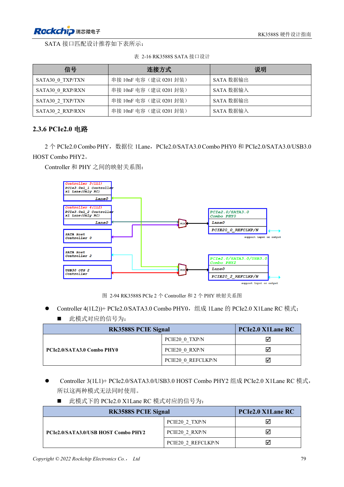
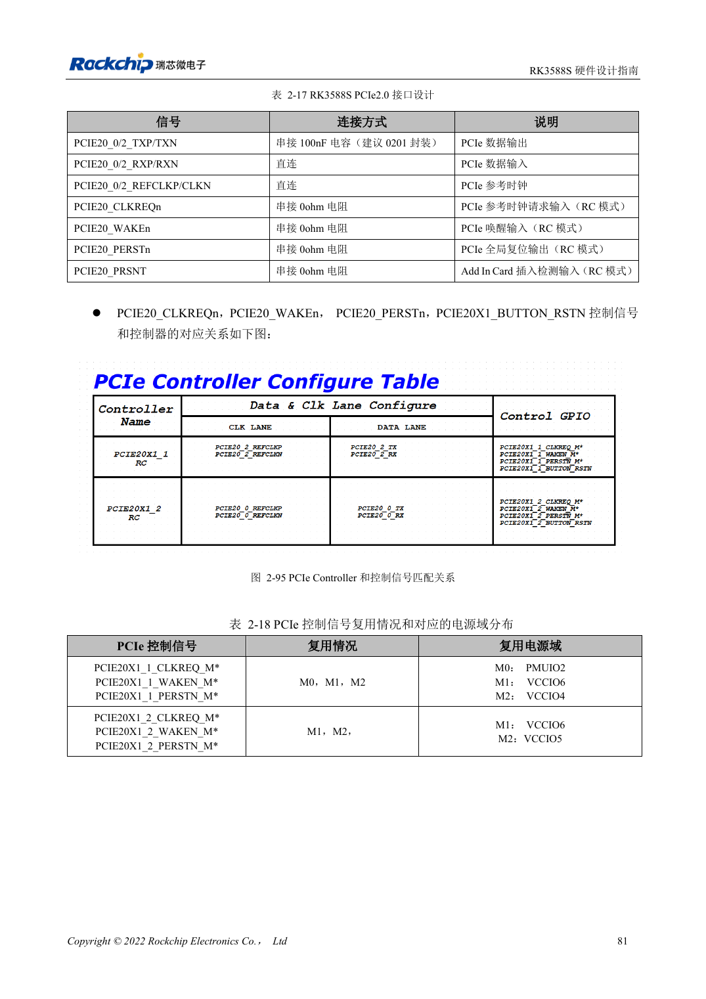

<!-- rk3588s-hardware-v12-20261109 -->

# RK3588S PCIe：通道分配、参考时钟与电源

本文依据 RK3588S Hardware Design Guide V1.2（2023-12-14）中文原稿，面向电路与 PCB 设计审查。CM7S 载板需遵循模块接口定义，Sige7S 可用于软件与外设评估。芯片能力不等于板卡接口清单；SDK/BSP、内核、板卡版本、固件及复用须逐项核对。数值为原稿参考，未经 ArmSoM 硬件实测。

**RK3588S Hardware Design Guide V1.2 (2023-12-14), CN** · §2.3.6; §3.4.4

## 按 PCIe2.0 x1 设计

RK3588S 章节明确列出两个 PCIe2.0 x1 RC 控制器，使用 PHY0/2，不是 RK3588 的 PCIe3.0 x4 架构。第 95 页仍有“PCIe3.0”的旧文字，第 94 页“不能同时使用”也缺乏清楚限定；本篇按映射图描述资源，不承诺两端口并发，实施前核对 TRM 与 SDK。REFCLK 默认输出给 EP。

## 控制信号与完整通道

CLKREQn/WAKEn 必须用功能脚且同属一个 Mx；PERSTn 可用 GPIO，若用功能脚也应同组。标准插槽控制电平为 3.3V，按实际 IO 域转换。串接 100nF，数据阻抗 85Ω、REFCLK 100Ω。检查模块、连接器、载板全路径，并测试冷启动、目标速率、休眠恢复和持续传输。

## 设计参数与检查表

| 项目 | 原稿参考值 |
| --- | --- |
| PCIe 控制器 | 2 × PCIe2.0 x1 RC |
| PCIe 数据阻抗 | 85Ω ±10% |
| REFCLK 阻抗 | 100Ω ±10% |
| PCIe 耦合 | 100nF ±20% |
| 数据 / REFCLK 对内差 | <6mil / <12mil |
| 长度/过孔 | <6in / 建议 ≤2 |

## 参考原图

本批没有对应英文设计指南，四语统一采用中文原稿截图，图注已本地化。点击图片查看清晰原图；图片用于核对电路和布局，正文与参数表可复制。页码为 PDF 物理页码。

中文原稿 · PDF 94 · 2-94

中文原稿 · PDF 96 · 2-95

## ArmSoM 开发路径

CM7S 适合定制载板：先确认模块已经完成的电源、DDR 与启动电路，再设计连接器外侧。Sige7S 可作为软件和外设评估起点。两种产品均须以对应版本资料核对接口是否引出、连接器针脚、电平、系统镜像与散热条件，不能把芯片原理图直接当成产品接线图。

- [ArmSoM CM7S](https://www.armsom.org/cm7s) · [CM7S Docs](https://docs.armsom.org/armsom-cm7s)
- [ArmSoM Sige7S](https://www.armsom.org/sige7s) · [Sige7S Docs](https://docs.armsom.org/armsom-sige7s)

## 继续阅读

- [RK3588S 硬件设计系列：30 个主题](/zh/articles/rk3588s-hardware-design-series/)
- [RK3588S SATA：三路控制器与 Combo PHY 复用](/zh/articles/rk3588s-sata-hardware-design/)
- [RK3588S 摄像头：CSI、D/C PHY 与 CIF 接口规划](/zh/articles/rk3588s-camera-hardware-design/)
